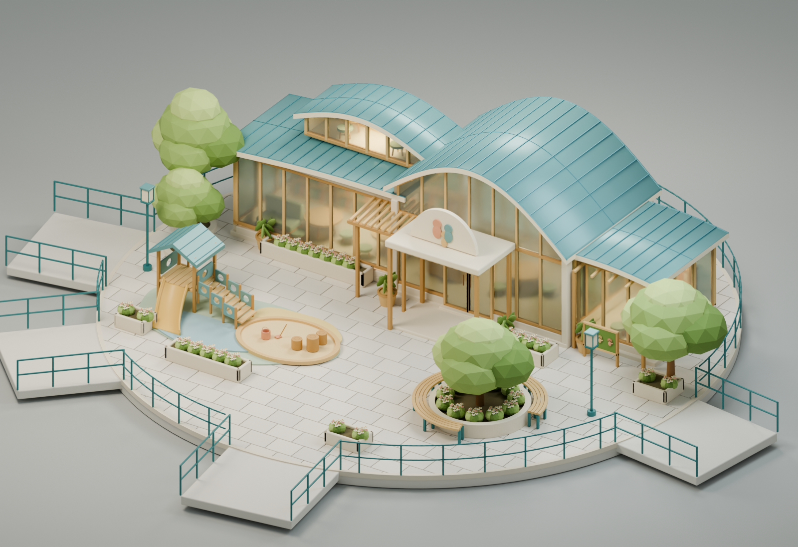
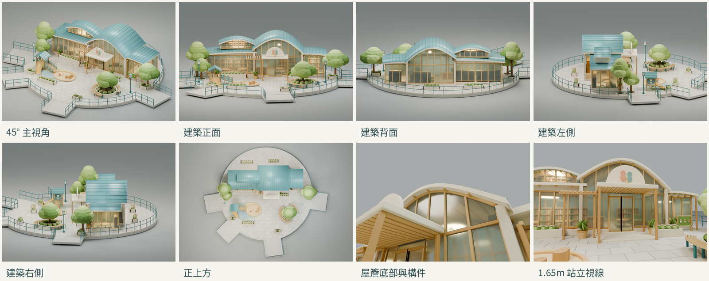
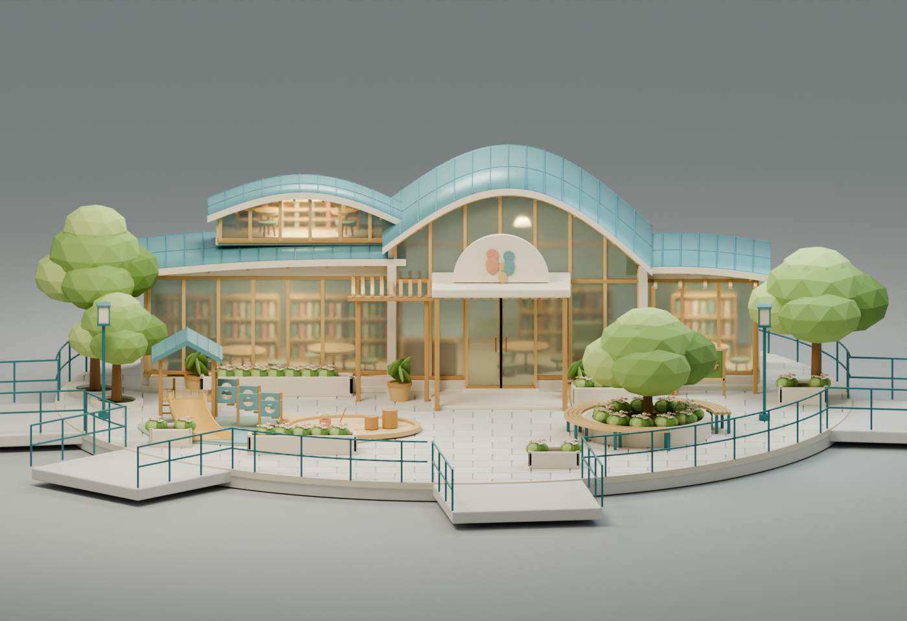
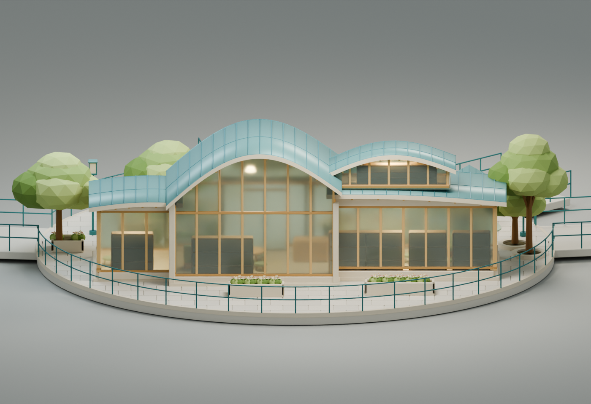
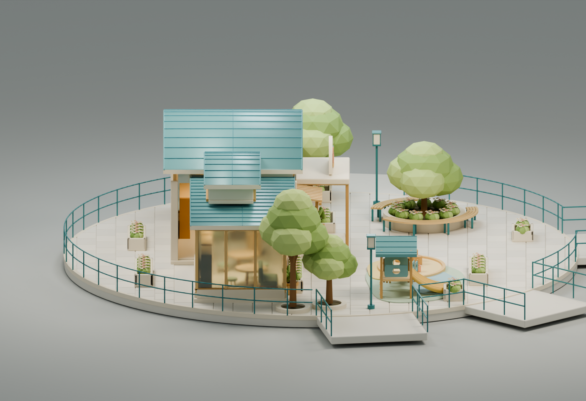
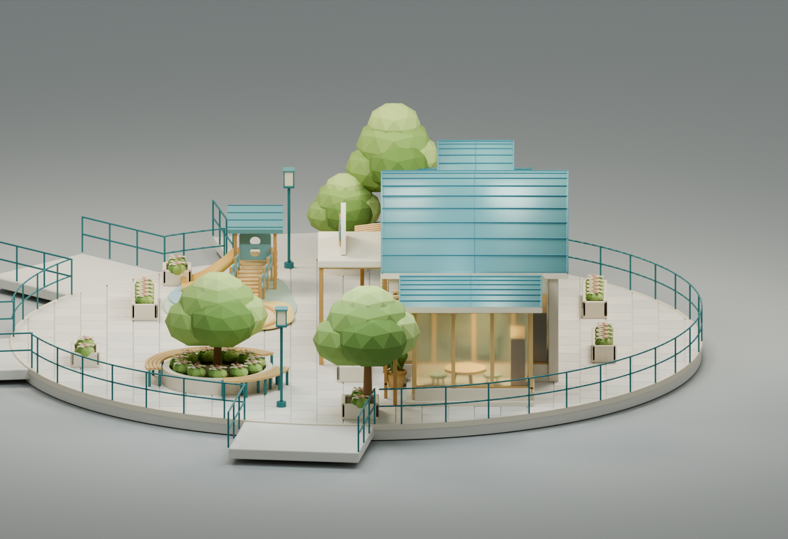
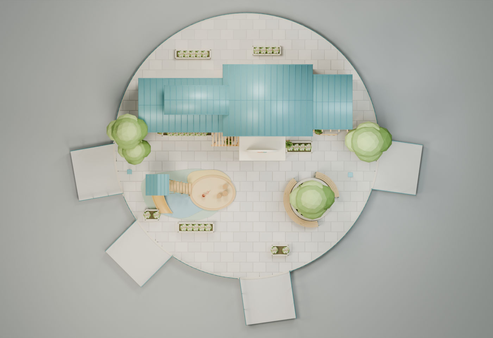
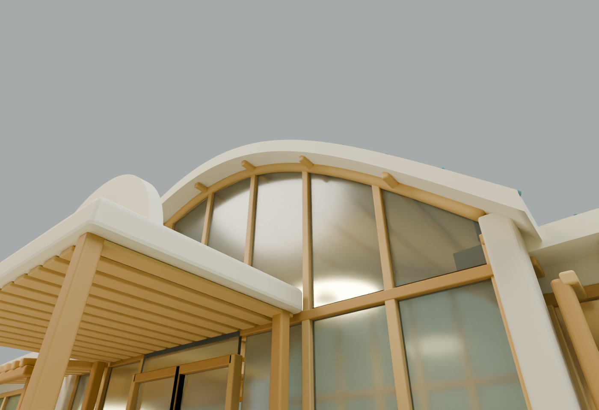
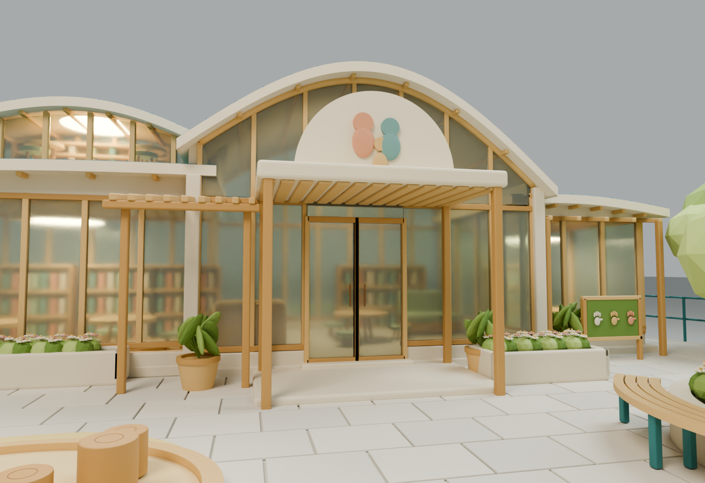

# 安心生養島｜Blender 建築與庭院重建稿

依本次使用者附圖建立的**完整可編輯 3D 模型稿，等待人工美術驗收**。主建築、雙層弧屋頂、玻璃立面、入口與格柵、遊戲場、樹池庭院及家具都有實際幾何；不是效果圖貼在平面上。所有圖片為 Blender Cycles 真實渲染，沒有使用 AI 圖片生成工具。

**本輪只建模。**沒有整合到 Sky Isles、修改八島／苑字路網、人物、政策 UI 或正式網站，也沒有合併任何 PR。

[下載完整模型檢視包](parent-child-model-review.zip) · [可編輯 Blender 檔](parent-child-centre.blend) · [Three.js 用 GLB](parent-child-centre.glb) · [逐項參考對照與差距](REFERENCE-COMPARISON.md) · [技術與驗證](TECHNICAL.md)

## 主視角

接近附圖的 3/4 斜視構圖；精確鏡頭位置與角度另記錄於 `render-record.json`。

## 八視角總覽

| 實際渲染 | 實際渲染 |
| --- | --- |
|  |  |
|  |  |
|  |  |

玩家站立視線：模型場地標高上方 **1.65m** 的 Blender 相機，不是遊戲整合截圖。

## 原圖並排對照

**不需要原本的 3D 檔案。**本次只有一張 2D 效果圖，已作為建模基準。執行環境能檢視聊天圖片，但沒有收到其可讀取的 PNG/JPG 位元檔；沒有把另一張生成圖冒充原圖。

提供[單檔離線並排對照工具](comparison.html)：下載後以瀏覽器開啟，選入您手上的原始效果圖，即可與內嵌的真實 Blender 主渲染並排查看，也可按「儲存並排 PNG」。圖片只在本機讀取，不上傳；不需要啟動網站或政策島遊戲。

本輪**未交付已嵌入原圖的靜態並排 PNG**，因為缺少該原始圖像的可讀檔案；逐項造型、配置、材質與差距已列於 `REFERENCE-COMPARISON.md`。原圖檔案一旦可用，即可用上述工具完成，無須重新建模。

## 可編輯與可調整內容

`.blend` 保留各物件、材質、倒角修改器、8 個相機及獨立攝影棚燈光。主建築與側翼、遊具、花圃、樹木及家具分開組織。

- `10_ARCHITECTURE`：主弧頂館、抬高採光層、左右側翼、入口雨棚、木格柵、門窗與基座。
- `20_INTERIOR`：書架與書本、桌椅、沙發、接待櫃台及吊燈幾何。
- `30_SITE_AND_PAVING`：參考圖展示底座、逐塊鋪面、四段橋口與欄杆。
- `40_PLAYGROUND`：遊戲平台、小屋、真正有圓孔的欄板、封閉厚度曲面溜滑梯、低橋、沙坑及玩具。
- `50_LANDSCAPE`：四棵樹、獨立花圃與盆栽、環形樹池、兩段弧形木座椅。
- `60_SITE_FURNITURE`：燈具與活動展示板。
- `90_STUDIO_NOT_EXPORTED`：渲染地面及燈光；不匯入 GLB。

GLB 另以材質及邏輯組件合批，保留建築、室內、遊具、景觀、底座與街道家具的獨立群組。詳細物件調整請使用 `.blend`；移動整棟建築時，可同時選取 `Architecture` 與 `InteriorFurniture`。

## 尺寸與檔案

本檔採 **1 Blender 單位＝1m 的建模尺度**，不是從圖中量得的真實工程尺寸。

| 項目 | 寬 × 深 × 高 |
| --- | --- |
| 完整展示模型（含底座與四段橋口） | 約 **24.458 × 21.655 × 5.382** |
| 建築群（不含景觀、底座） | 約 **14.856 × 6.680 × 4.982** |
| 展示圓形底座 | 名義半徑 **9.2**；僅本獨立模型，不是遊戲島嶼設定 |

Blender 評估後約 **370,116 三角面、1,757 個 Mesh 物件**。實際 GLB 載入為 **369,608 三角面、197 個 Mesh／材質批次、29 種材質、0 貼圖**。兩者的實際統計與匯出設定均保留，沒有用面數代替美術驗收。

## 驗證與尚待人工確認

- 1,757 個評估後實體網格：沒有非流形邊或反向體積。
- Khronos glTF 驗證：0 錯誤、0 警告。
- Three.js 真正解析 GLB：成功，0 缺失材質；建築與景觀各群組可分別取得。
- 八張圖均取自同一份最終 `.blend`，逐張記錄相機、採樣、尺寸、來源與 PNG SHA256。
- 遊戲原始檔與 `public/` 完全未改；這次沒有執行遊戲整合與實機效能驗收。

**尚未宣稱與附圖完全一致。**屋頂局部曲率、側翼深度、窗格間距、玻璃光感、樹冠與花圃密度仍有差異；背面、側面及部分室內是依同一語言延伸的設計。請以逐項對照報告及實際模型進行人工美術驗收後，再決定調整或整合。

[模型材質報告](model-report.json) · [組件尺寸](assembly-dimensions.json) · [實體稽核](solid-geometry-audit.json) · [Khronos 檢查](gltf-validation.json) · [Three.js 載入](three-loading-report.json) · [八視角來源記錄](render-record.json) · [媒體 SHA256](media-manifest.json)

沿用專案 MIT 授權。模型為本次原創幾何重建，未引入未授權外部模型、貼圖或素材。檢視包附原專案 LICENSE。
