# 安心生養島｜第二階段精修

接續 **PR #11 的可編輯 Blender 工程**，從已交付 `.blend` 開檔精修，沒有使用早期簡化車站／親子館、另建網站或重建一套遊戲。

[下載精修檢視包](parent-child-refinement-review.zip) · [可編輯 BLEND](parent-child-centre.blend) · [Three.js GLB](parent-child-centre.glb) · [逐項修改與限制](REFINEMENT.md) · [尺寸／面數差異](metrics-comparison.json) · [技術與測試](TECHNICAL.md)

## 實際模型主視角

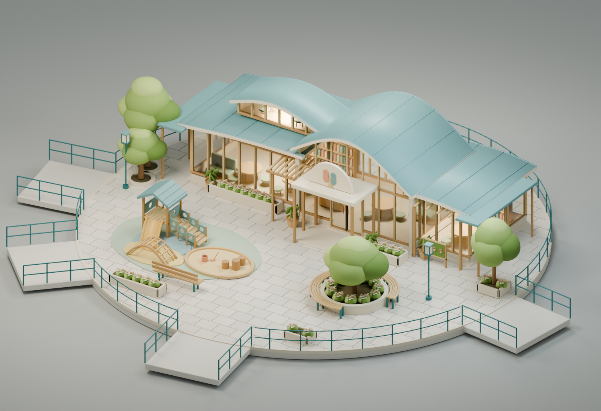

屋頂曲線保留原有雙層構圖，降低金屬感及分割線密度；主入口木構雨棚與家庭拱牌保留。兩翼加深、加入開放側廊，玻璃後方家具更清楚。新增低矮攀爬架、完整軟地面與照顧者座椅，沿用原本小滑梯、沙坑與木遊戲平台。

## 修改前後：相同相機與尺度

舊版是從原始 PR #11 BLEND 重新渲染；兩邊的**相機位置、旋轉、投影尺度、圖片尺寸及採樣數相同**。為納入擴大的平台，共同比原主圖拉寬取景；不縮放模型，不以不同遠近掩飾比例。

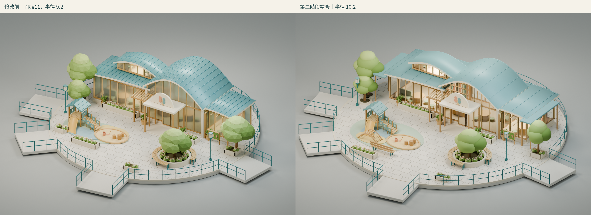

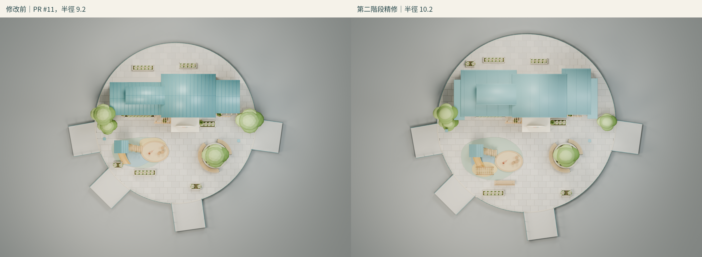

## 八個原有角度

延續原八台相機的方位／位置與鏡頭。正交視角僅調整取景範圍，近景及 1.65 高度視角保持原鏡頭。

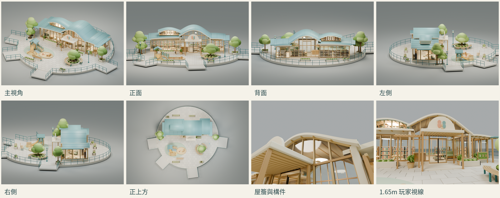

| 正面 | 背面 |
| --- | --- |
| 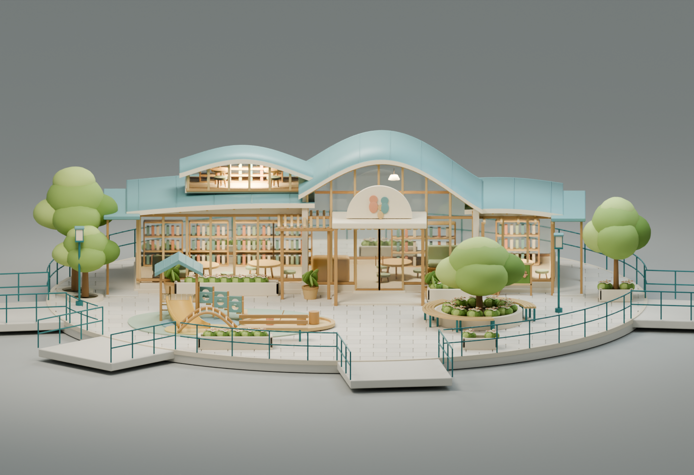 | 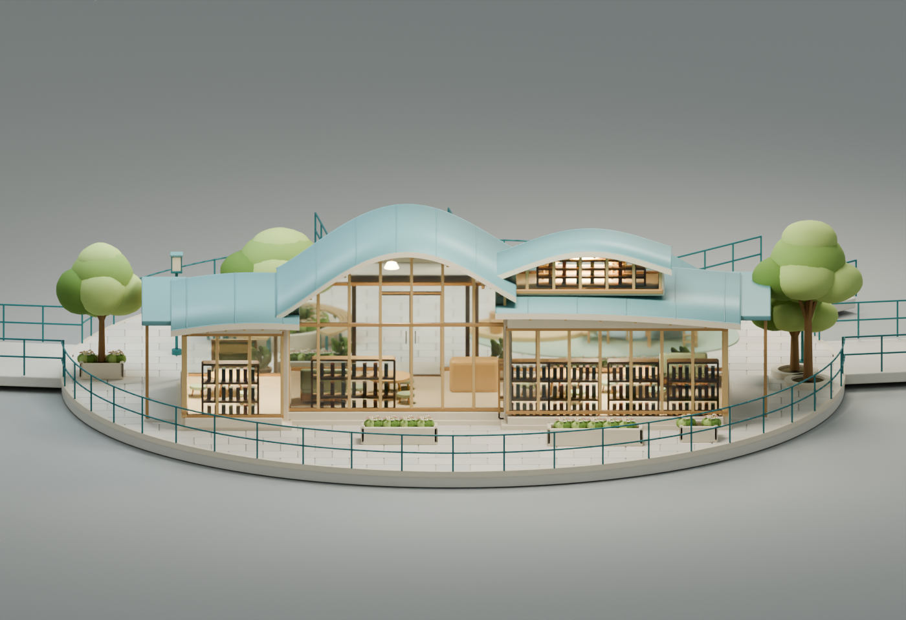 |

| 左側 | 右側 |
| --- | --- |
| 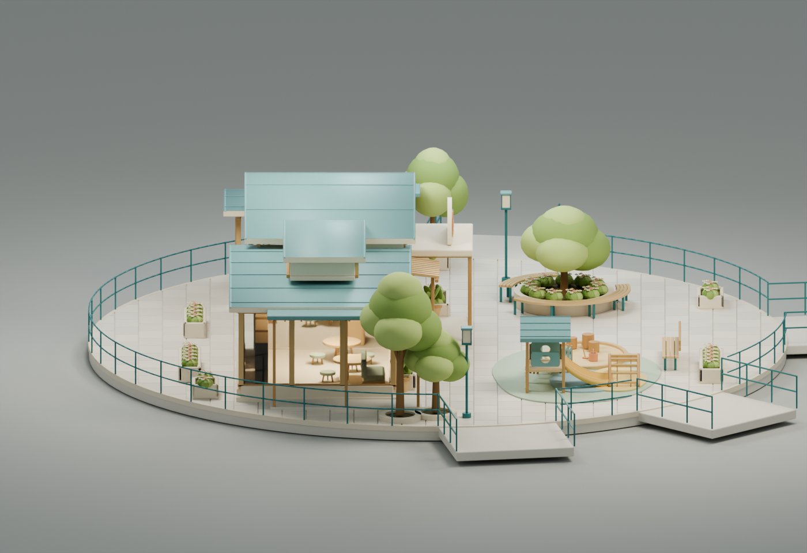 | 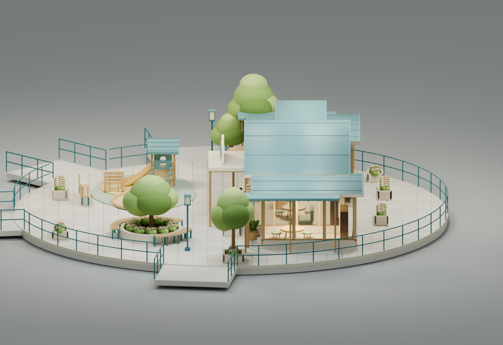 |

| 正上方 | 屋簷底部與構件 |
| --- | --- |
| 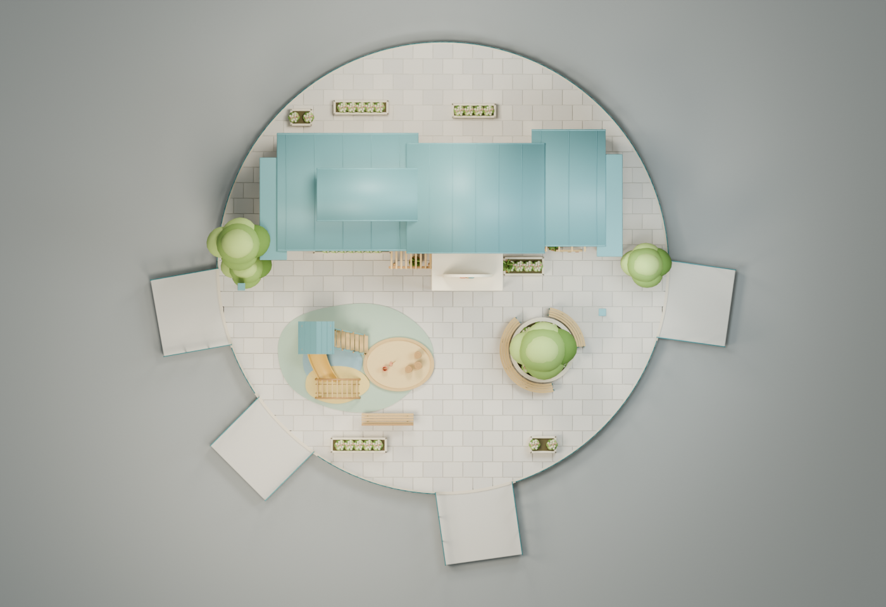 | 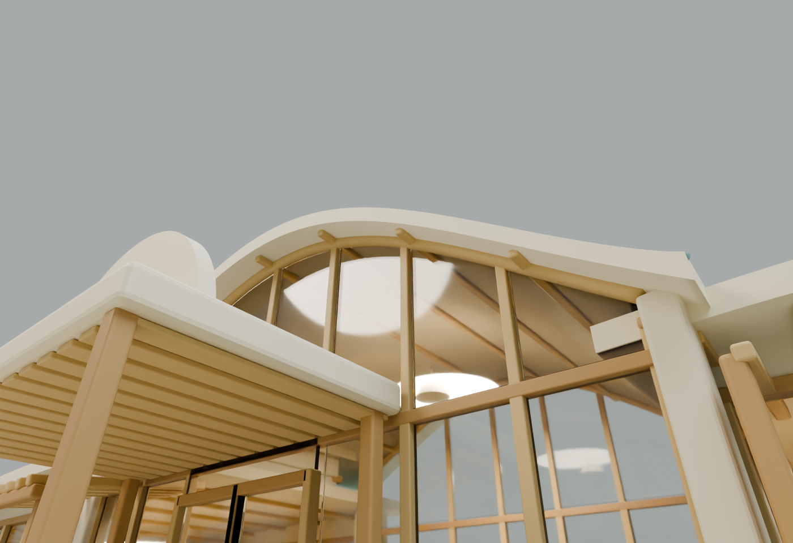 |

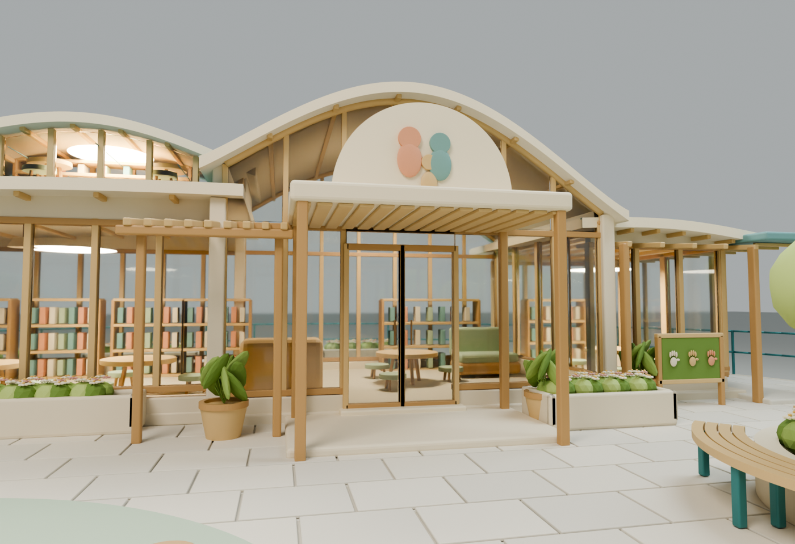

以上八張皆為 **Blender 4.3 Cycles 真正渲染**。索引與比較圖僅排版實際渲染，沒有使用 AI 概念圖。

## 土地與玩家／NPC 空間

建議獨立模型平台半徑 **10.2**，由原本 9.2 增加 1，面積增加 **22.92%**。用於兩翼縱深、側廊與互不阻擋的親子停留空間；不是增加建築密度。**沒有修改遊戲島嶼半徑、苑字路網或其他七島。**

四入口保留原本方向 190°、225°、278°、352°；展示橋口隨新平台向外銜接，沒有刪除入口。這些是獨立模型橋口，不代表已對齊遊戲現場路網。

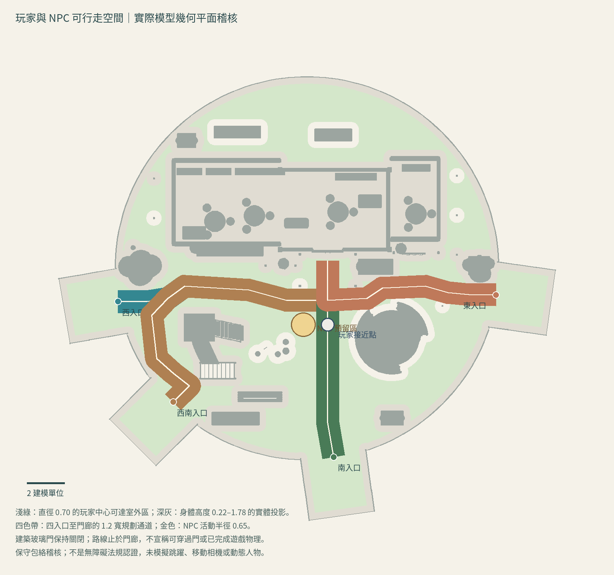

平面圖來自最終模型的實際幾何。四條規劃通道寬 1.2，與模型實體包絡無重疊；使用半徑 0.35 的保守玩家檢查（現有遊戲護欄程式為 0.33）。NPC 只預留資料，不建立角色：Blender 座標 **(-0.2, -3.0, 0.03)**，活動半徑 **0.65**，面向 +X；玩家接近點 **(1.1, -3.0, 0.03)**。NPC 預留區不侵入四條通道。

這是**空間規劃與幾何稽核**，不是已完成遊戲物理。路線止於可站立門廊，玻璃門保持關閉，未宣稱可穿門或已完成室內漫遊。

## 資產規模與檢查

| 項目 | PR #11 | 第二階段 |
| --- | ---: | ---: |
| 平台半徑 | 9.2 | 10.2 |
| 含橋口模型寬×深×高 | 24.458×21.655×5.382 | 26.466×23.662×5.173 |
| 建築群寬×深×高（含新側廊） | 14.856×6.680×4.982 | 16.390×7.296×4.773 |
| Blender 評估三角面 | 370,116 | 381,520 |
| GLB 實際三角面 | 369,608 | 380,999（+3.08%） |
| GLB 材質網格批次 | 197 | 207 |
| GLB 材質數 | 29 | 29 |
| GLB 大小 | 19.714 MB | 20.239 MB |

Khronos glTF：**0 errors / 0 warnings**；Three.js 真正解析及 Chromium WebGL 實際繪製成功，缺失材質 0，WebGL error 0。1,872 個評估實體構件的封閉／正向體積檢查沒有問題。

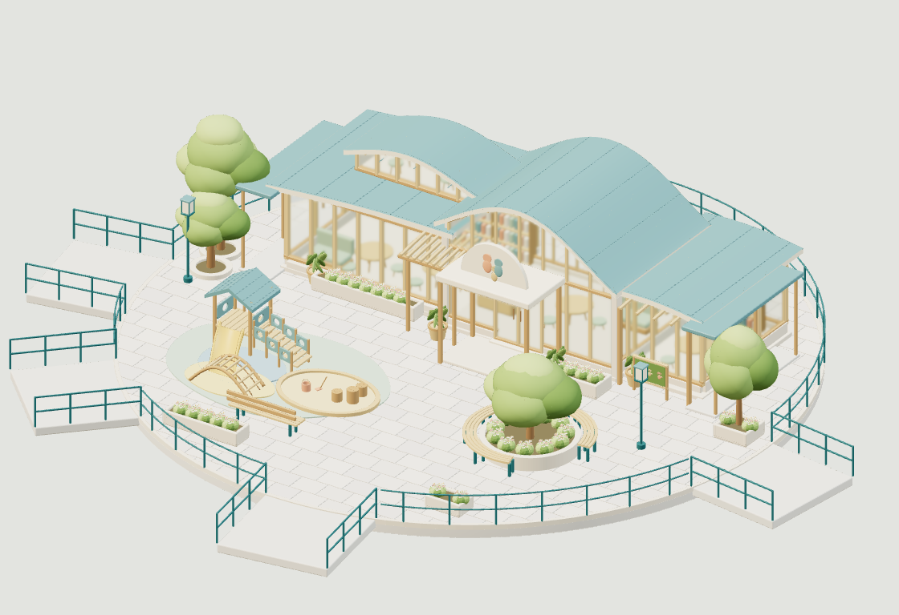

上圖為獨立驗證工具的實際 WebGL 畫面，**不是已整合的政策島遊戲**。本模型沒有貼圖；瀏覽器統計的 1 個 texture 是 transmission 的內部渲染目標。單一 GLB 的 207 批次在此透明傳輸設定下實際產生 414 calls；未以此宣稱手機 FPS 或八島效能通過。

## 待人工驗收

- 屋頂是否已足夠柔和、玻璃與室內明暗是否合意。
- 新側廊、樹冠及遊具的美術比例；樹冠是圓潤化風格，不是寫實植物。
- 平台擴大比例與四入口的觀感，及 NPC 預留區是否符合日後互動需求。
- 未進行正式遊戲碰撞、LOD、真機發熱／FPS、實際搖桿及相機跟隨驗收；需下一步整合測試。

[渲染來源與相機](render-record.json) · [舊版重渲染來源](before-render-record.json) · [通行稽核](space-audit.json) · [GLB 格式](gltf-validation.json) · [Three.js 解析](three-loading-report.json) · [實際 WebGL](three-webgl-validation.json) · [媒體大小／SHA256](media-manifest.json)

沿用專案 MIT 授權，未引入外部模型或貼圖。完成本輪後停止，等待人工驗收，不合併、不部署、不自動整合遊戲。
