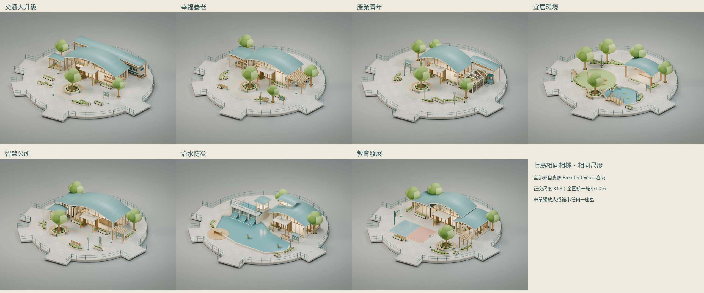

# 七座政策島｜獨立 Blender 資產

七套可編輯模型與 GLB，依使用者提供的七張正式設計圖製作；安心生養只作美術與複雜度上限基準，原始 BLEND／GLB 不變。本輪沒有將七島整合進現有遊戲，也沒有修改苑字中心線、島中心、Production 或正式政策。

## 相同角度、相同尺度總覽

七個主視圖使用**同一相機位置／旋轉、正交尺度 33.8、1280×960**，總覽每張統一縮成 640×480。未單獨調整島嶼縮放。這是七張真實 Cycles 渲染的排版，不是 AI 概念圖。

## 模型、下載與尺寸

尺寸為完整資產的 Blender X寬×Y深×Z高，**包含獨立展示平台與四個展示橋臂**。半徑是量測建築（含屋簷）、低景觀及設施後，加 1m 邊緣餘裕得到的圓形美術展台；不是已批准套用到遊戲的半徑。

| 政策島 | 可編輯模型／匯出 | 完整包圍盒 | GLB 三角面 | 材質 | 圓展台半徑 |
| --- | --- | --- | ---: | ---: | ---: |
| [交通大升級](transport/README.md) | [BLEND](transport/transport.blend) / [GLB](transport/transport.glb) | 29.59×27.42×5.30 | 225,496 | 26 | **12.6（>12）** |
| [幸福養老](senior/README.md) | [BLEND](senior/senior.blend) / [GLB](senior/senior.glb) | 27.98×25.81×5.30 | 210,879 | 26 | 11.8 |
| [產業青年](industry/README.md) | [BLEND](industry/industry.blend) / [GLB](industry/industry.glb) | 29.99×27.82×5.30 | 233,109 | 26 | **12.8（>12）** |
| [宜居環境](environment/README.md) | [BLEND](environment/environment.blend) / [GLB](environment/environment.glb) | 27.98×25.81×5.72 | 181,784 | 24 | 11.8 |
| [智慧公所](digital/README.md) | [BLEND](digital/digital.blend) / [GLB](digital/digital.glb) | 27.17×25.01×5.31 | 206,567 | 26 | 11.4 |
| [治水防災](water/README.md) | [BLEND](water/water.blend) / [GLB](water/water.glb) | 29.19×27.02×5.52 | 176,475 | 28 | **12.4（>12）** |
| [教育發展](education/README.md) | [BLEND](education/education.blend) / [GLB](education/education.glb) | 27.98×25.81×5.30 | 231,381 | 27 | 11.8 |

[圖片對照](REFERENCES.md) · [尺寸與苑字路網評估](SITE-PLANNING.md) · [測試／限制](VALIDATION.md) · [可重現流程](WORKFLOW.md) · [舊交通模型備份](legacy-transport-backup/README.md) · [大小／SHA256](media-manifest.json) · [GitHub 上傳核對](github-verification.json)

## 審查界線

- 每島六張 PNG 都由同一份最終 `.blend` 以 Blender 4.3 Cycles 輸出；來源 SHA、相機及採樣見各島 `render-record.json`。
- 幾何封閉、三角面上限、材質、GLTFLoader／Khronos／隔離 WebGL 檢查完成。這些不等於人工美術驗收，也不等於遊戲碰撞與真機效能認證。
- 四個展示橋臂是設計圖展台的一部分，與真正 B 方案橋口不同。未來整合須按原中心線調整平台與橋口介面，保持建築比例。
- 交通的 12.6 圓台會吃進 J1／J2 附近筆畫空間；另提供局部拓展與橢圓方案，不能直接把圓半徑寫回正式世界。
- NPC 只保留 Empty 與結構化站位，不建立人形、對話或任務。列車／水景為獨立展示資產，本輪不加搭乘、任務或水文模擬。
- 屋頂及建築主體按主圖建立；植物花瓣、展板圖示、家具數量、水花等採一致的三維構造，沒有追逐 AI 多視圖中互相矛盾的小細節。玻璃門關閉，沒有宣稱已完成整套可進入室內。

沿用專案 [MIT 授權](../../../LICENSE)，沒有外部模型、貼圖或新音樂。等待使用者整體美術驗收，不自行開始遊戲整合或後續擴充。
