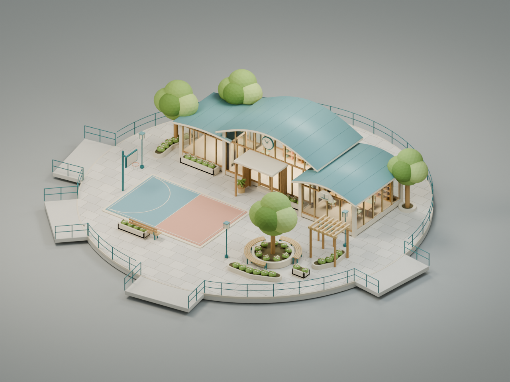
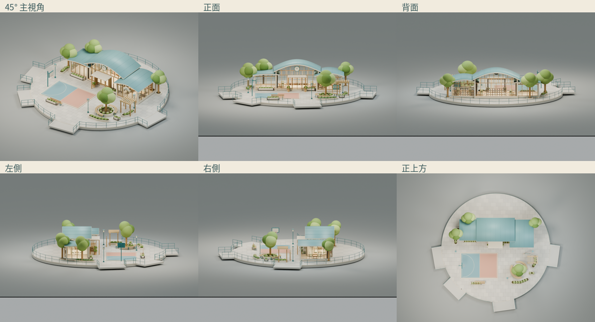

# 教育發展｜Blender 資產

中高弧頂學習館、兩翼教室／閱讀館、玻璃後書架與桌椅、半場活動地坪、籃架、閱讀樹院及戶外書廊。

[下載 BLEND](education.blend) · [下載 Three.js GLB](education.glb) · [正式參考圖](../../../references/policy-islands/education-reference.png) · [實際模型規模](model-report.json) · [島台／橋口評估](site-planning.json)

## 六個實際角度

[45° 主視角](renders/hero.png) · [正面](renders/front.png) · [背面](renders/back.png) · [左側](renders/left.png) · [右側](renders/right.png) · [正上方](renders/top.png)

## 實際量測與分組

- 完整包圍盒：**27.979×25.811×5.297**（Blender X/Y/Z；包含展台橋臂）。
- Blender 評估三角面 231,388；GLB 231,381；材質 27；匯出網格批次 74。
- 建築、室內可見家具、景觀、主題設施、家具與展台分 Collections；原始構件及非破壞倒角保持可編輯。
- 量測後圓展台半徑 **11.8**。不縮小建築，不變更遊戲半徑。
- NPC 只有預留 Empty：本地 Blender XYZ `[1.7, -1.6, 0.03]`，活動預留半徑 0.65、互動半徑 1.4；玩家接近點 `[1.7, -2.9000000000000004, 0.03]`。沒有角色或對話。
- [Khronos glTF](gltf-validation.json)：0 errors／0 warnings；[Three.js 載入](three-loading-report.json)：缺失材質 0；[實際 WebGL](webgl-compatibility.json)：GL error 0。
- [原始 BLEND 複驗](source-audit.json) · [渲染來源與相機](render-record.json) · [六視角無裁切檢查](camera-fit.json)。

## 尚待人工及整合驗收

主輪廓、曲面與色彩是否達到使用者對主圖的要求，仍由人工美術確認。花瓣分布、看板圖示及家具數量有可控簡化；沒有將原參考圖貼到模型上代替構件。玻璃使用同系列 PBR，但離線棚燈與未來遊戲光照會有差異。

這是獨立資產：正式橋口對齊、玩家地面／護欄／屋簷碰撞、相機避障、NPC 對話與真機 FPS 尚未整合驗證。展示橋臂可與 Site 群組分離，不得當作現有世界已更新。原始 BLEND 與 GLB 都保留供後續授權整合使用。
