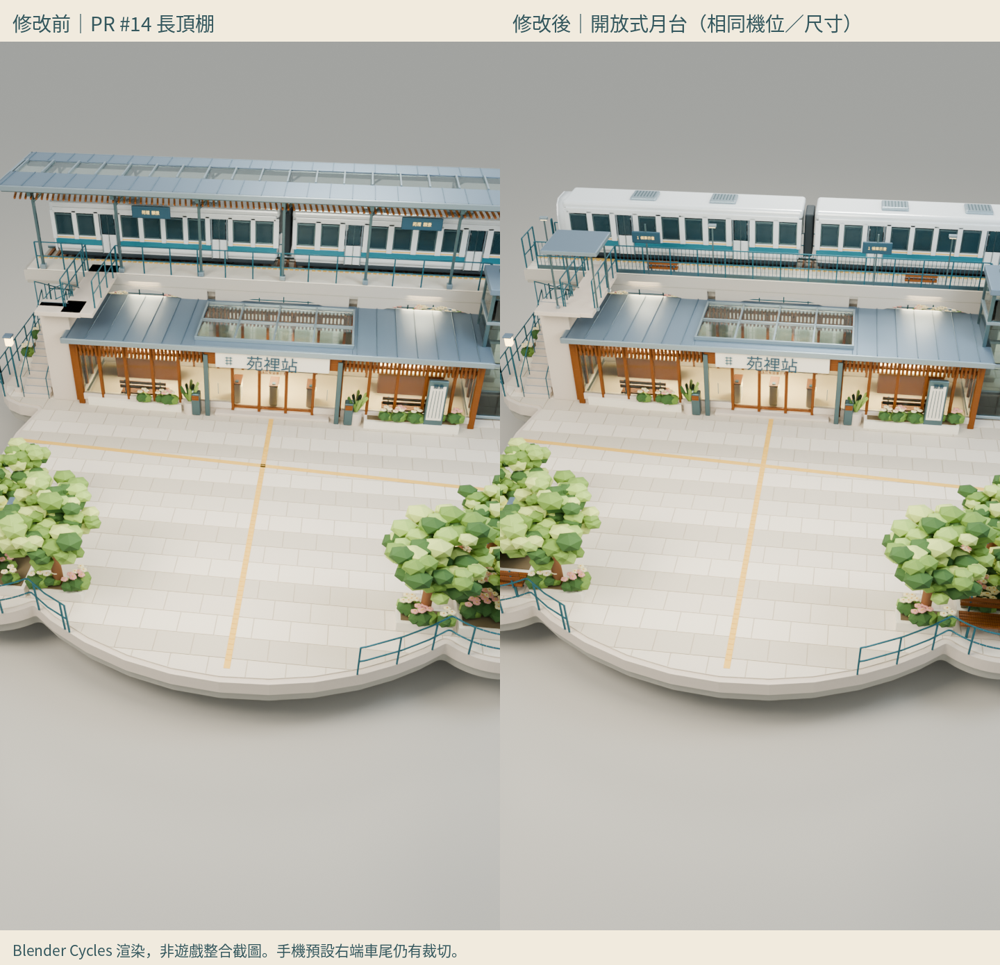

# 交通大升級 V9｜開放式高架月台修訂

[Draft PR #14](https://github.com/qaz741612/sky-isles/pull/14) · [可編輯 BLEND](transport-station-v9.blend) · [展示 GLB](transport-station-v9-showcase.glb) · [遊戲候選 GLB](transport-station-v9-game-candidate.glb)

**本次收尾沒有重新建模**；BLEND與兩GLB仍和ca94f48逐位元一致，見[鎖定核對](asset-lock.json)。以下改造描述是ca94f48已保存的成果。

既有 V9 Blender 修訂完整移除高架長棚的 **241** 個物件及孤立網格，保留地面站房金屬屋頂、玻璃天窗、木格柵、招牌及入口；沒有重建整座車站或沿用弧形屋頂模板。橋體／拱梁、軌道、月台、樓梯與電梯也保留。

兩節列車保持原尺寸、輪軌關係與軌道中心，只繞自身中心迴轉180°朝西；45°主視角改由西側觀看。小型遮雨亭僅覆蓋樓梯出口，與列車平面重疊0。月台補端部護欄、細直欄、靠軌安全線、鋪面收邊、候車資訊、獨立照明與短坐靠設施。前庭花園只縮短兩個前端，座椅回到真正鋪面內；樹木、暖木、主要花帶與留白保留。

## 同源六視圖與玩家鏡頭

[45° 主視角（西側車頭）](renders/hero.png) · [正面](renders/front.png) · [背面](renders/back.png) · [左側](renders/left.png) · [右側](renders/right.png) · [正上方](renders/top.png) · [列車側面](renders/train-side.png) · [桌機預設模擬](renders/player-desktop.png) · [手機預設模擬（車尾裁切）](renders/player-mobile.png) · [補充 zoom28，非預設](renders/player-mobile-zoom28.png) · [補充橋口站位，非預設](renders/player-mobile-arrival-overview.png)

全部修改後圖源自同一 BLEND：`5d99e81f8255f815e60ab0d63615ce024e96533c6757821beb74eb777c7eade6`。六視圖為正／背／左／右／俯視及45°主視角。這些是 **Blender Cycles 渲染與原遊戲相機參數模擬，不是遊戲整合截圖**。

## 真正同機位修改前後

[桌機預設比較](comparison-player-desktop.png) · [45°同機位比較](comparison-hero.png) · [俯視比較](comparison-top.png) · [相機逐項核對](before-render-record.json)

手機兩側固定720×1280渲染像素（360×640 CSS／DPR2）、dist22、pitch0.67、yaw0.12、垂直FOV58、目標(0,2,3.5)，出生點(0,0.5,3.5)不動；這是出生瞬間加1.5目標高度的靜態模擬，未冒稱落地後／避障中的實際相機。已用原src/sim/camera-profile.js核對兩組參數，見camera-profile-audit.json。未用zoom28或橋口觀察點代替預設圖。修改後車頭與站房入口的投影範圍完整入鏡，車頭中心視線先撞到車頭本身；這不是全部車頭像素均無遮蔽的證明，小亭／欄杆仍遮住車頭下緣，正面讀感待人工判斷。**右端車尾及部分外側高架仍裁切，沒有宣稱整列車／全島均在手機預設窄幅內**。補充拉遠圖明確標示，請勿混用。

## 本輪測量

| 版本 | GLB實際三角面 | 材質 | 網格批次 | 大小 |
| --- | ---: | ---: | ---: | ---: |
| 前輪展示 | 540,480 | 33 | 90 | 42.61 MB |
| 本輪展示 | 516,324 | 33 | 91 | 40.65 MB |
| 前輪候選 | 213,416 | 33 | 90 | 18.56 MB |
| 本輪候選 | 201,740 | 33 | 49 | 17.63 MB |

候選較前輪三角面減5.5%、靜態材質合批後批次減45.6%；主建築沒有縮小。薄玻璃近似、微植栽與倒角差異仍限候選，不回寫展示原檔。33材質仍全部有實際用途；頂棚原本共用站房屋面／玻璃／木材，不能連共用材質一併刪除。

## 檢查與界線

- 8,451個源網格重新開啟，全部封閉／正體積；841個保留構件的幾何、材質指派、變換完全相同。
- 77個低位結構支承以實際三角面投影檢查，越出台地0；兩NPC 3×3空間、S09/S10/S15/S18、15地面採樣點與3上層平面通道通過離線檢查。
- 安心生養以10.2半徑保守檢查，交通提案島台與其交疊0；其他非接入路段交疊0。四口與原苑字控制點不改。
- 兩GLB Khronos為0 errors／0 warnings，實際Three.js GLTFLoader／WebGL與量測另列[報告](PERFORMANCE.md)。
- 原PR14既有遊戲`npm run check`：本輪Node實際回報50個測試檔通過、0失敗，lint與build成功；不沿用舊50項文字，也不把這結果當新模型整合證據。

[空間／碰撞候選稽核](VALIDATION.md) · [美術自審及待驗](ART-REVIEW.md) · [基底安全整理方案（未執行）](BRANCH-ISOLATION.md) · [重現流程](WORKFLOW.md) · [修改清單](MODIFIED-FILES.md) · [媒體大小／SHA256](media-manifest.json)

RECOVERY.md及RECOVERY-INTERRUPTION-2.md保留為先前中斷的歷史紀錄，本輪最新狀態以本README、VALIDATION及ACCEPTANCE為準。

沒有修改安心生養、其他島、正式遊戲、政策、苑字路網、main或Production；沒有處理全地圖橋邊景觀。本輪不整合、不合併、不部署。等待人工美術與手機視角驗收。
