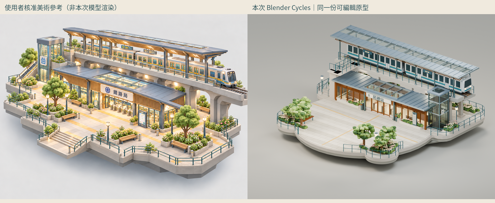
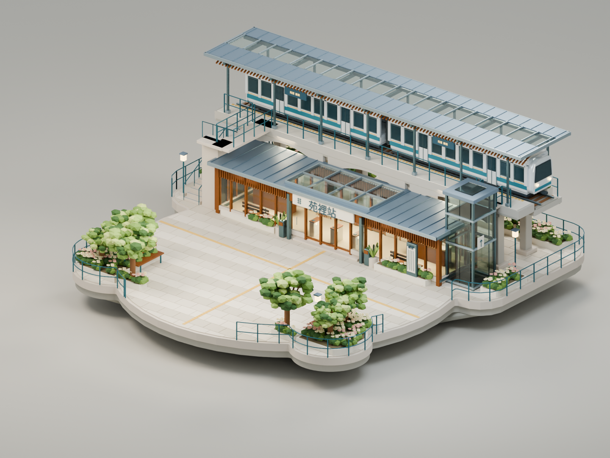
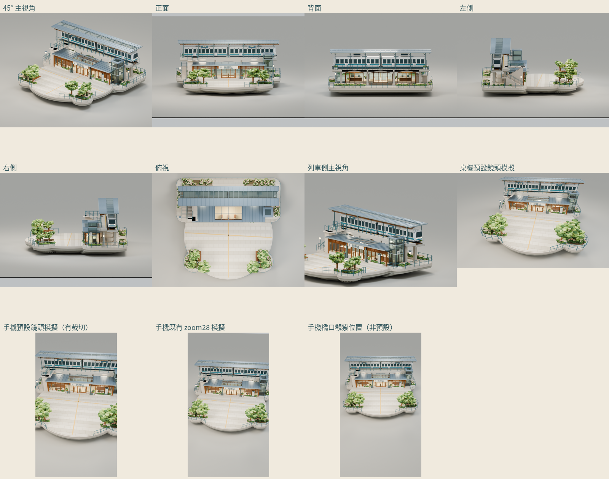
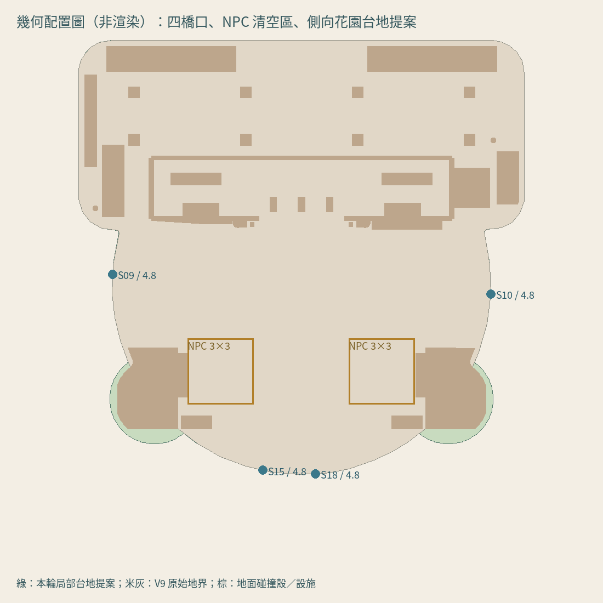

# 交通大升級 V9｜獨立 Blender 精修原型

[可編輯 BLEND](transport-station-v9.blend) · [精修展示 GLB](transport-station-v9-showcase.glb) · [遊戲優化候選 GLB](transport-station-v9-game-candidate.glb) · [尺寸／效能／限制](VALIDATION.md) · [實際PBR材質表](material-report.json) · [與核准圖逐項比對](ART-REVIEW.md) · [製作流程](WORKFLOW.md)

本輪只製作交通島原型，**沒有整合正式遊戲**。V9 GLB 僅用來量測地界與構件配置；站房、雨棚、橋體、兩節列車、樓梯、玻璃電梯、景觀及材質都是重新建立的原生三維構件，沒有沿用 V9 白模外觀或 `k.hall()`／統一弧形屋頂。

## 同源實際渲染

[45° 主視角](renders/hero.png) · [正面](renders/front.png) · [背面](renders/back.png) · [左側](renders/left.png) · [右側](renders/right.png) · [俯視](renders/top.png) · [列車側主視角](renders/train-side.png) · [桌機預設鏡頭模擬](renders/player-desktop.png) · [手機預設鏡頭模擬（有裁切）](renders/player-mobile.png) · [手機既有 zoom28 模擬](renders/player-mobile-zoom28.png) · [手機橋口觀察位置（非預設）](renders/player-mobile-arrival-overview.png)

十一張均由**同一份最終 BLEND**的幾何輸出。後兩張是另外明確標示的相機模擬，沒有修改模型或原檔。所有來源與圖片 SHA、相機、解析度、採樣見 [render-record.json](render-record.json)。它們是 Blender 渲染，**不是實際 Sky Isles 遊戲截圖**；`qa/` 是另行標示的隔離 Three.js GLB 測試畫面。

## 實測規模

| 檔案 | GLB 實際三角面 | 材質 | 網格批次 | 體積 |
| --- | ---: | ---: | ---: | ---: |
| 精修展示 | 540,480 | 33 | 90 | 42.61 MB |
| 遊戲候選 | 213,416 | 33 | 90 | 18.56 MB |

候選減少約 **60.5% 三角面**，保留建築、門窗、軌道及列車位置與主要輪廓，降低倒角細分並略去 1530 個微小植栽構件。沒有縮小整座模型。候選另採透明薄玻璃（建築alpha0.25、車窗0.54）取消折射pass；這是明確的材質近似，保留通透與主配色，但反射／折射外觀須人工比對，精修BLEND及展示GLB維持原PBR。候選尚未獲遊戲整合或手機效能認證。

## 尺寸、配置與空間

世界座標 X 東／Y 上／Z 北，單位沿用 Sky Isles；玩家身高基準1.5。完整站體包含屋簷，實際尺寸如下。

| 組別 | X寬 × Y高 × Z深 | 世界包圍盒 min → max |
| --- | --- | --- |
| Canopy | 19.740 × 3.550 × 3.900 | [-9.87, 3.31, -9.54] → [9.87, 6.86, -5.64] |
| Hall | 14.250 × 2.995 × 3.605 | [-7.125, 0.04, -6.08] → [7.125, 3.035, -2.475] |
| TrainRollingStock | 18.110 × 2.347 × 1.704 | [-8.68, 3.541, -9.052] → [9.43, 5.888, -7.348] |
| VerticalCirculation | 17.830 × 4.997 × 4.658 | [-9.155, 0.0, -7.333] → [8.675, 4.997, -2.675] |
| Viaduct | 18.900 × 3.651 × 3.380 | [-9.45, 0.06, -9.34] → [9.45, 3.711, -5.96] |

V9 原地界面積 333.787；本原型側向花園提案面積 346.355，增加 **12.568**。外接框仍約20.33×19.82。這是保留完整兩側花園、四入口及兩塊NPC清空區的局部土地提案，**未寫回正式世界**。四口與其他道路、鄰島分析見 [geometry-space-audit.json](geometry-space-audit.json)。

兩位 NPC 只有預留 Empty／資料，不製作人物或對話。四口 S09/S10/S15/S18 沿用真正 `src/data/yuan-plan.json`，寬4.8，相近的雙口共享開放區域；沒有重畫路網。左折返樓梯及其上層連橋、右玻璃電梯與月台連接幾何都存在；實機踏階／電梯操作留待正式整合。

## 原型重要限制

手機預設直式相機會裁到部分高架及列車端部；完整保留了這個結果。另附既有 zoom28，以及玩家步行至橋口 `(0,0.5,7.5)`、yaw0、zoom28 的觀察模擬；補充圖不是預設視角，沒有暗改 FOV。

人工美術驗收、90分整合門檻與真機驗證尚未由工具替使用者宣布通過。逐項差異與自行修正紀錄見 ART-REVIEW。正式遊戲相機避障、膠囊碰撞、上下樓、列車動畫及硬體 FPS 均未整合；本輪無搭乘、NPC、任務或新音樂。

原安心生養 BLEND／GLB、其他七島資產、政策資料、`src/`、`public/`及苑字路網不變。所有原創程式與幾何沿用專案 [MIT](../../../LICENSE)；使用者提供參考與設計包保留原始權利。文字輪廓由 Noto Sans CJK（SIL OFL）產生，沒有複製未提供官方標誌，也沒有外部建築模型。

[原成果保留核對](source-preservation.json) · [檔案大小／SHA256](media-manifest.json) · [GitHub 下載核對](github-verification.json) · [輸入來源](input-audit.json)
