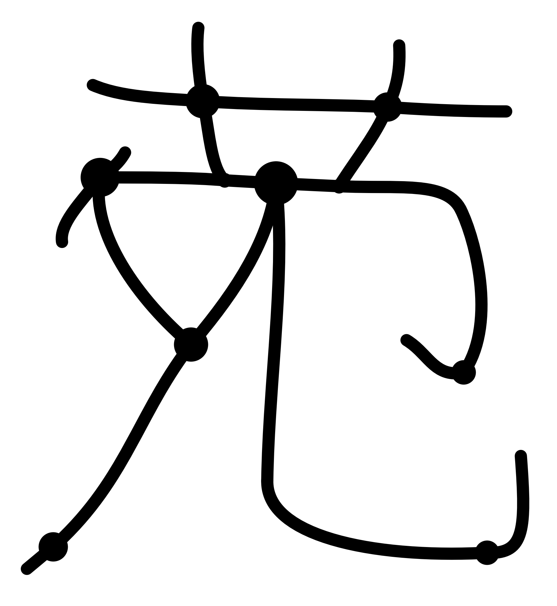
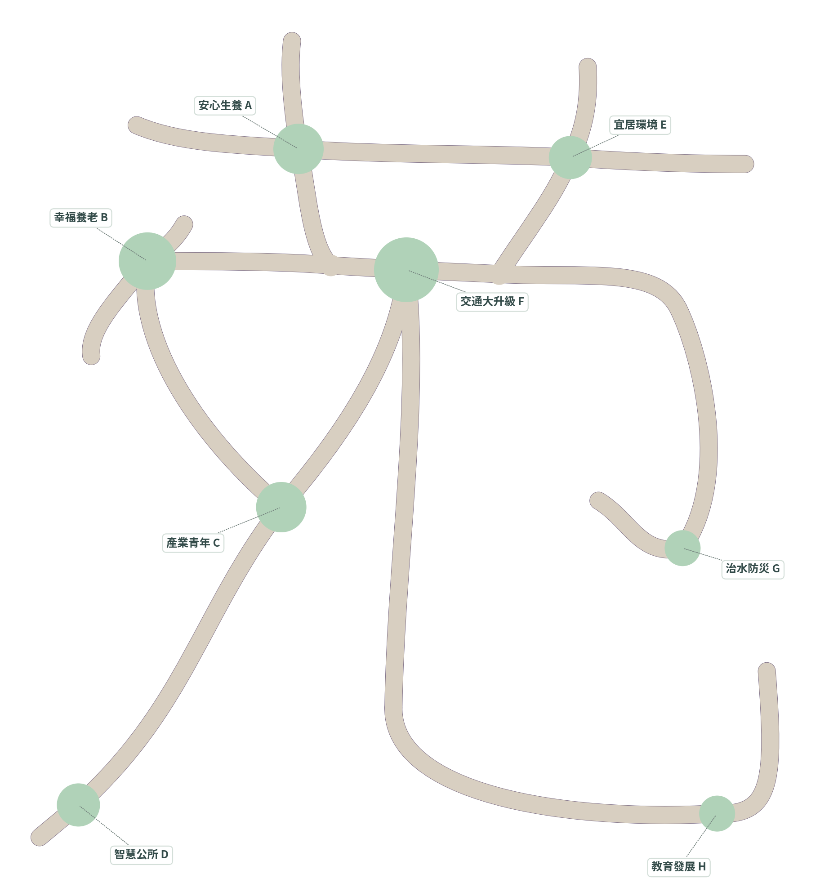
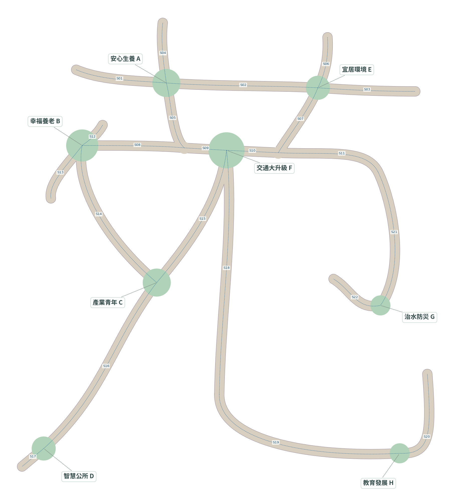

# 苑字全景總體規劃｜方案 A（僅設計，待確認）

依使用者提供的手繪「苑」逐段整理控制點，**不使用字型描邊、文字貼圖、天空投影或特效替代步道**。SVG／PNG 是設計文件，未放入網站當作地圖材質。未修改網站、未重建 3D 地圖、未修改政策、未合併 PR、未推送分支或更新 Cloudflare。

本地設計分支：`codex/yuan-masterplan-design`；基於第四階段完成提交 `0295b0c228652ea2145da829cc583a4cf0b83854`。本次只新增本資料夾。

## 先看這兩張

- [不含任何標籤的純字形 PNG](yuan-pure.png)／[SVG](yuan-pure.svg)：黑色只代表八島與實體步道的俯視外輪廓；沒有任何文字物件或字型輪廓。這是主要辨識度驗收圖。
- [含八島名稱的配置 PNG](yuan-labelled.png)／[SVG](yuan-labelled.svg)：綠色是八座政策島，米色是步道。虛線是圖面註記引線，不是實體步道。
- [步道中心線與路段編號 PNG](yuan-centerlines.png)／[SVG](yuan-centerlines.svg)：藍色虛線與 S01–S22 是工程註記，不進入 3D 場景。

## 1. 字形與節點

保留手繪上橫與兩個上豎構成的「艹」、左側三角形留白及長斜撇、右部內鉤，以及右下長豎彎鉤。右下大弧屬於手繪筆畫本身，不為處理高差增加額外 U 字繞路。

交通島置於中橫與下部交會的 F，保留世界原點及車站的島內局部配置。其他島放在草字頭交會、左側轉折及兩個鉤端。**八島原半徑保留**，新增的 J1/J2 只是步道共用平台，不是第九／第十座島。

純輪廓中的兩個較小凸點是實體交會平台。島嶼大小按原場景保留，沒有為展示字形而另外縮放整個世界。

## 2. 八島新座標

x 向圖右、z 向圖下、y 向上。世界原點對應手繪約 (170,125)，參考點換算倍率 0.6。這是字形空間，不是苑裡地理位置。

| 政策島 | 圖面節點 / 原 id | x | y | z | 原半徑 r |
|---|---|---:|---:|---:|---:|
| 交通大升級 | F / `home` | 0 | 0 | 0 | 9 |
| 安心生養 | A / `tree` | -30 | 0.8 | -33.6 | 7 |
| 幸福養老 | B / `temple` | -72 | 0.6 | -2.4 | 8 |
| 產業青年 | C / `koi` | -34.8 | 1.2 | 66 | 7 |
| 宜居環境 | E / `meadow` | 45.6 | 0.8 | -31.2 | 6 |
| 智慧公所 | D / `windmill` | -91.2 | 1.6 | 148.8 | 6 |
| 治水防災 | G / `crystal` | 76.8 | 1.6 | 77.4 | 5 |
| 教育發展 | H / `lookout` | 86.4 | 2 | 151.2 | 5 |

另有可匯入的 [islands.csv](islands.csv)。高度壓縮至 0–2，使字形路線可直接承擔緩坡；浮島錐形岩底、草地、交通建築及其他既有場景模型保留。

## 3. 全部步道中心線與寬度

[ROUTES.md](ROUTES.md) 列出 **22 段**的端點、全部直線／三次貝茲 XZ 控制點、長度、坡度與兩端水平長度。[yuan-layout.json](yuan-layout.json) 是同一份完整數值藍圖，包含 21 節點、22 段曲線、節點高度與驗證結果。

- 全線路面寬 4.8，含護欄外輪廓約 5.0；護欄高 1.3、厚 0.16，沿用人物半徑 0.33。
- 上橫 S01–S03；左草字頭 S04–S05；右草字頭 S06–S07。
- 中橫 S08–S11；左短撇 S12–S13；左下「夕」與長撇 S14–S17。
- 右下長豎彎鉤 S18–S20；右側內鉤 S21–S22。
- 每個止步端是實際可走的觀景端，不是懸空線條，並有端部護欄。

## 4. 連通性與坡度分析

數值分析已執行，**尚未實作 Three.js 網格或執行新地圖的角色通行測試**。

| 檢查 | 設計分析結果 |
|---|---|
| 圖論連通 | 21 節點／22 路段全部連通；8 座政策島均從 F 可達 |
| 迴路 | 2 個迴路，來自草字頭共連與左側留白；無須另拉破壞字形的捷徑 |
| 同高交會 | 相鄰重疊範圍抽樣高度差為 0；平段延長至實體筆畫分開後再升降 |
| 無意外跨線 | 沒有發現非共用節點路段的額外接觸，無須靠上下層交叉假裝連通 |
| 最大中心線坡度 | 7.32%（約 4.18°），在 S05；其餘詳路段表 |
| 曲率 | 排除島面／節點覆蓋區後，最小中心線半徑約 8.56；扣半路寬後仍約 6.16 的內彎半徑 |
| 人物餘裕 | 路面向內縮 0.41（人物半徑 0.33 + 護欄半厚 0.08）後，8 島中心仍在同一主要可行區 |
| 分析精度 | 平面格網 0.125 世界單位／格；曲線密集取樣，不等於正式碰撞網格 |

格網內縮另出現面積約 0.078、0.156 的兩小片邊緣區域，均不包含任何島中心或必要路徑。實作時須清理／圓滑內角並排除不可達小面域作為出生點或安全點，再以實際網格驗證；不把「圖上線相連」當成完成碰撞驗收。

## 5. 護欄交會與碰撞可行性

### 必須改成共享路面，而非逐段各自圍欄

1. 將所有筆畫路面帶、J1/J2 平台與八島平面入口做幾何聯集，取得真實可行區。
2. 只沿步道聯集的外邊界產生護欄，交會內部不留橫向欄杆；島嶼入口切開護欄，讓角色能自然進出。
3. F 的兩條向下筆畫初段較近，S15／S18 共用水平區分別約 20.17／20.47；讓其形成同一個自然 Y 型分岔，不把中間重疊區各自架欄。
4. J1／J2 為三向交會，保持同高平面；J3／J4 為自然曲線接點。直線與曲線按誤差自適應細分，建議水平弦誤差 ≤0.05、最長段約 1–2，直段可更長。
5. 護欄碰撞線與可見外欄共用同一份外輪廓；延用第四階段圓形人物掃掠、每子步 ≤0.1 的水平阻擋。
6. 路面三角化必須共享交會頂點與一致高度，不能以互穿的獨立橋面覆蓋同一位置。保留島內與入口平段；所有實際三角面的坡度須重新驗證，中心線上限不能直接當成網格上限。

提案的工程驗收目標：所有實際地面三角形坡度 ≤10%，交會處無可見／碰撞台階；所有必要路徑保留足夠人物餘裕，護欄端點不出現可穿越缺口。若局部面坡度超標，優先調整極小的交會高度場或延長既有平段，不另加大 U 字。

### 交通島內部入口需獨立核對

交通島保留 F=(0,0,0) 與既有局部模型。S09 西入口附近現有道路橋的可站立高度約 0.55，S15/S18 南側靠近既有廣場。中心線到 F 表示「進入同一島內可步行區」，不代表把一條新路直接穿過車站、道路護欄或列車。

正式製作必須先在現有模型上選出島內實際通行門口、欄杆開口及連接廣場的路徑；若西入口需接道路橋，應在島內安排短緩坡或調整開口，保持島外字形中心線不動。這部分尚未以真實角色碰撞驗證，不能用本次平面連通結果宣稱已解決。若必須改動交通模型的欄杆／入口，另提出小範圍確認，不直接重設車站或列車。

## 6. 未來「全景」按鈕（這次不實作）

- 正上方驗收採 `OrthographicCamera`，相機 up 固定 `(0,0,-1)`，讓 +x 向右、+z 向下，與本圖一致；避免鏡像、斜看或用透視變形掩飾字形。
- 對真實島嶼與步道包圍盒加約 10% 邊界，再依桌面／手機 aspect 計算正交視錐；不是放大縮小世界。目標大致位於 x≈0、z≈47，精確值以實作後模型包圍盒取得。
- 探索 → 過渡 → 全景 → 返回：儲存探索相機姿態／orbit，停下移動並清除輸入；空中先落地，不傳送人物。過渡約 1.0–1.2 秒，位置 easing、旋轉 quaternion slerp；透視至正交使用匹配構圖的投影過渡並同步 inverse matrix，須實測避免最後一幀跳動。
- 全景期間停止探索鏡頭每幀追蹤，禁止舊 orbit 縮放上限把遠景拉回；返回還原原本視角與操作，不重置人物或檢查點。
- 全景預設關閉政策標籤及中央操作提示，只留必要返回按鈕。雲霧、光束及瀑布霧氣可在全景模式降低或暫時隱藏，避免遮住真實島／步道。這些不負責產生字形，島與步道仍是唯一字形來源。
- 純字形驗收時須關掉所有標籤與裝飾遮擋層，直接檢查實體地面／島嶼外形；不放置字形貼片、天空字、發光描字或字型輪廓模型。

## 7. 確認後需要修改的 Three.js 檔案

以下只是**待做清單**，本次沒有修改這些檔案。

| 檔案 | 確認後的修改 |
|---|---|
| `src/world/islands.js` | 套用 8 島新 x/y/z；保留原 id、r、浮島與模型局部配置 |
| `src/sim/walkways.js` | 由舊 7 線 U 型規劃改為具交會節點的 22 段曲線圖；讀取共用高度與平段 |
| `src/world/bridges.js` | 依真實輪廓聯集、共享頂點三角化與外側護欄建立彎曲步道；適度分區裁剪 |
| `src/world/transport.js`（僅必要時） | 核對西入口與既有道路橋 0.55 高差、島內門口；原站／車模型不重建，開口微調需另確認 |
| `src/main.js` | 統一相機模式更新、建立新配置、串接全景按鈕與導航資料 |
| `src/sim/player.js` | 讓相機追蹤只在探索模式執行；接收新地面／邊界，保留人物與移動物理 |
| `src/sim/camera-profile.js` | 保留桌面／手機探索配置，另提供全景 fit 規則，不共用探索 orbit 距離上限 |
| `src/ui.js`、`index.html` | 加入全景／返回操作、過渡期間輸入鎖定與標籤可見性；保留單手搖桿 |
| `src/policies.js` | 全景時依模式隱藏標籤；政策名稱與內文不改 |
| `src/world/sky.js`、`src/world/clouds.js`、`src/world/props.js` 的霧效層 | 提供全景環境可見性控制，保留探索模式原美術 |
| 新 `src/data/yuan-layout.json`（建議） | 放置已確認的配置資料，與政策 JSON 分開 |
| 新相機導演／交會網格模組（建議） | 將 projection 過渡與輪廓／高度場建置獨立，避免全部堆進 main |
| `test/walkways.test.js`、`walkways.e2e.js`、相關 UI 測試 | 重驗 8 島單手可達、各個新交會、止步端、坡面、護欄、檢查點與全景往返 |
| `scripts/capture-*.mjs` | 增加完全無標籤的正交俯視與有標籤版本，與本方案輪廓比較 |

`public/data/policies.json`、交通建築、人物外觀與既有單手操作數值原則上不改。曲線／聯集可先用現有 Three.js 幾何與 ShapeUtils 三角化；輪廓聯集的數值穩定性需單獨驗證，不在設計階段預先承諾無須任何輔助幾何工具。

## 8. 效能與正式製作後驗收

- 保留原生幾何與共用材質；曲線按弦誤差細分，不把每 0.125 的分析格網照搬成 3D 面數。護欄用連續幾何／實例化立柱，按空間分區讓近距離探索能裁掉遠端路段。
- 全景同時顯示 8 島，比探索視角負荷高；需實機量測，不用設計圖宣稱已達某個 FPS。
- 設計已確認：21 節點圖連通、8 島位於同一內縮可行主區、相鄰重疊段同高、無非相鄰路段誤接、曲率與中心坡度數值、純圖沒有文字元素。
- 尚待製作：地面三角化、欄杆實際阻擋、所有路段與岔路的單指巡航、安全點回復、全景轉場與手機效能。
- 辨識度屬人工驗收：請先看完全無標籤的黑色版本，判斷是否容易讀成你手寫的「苑」，以及 8 個島節點的粗細是否合適。**這不是已完成的 3D 網站截圖，也不宣稱新地圖已可操作。**

確認前不重建地圖、不修改網站、不合併 PR、不更新 Cloudflare。
