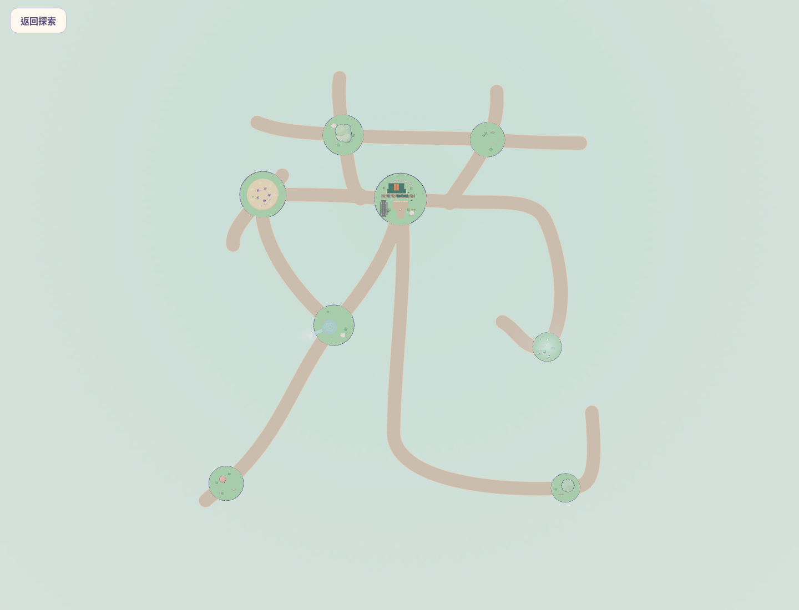
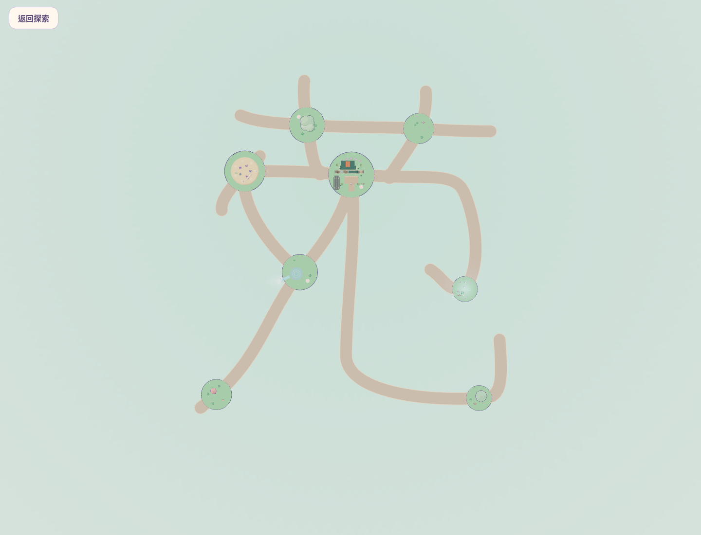
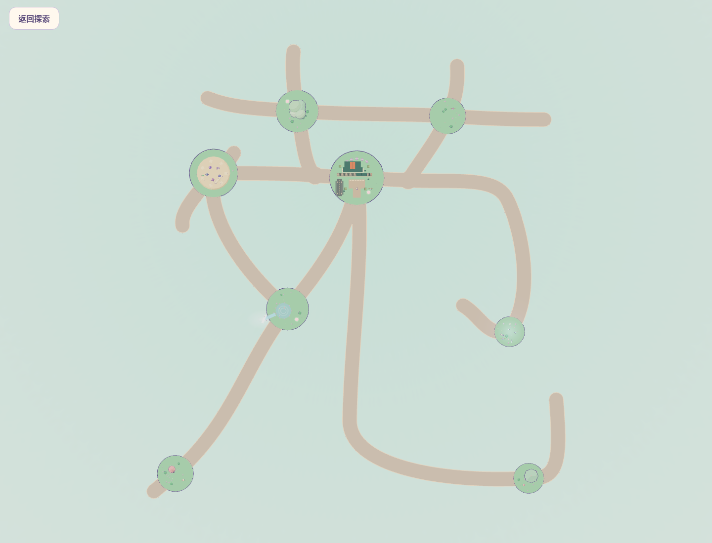
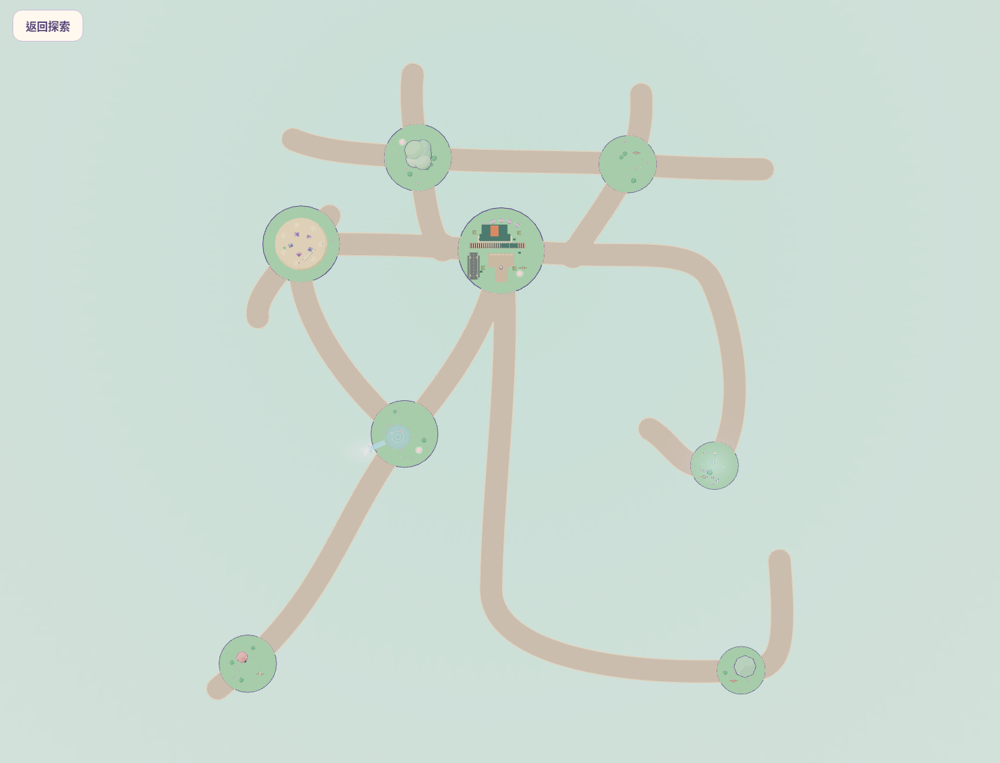
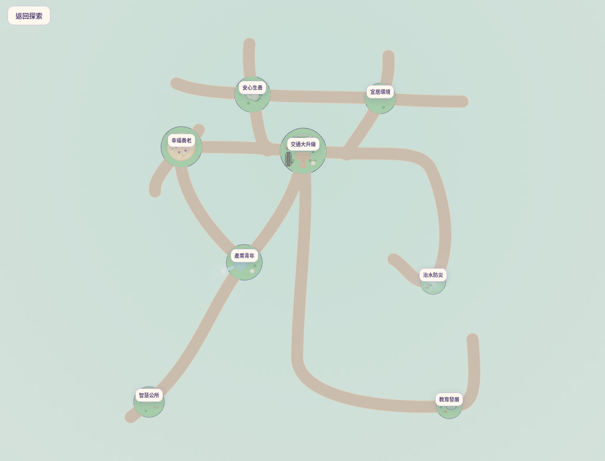
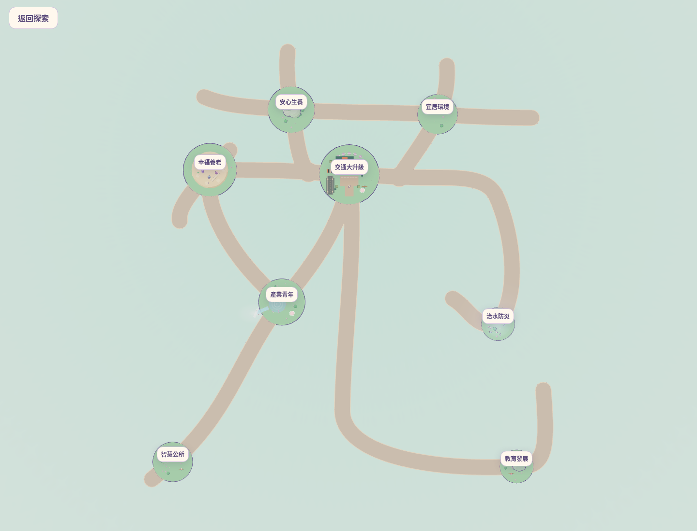
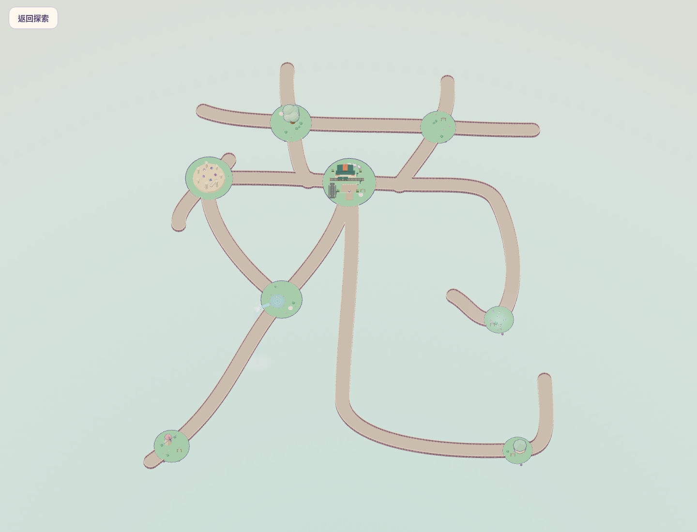
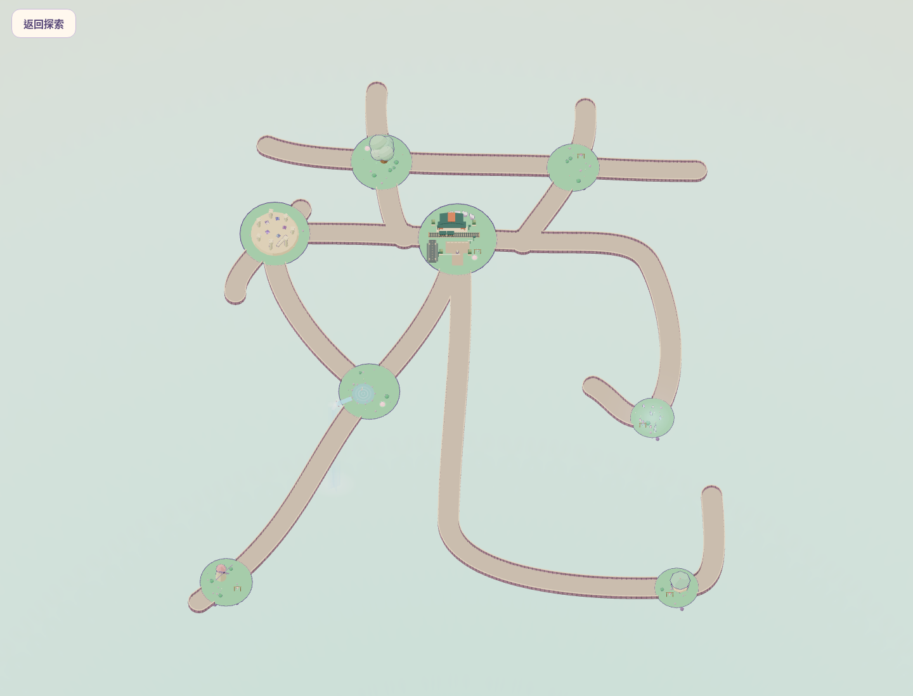

# 苑字大小審查：方案 A（−15%）／方案 B（−25%）

**僅供配置審查，兩案均未套用至網站運行版本。** 基準為 PR #4 完成提交 `860cf7a57a6d65771bbb445ea04493c219047a56`。本分支只新增本目錄；`src/`、`public/`、人物、政策、UI 及造景程式完全不變。

## 結論與建議

兩案均可在保留八島原半徑、模型尺寸、人物比例及 4.8 單位步道寬度下連通，不必將 B 回退為較小縮減幅度。若以縮短步行為主，**B 是可供人工確認的候選**；A 保留較多留白與未來調整空間。兩案均未自動定稿。

- A：中心線約 **753.874**，較目前少 133.042。
- B：中心線約 **665.179**，較目前少 221.738，亦比 A 少約 88.695。
- 純字形圖保留草字頭、中央橫、左側長撇、右內鉤與右下大彎鉤；B 因島與路面沒有縮小，視覺筆畫較粗、島嶼占比更大。主要兩處封閉留白均仍存在，未發生意外筆畫黏連。**能否直覺讀作「苑」仍須使用者人工判斷。**

## 同尺度比較（重要）

以下兩張使用相同正交投影、相同世界座標視野與 1440×1100 畫布；可以直接比較真正世界大小。不是將圖片或 Three.js 世界縮放。

| A：相對目前 85% | B：相對目前 75% |
| --- | --- |
|  |  |

## 各案滿版、無政策標籤的真實 3D 字形

以下各自配合外框構圖，供辨識筆勢，**不可據此比較螢幕上的絕對大小**。

| A | B |
| --- | --- |
|  |  |

## 八島名稱版本

| A | B |
| --- | --- |
|  |  |

## 補充：可見浮空岩體的斜俯瞰 3D 照片

| A | B |
| --- | --- |
|  |  |

全部八張圖均由本機 Chromium 的實際 Three.js 場景拍攝，使用原有島嶼、模型、路面與護欄，沒有文字輪廓、背景字樣或字形貼圖。

## 數值比較

| 指標（世界單位） | PR #4 目前 | A | B |
| --- | ---: | ---: | ---: |
| 22 段中心線總長 | 886.917 | 753.874 | 665.179 |
| 真實可行走區域外框寬（不含相機留白） | 163.268 | 139.499 | 123.652 |
| 外框高 | 177.492 | 151.588 | 134.319 |
| 最近兩政策島的島緣間距 | 19.134 | 13.864 | 10.351 |
| 非相接步道的中心線外推邊緣最小淨距 | 11.584 | 9.126 | 7.487 |
| 步道與非端點政策島最小淨距 | 5.007 | 2.546 | 0.905 |
| 共享可行走面積 | 4629.246 | 3991.568 | 3566.441 |
| 外框寬／高 | 0.9199 | 0.9202 | 0.9206 |
| 實體區域連通分量 | 1 | 1 | 1 |
| 主要封閉留白數 | 2 | 2 | 2 |
| 非相接步道相交 | 0 | 0 | 0 |
| 侵入非端點政策島 | 0 | 0 | 0 |
| 有面積重疊的相接路段配對數 | 38 | 38 | 38 |

外框不含 PR #4 全景相機額外留白，故數值不宜與舊報告含留白的寬高混用。路長採曲線離散弧長，與理想 0.85／0.75 倍的微小差異來自採樣。非相接步道淨距是折線距離扣除固定路寬的幾何估算；另以實際展寬多邊形交集檢查重疊。

## 八島全部 28 組最短中心線步行距離

起訖為島中心，沿 21 節點／22 邊弧長最短路計算，非整個連續路面任意抄近路的測地最短距離。

| 起點 | 終點 | 目前 | A | B |
| --- | --- | ---: | ---: | ---: |
| 交通大升級 | 安心生養 | 42.987 | 36.539 | 32.240 |
| 交通大升級 | 幸福養老 | 56.210 | 47.778 | 42.157 |
| 交通大升級 | 產業青年 | 59.084 | 50.222 | 44.313 |
| 交通大升級 | 宜居環境 | 49.820 | 42.347 | 37.365 |
| 交通大升級 | 智慧公所 | 137.607 | 116.966 | 103.205 |
| 交通大升級 | 治水防災 | 115.316 | 98.017 | 86.485 |
| 交通大升級 | 教育發展 | 174.981 | 148.734 | 131.235 |
| 安心生養 | 幸福養老 | 66.383 | 56.425 | 49.787 |
| 安心生養 | 產業青年 | 102.072 | 86.760 | 76.553 |
| 安心生養 | 宜居環境 | 59.004 | 50.153 | 44.253 |
| 安心生養 | 智慧公所 | 180.594 | 153.504 | 135.444 |
| 安心生養 | 治水防災 | 158.303 | 134.556 | 118.725 |
| 安心生養 | 教育發展 | 217.969 | 185.272 | 163.475 |
| 幸福養老 | 產業青年 | 63.221 | 53.738 | 47.416 |
| 幸福養老 | 宜居環境 | 106.030 | 90.126 | 79.522 |
| 幸福養老 | 智慧公所 | 141.744 | 120.482 | 106.307 |
| 幸福養老 | 治水防災 | 171.525 | 145.796 | 128.643 |
| 幸福養老 | 教育發展 | 231.191 | 196.512 | 173.393 |
| 產業青年 | 宜居環境 | 108.905 | 92.569 | 81.678 |
| 產業青年 | 智慧公所 | 78.522 | 66.744 | 58.892 |
| 產業青年 | 治水防災 | 174.400 | 148.239 | 130.798 |
| 產業青年 | 教育發展 | 234.066 | 198.956 | 175.549 |
| 宜居環境 | 智慧公所 | 187.427 | 159.313 | 140.570 |
| 宜居環境 | 治水防災 | 124.844 | 106.117 | 93.632 |
| 宜居環境 | 教育發展 | 224.802 | 191.081 | 168.600 |
| 智慧公所 | 治水防災 | 252.922 | 214.983 | 189.690 |
| 智慧公所 | 教育發展 | 312.588 | 265.699 | 234.440 |
| 治水防災 | 教育發展 | 290.297 | 246.751 | 217.721 |

## 八島島緣間距（全部配對）

間距 = 島中心直線距離 − 兩島原半徑；不代表步行路長。全數為正。

| 島對 | 目前 | A | B |
| --- | ---: | ---: | ---: |
| 交通大升級 ↔ 安心生養 | 19.134 | 13.864 | 10.351 |
| 交通大升級 ↔ 幸福養老 | 39.191 | 30.763 | 25.143 |
| 交通大升級 ↔ 產業青年 | 42.198 | 33.468 | 27.648 |
| 交通大升級 ↔ 宜居環境 | 28.097 | 21.632 | 17.323 |
| 交通大升級 ↔ 智慧公所 | 121.129 | 100.710 | 87.097 |
| 交通大升級 ↔ 治水防災 | 71.049 | 58.291 | 49.786 |
| 交通大升級 ↔ 教育發展 | 121.833 | 101.458 | 87.875 |
| 安心生養 ↔ 幸福養老 | 25.810 | 19.689 | 15.608 |
| 安心生養 ↔ 產業青年 | 63.778 | 52.111 | 44.334 |
| 安心生養 ↔ 宜居環境 | 45.998 | 37.148 | 31.248 |
| 安心生養 ↔ 智慧公所 | 137.067 | 114.557 | 99.550 |
| 安心生養 ↔ 治水防災 | 108.148 | 90.126 | 78.111 |
| 安心生養 ↔ 教育發展 | 158.355 | 132.801 | 115.766 |
| 幸福養老 ↔ 產業青年 | 45.732 | 36.622 | 30.549 |
| 幸福養老 ↔ 宜居環境 | 80.439 | 66.273 | 56.829 |
| 幸福養老 ↔ 智慧公所 | 104.883 | 87.051 | 75.162 |
| 幸福養老 ↔ 治水防災 | 118.701 | 98.946 | 85.776 |
| 幸福養老 ↔ 教育發展 | 159.102 | 133.287 | 116.076 |
| 產業青年 ↔ 宜居環境 | 85.391 | 70.633 | 60.794 |
| 產業青年 ↔ 智慧公所 | 65.143 | 53.422 | 45.608 |
| 產業青年 ↔ 治水防災 | 75.501 | 62.376 | 53.626 |
| 產業青年 ↔ 教育發展 | 103.557 | 86.224 | 74.668 |
| 宜居環境 ↔ 智慧公所 | 164.346 | 137.894 | 120.259 |
| 宜居環境 ↔ 治水防災 | 77.134 | 63.914 | 55.101 |
| 宜居環境 ↔ 教育發展 | 134.788 | 112.920 | 98.341 |
| 智慧公所 ↔ 治水防災 | 131.384 | 110.026 | 95.788 |
| 智慧公所 ↔ 教育發展 | 127.541 | 106.760 | 92.905 |
| 治水防災 ↔ 教育發展 | 48.049 | 39.342 | 33.537 |

## 路口與潛在碰撞分析

- 各案以原有共享路面聯集流程重新三角化，再從外輪廓生成護欄，並未只平移舊護欄，也沒有在路口放入內部柵欄。
- 八島原半徑 5–9、J1／J2 平台半徑 3、人物與建築模型均不變；y 維持原型的共同 0 高度，路面仍平接。
- B 的非端點步道到政策島最小幾何淨距約 **0.905**，A 約 **2.546**。這是道路外側與附近島的間隔，不是把路寬減至 0.905；路面仍為 4.8。
- 交通島 F 與 J1 平台的圓形輪廓間隔：目前 4.407、A 1.946、B 0.305。兩者本來就由實體路面連接，0.305 不是可跌落縫隙；B 此處視覺與未來建築擴充餘裕較少。
- 38 對相接路段有合理共享面；每一對的交集面積記錄於 comparison.json。非相接路段與非端點島面的多邊形重疊皆為 0。
- 每案使用既有真實 Player、實體路面與交通島既有碰撞面，執行全部 22 段雙向、兩種 dt、76 種路口轉向、護欄阻擋與地面接縫測試，**9 項皆通過**。車站／列車／道路模型不需移動。
- 原有島嶼懸崖行為不變；本次沒有替所有建築新增碰撞，也沒有宣稱證明所有任意手動操作均不會跌落。

## 驗證與未驗證範圍

- 兩案沙盒正式建置通過；目前網站原配置的正式建置也通過。
- [A 物理測試](a/physics.log)／[B 物理測試](b/physics.log)：各 9 通過、0 失敗。
- [A 建置](a/build.log)／[B 建置](b/build.log)；[原配置建置](baseline-build.log)。
- 本機桌面 Chromium／軟體 WebGL 實際載入兩案，政策名稱版本各顯示八個標籤，無 pageerror；資料見各案 browser.json。
- 未改 UI，未執行整套手機回歸，未在真機驗證 FPS 或單手手感。此階段不是發布驗收。
- 需人工決定：無標籤辨識度、筆畫粗細、B 較緊密的中央區域是否符合偏好，以及剩餘步行距離是否足夠短。

## 檔案與重現

- `a/yuan-plan.json`、`b/yuan-plan.json`：可審查的節點座標與 Bezier 控制點。
- 各案 `yuan-layout.json`、`yuan-surface.json`：對應可實際載入的路網、三角面及護欄生成物。
- [完整比較數據](comparison.json)：全部島距、最短路、路口交集面積、重疊檢查。
- [圖片雜湊清單](images-manifest.json)。

```bash
npm ci
node docs/design/yuan-size-comparison-v1/generate.mjs
node docs/design/yuan-size-comparison-v1/analyze.mjs
node work/yuan-size/a/test/walkways.test.js
node work/yuan-size/b/test/walkways.test.js
node docs/design/yuan-size-comparison-v1/render.mjs
```

`generate.mjs` 僅將 PR #4 現有座標、控制點分別乘 **0.85／0.75 一次**。原 `compressionXZ=0.78` 已反映在基準座標中，不會再乘到座標上；合成值 0.663／0.585 僅提供原生成器採樣密度 metadata。半徑、寬度、模型 scale 都不乘。

隔離複本位於 `work/yuan-size/a`、`b`，不提交、不作為網站入口。若要人工操作，可在該複本內執行 `npm run dev -- --port 4286`（B 可用 4287）。正常根目錄啟動仍為 PR #4 原配置。

本次僅提交本設計目錄，不合併任何 PR，不更新 Cloudflare Production 分支、不執行部署。新分支推送仍可能依既有設定產生公開 Preview，但其網站運行檔案與 PR #4 相同，不會自動套用 A 或 B。完成後等待人工選定大小。
