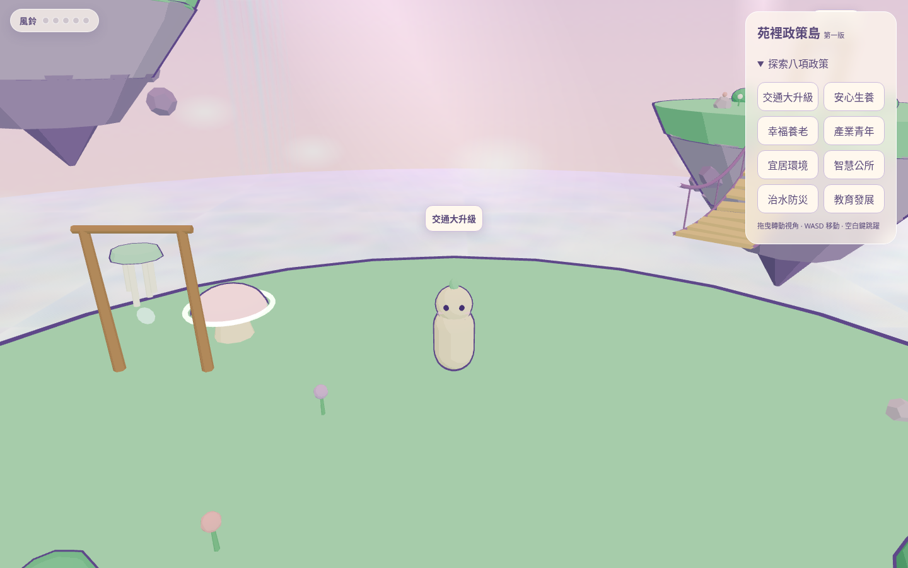
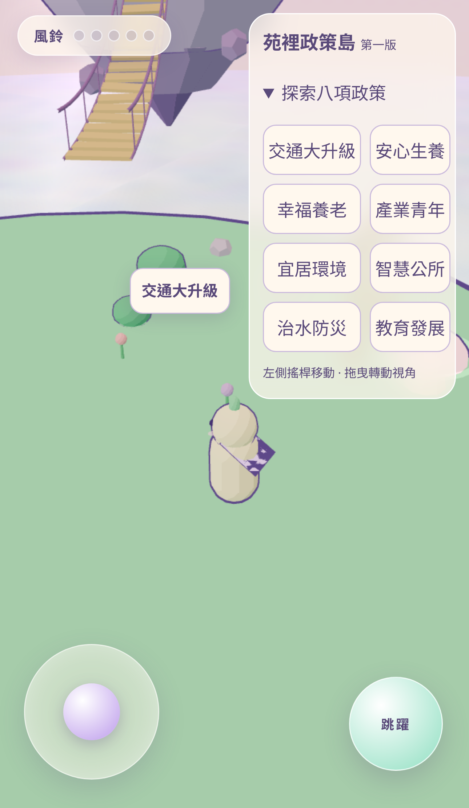
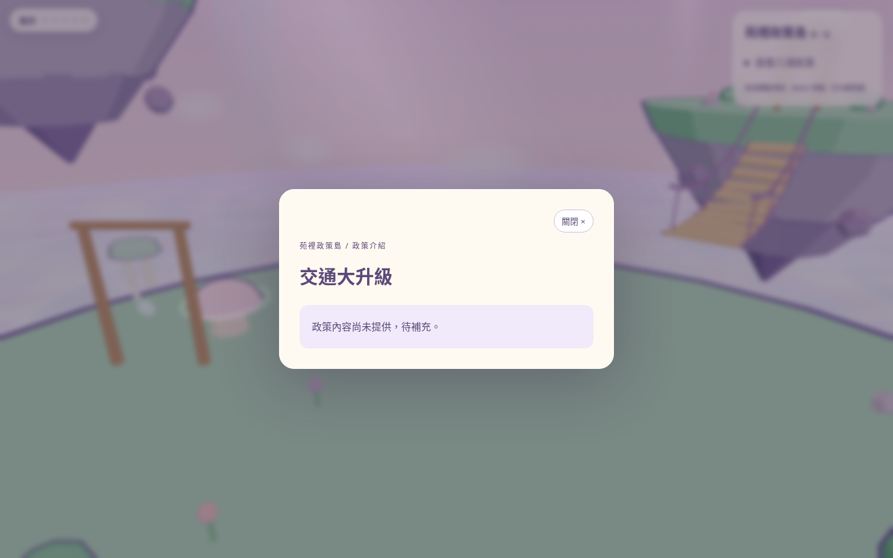

# 苑裡政策島第一版預覽

## 第三階段：鏡頭與 UI/UX

[桌面預覽](ux-desktop.png) · [手機預覽](ux-mobile.png) · [手機展開選單](ux-mobile-menu.png) · [手機首次提示](ux-mobile-help.png)

[變更、測試結果與人工評估項目](ux.md)


## 第二階段：交通島 3D 美術原型

- [交通島桌面 PNG](transport-desktop.png)
- [交通島手機 PNG](transport-mobile.png)
- [原型說明、變更檔案、驗證與限制](transport.md)

以下保留第一版的三張預覽圖。


這三張圖片重新擷取自目前專案的 `dist/` 建置產物；未修改網站功能，未部署網站。

- [桌面版](desktop.png)
- [手機版](mobile.png)
- [政策介紹視窗](policy-dialog.png)







## 從 GitHub 查看

三張 PNG 與網站程式修改一同納入此分支。在 GitHub 的 Code 頁切換至此 PR 的來源分支，進入 `docs/previews/`，即可直接在本 README 查看圖片；也可點選各 PNG，使用 Raw／下載按鈕取得原圖。

這些是實際本機建置的截圖，圖片上傳 GitHub 不代表網站已部署。

## 開啟真正可操作的 3D 網站

在擁有這份修改後專案的 Codex 終端機執行：

```bash
cd /workspace/sky-isles
npm run dev -- --host 0.0.0.0 --port 4185 --strictPort
```

伺服器成功啟動後：

- 若 Codex 客戶端提供連接埠轉送或網站預覽功能，選擇連接埠 4185，使用客戶端產生的預覽網址。遠端工作區的 localhost 不是你電腦的 localhost。
- 若在本機 Codex 開啟此專案並執行上述命令，可開啟 http://localhost:4185 。本機專案路徑請改為實際路徑。
- 此次雲端工作階段沒有可用的互動預覽面板、連接埠轉送工具或 `sites-preview` 命令，因此不能在這裡提供已驗證可從你裝置連線的互動網址；單純執行命令不會自動建立可存取的 Codex 預覽。

進入網站後按「開始探索」。可拖曳鏡頭、WASD／方向鍵移動、空白鍵跳躍；手機使用搖桿與跳躍按鈕。點選島名或政策選單可開啟介紹。

此流程不需要正式公開部署網站。
