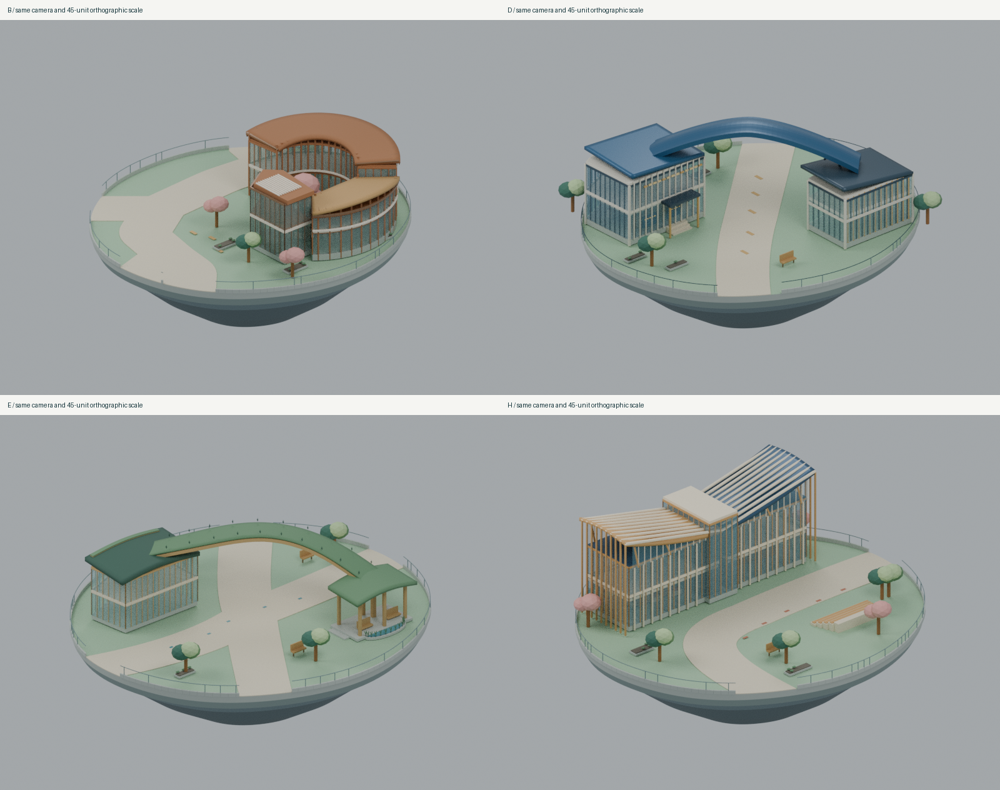
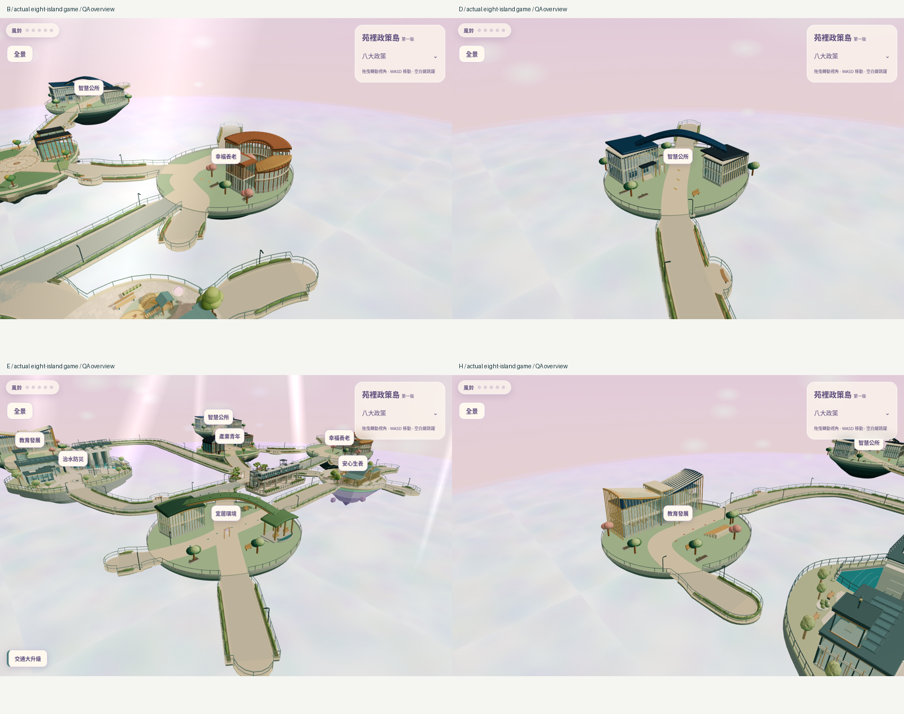
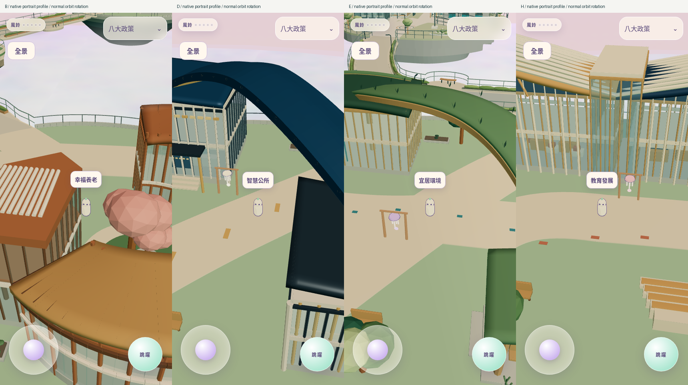
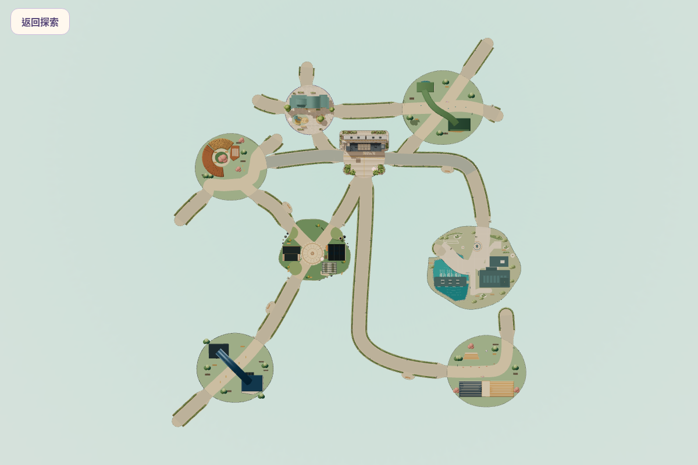

# B／D／E／H R21 Blender 精修與遊戲整合

四島已在同一個真正Sky Isles世界載入，替換舊臨時造景；可編輯Blender、正式GLB、同源渲染、桌手機遊戲畫面及驗證資料已提交。維持Draft PR19，等待使用者人工美術及真機驗收。沒有合併、正式部署、NPC、室內、橋景或新路燈施工。

基準PR18 G V5.1：`2b4404927f33096ab28539a01f5e6236d670c038`。獨立分支：`codex/bdeh-r21-game-integration`。來源ZIP48檔、原manifest47項核對相符；只執行R21建築函式。設計包中的R18/R20檔案是原始碼依賴引擎，與禁止導入的GitHub PR13資產無關，未選用其建築。

## 驗收入口

[完整工程、美術與限制報告](REPORT.md) · [重建與在Codex操作](REBUILD.md) · [修改檔案清單](FILE-LIST.md) · [SHA256與圖片尺寸](MANIFEST.json) · [GitHub逐檔下載收據](GITHUB-VERIFIED.json)

## 每島模型與多視圖

| 島 | 可編輯Blender | 正式GLB | 同源六視圖 | 美術審查／比較 |
|---|---|---|---|---|
| B 幸福養老 | [工程](../../design/bdeh-r21/B/B-r21.blend) | [GLB](../../../public/models/bdeh-r21/B.glb) | [六視圖](B/six-views.png) | [兩輪紀錄](B/SELF-REVIEW.md)、[初輪→精修](B/before-after-blender.png) |
| D 智慧公所 | [工程](../../design/bdeh-r21/D/D-r21.blend) | [GLB](../../../public/models/bdeh-r21/D.glb) | [六視圖](D/six-views.png) | [兩輪紀錄](D/SELF-REVIEW.md)、[初輪→精修](D/before-after-blender.png) |
| E 宜居環境 | [工程](../../design/bdeh-r21/E/E-r21.blend) | [GLB](../../../public/models/bdeh-r21/E.glb) | [六視圖](E/six-views.png) | [兩輪紀錄](E/SELF-REVIEW.md)、[初輪→精修](E/before-after-blender.png) |
| H 教育發展 | [工程](../../design/bdeh-r21/H/H-r21.blend) | [GLB](../../../public/models/bdeh-r21/H.glb) | [六視圖](H/six-views.png) | [兩輪紀錄](H/SELF-REVIEW.md)、[初輪→精修](H/before-after-blender.png) |

## 真正遊戲／玩家畫面

每島 `game/{B,D,E,H}-desktop-native.png` 與 `mobile-native.png` 為原生距離／pitch／FOV；`-facing` 是正常orbit轉向；`-hero`、`-top` 是QA特製相機，不能當作預設畫面。手機直式430×932、橫式932×430、桌機1200×800，均DPR1。Blender800×600、Cycles64 samples。完整位置、camera、orbit、地面狀態、GPU、served bundle／GLB SHA見 [capture-record](game/capture-record.json)。

| 島 | 桌機原生／轉向 | 手機直式原生／轉向 | 手機橫式 | 全島QA | NPC預留視線 |
|---|---|---|---|---|---|
| B | [原生](game/B-desktop-native.png)／[轉向](game/B-desktop-facing.png) | [原生](game/B-mobile-native.png)／[轉向](game/B-mobile-facing.png) | [橫式](game/B-mobile-landscape.png) | [主視](game/B-hero.png)／[俯視](game/B-top.png) | [桌機](game/B-desktop-npc-reservation.png)／[手機](game/B-mobile-npc-reservation.png) |
| D | [原生](game/D-desktop-native.png)／[轉向](game/D-desktop-facing.png) | [原生](game/D-mobile-native.png)／[轉向](game/D-mobile-facing.png) | [橫式](game/D-mobile-landscape.png) | [主視](game/D-hero.png)／[俯視](game/D-top.png) | [桌機](game/D-desktop-npc-reservation.png)／[手機](game/D-mobile-npc-reservation.png) |
| E | [原生](game/E-desktop-native.png)／[轉向](game/E-desktop-facing.png) | [原生](game/E-mobile-native.png)／[轉向](game/E-mobile-facing.png) | [橫式](game/E-mobile-landscape.png) | [主視](game/E-hero.png)／[俯視](game/E-top.png) | [桌機](game/E-desktop-npc-reservation.png)／[手機](game/E-mobile-npc-reservation.png) |
| H | [原生](game/H-desktop-native.png)／[轉向](game/H-desktop-facing.png) | [原生](game/H-mobile-native.png)／[轉向](game/H-mobile-facing.png) | [橫式](game/H-mobile-landscape.png) | [主視](game/H-hero.png)／[俯視](game/H-top.png) | [桌機](game/H-desktop-npc-reservation.png)／[手機](game/H-mobile-npc-reservation.png) |

[手機完整全景](game/yuan-mobile-panorama.png) · [實際路網前後矩陣](network-comparison-r21.json) · [碰撞與NPC空間稽核](geometry-stage-2.json) · [效能比較](performance.json)

## 實際可操作預覽

本機production preview使用4274；在同一Codex工作環境的Ports／Preview開啟4274即可操作，或checkout此分支執行 `npm ci`、`npm run dev -- --port 4274 --strictPort`。GitHub PNG／GLB頁面不是可操作網站。未啟動正式部署；若既有Cloudflare整合沒有產生可用Preview，不提供虛構網址。

## 驗證結果與界線

83個具名單元＋lint＋build通過。全套瀏覽器首輪60通過／4不適用／4失敗，修正驅動及資料後受影響6/6通過；按相同案例身分彙整64通過／4不適用，不冒稱單次最終68全通。22道路雙向與四島公共空間、NPC、鏡頭、政策、全景、復位已測，詳細範圍與排除起點在REPORT及JSON內。

**待人工批准：** 四島最終美術與用途辨識、真機手機FPS／Safari、長時間觸控及熱／電量。室內、屋頂、NPC、橋景／新燈未實作；不得視為已驗收。沒有合併PR或更新Production。
