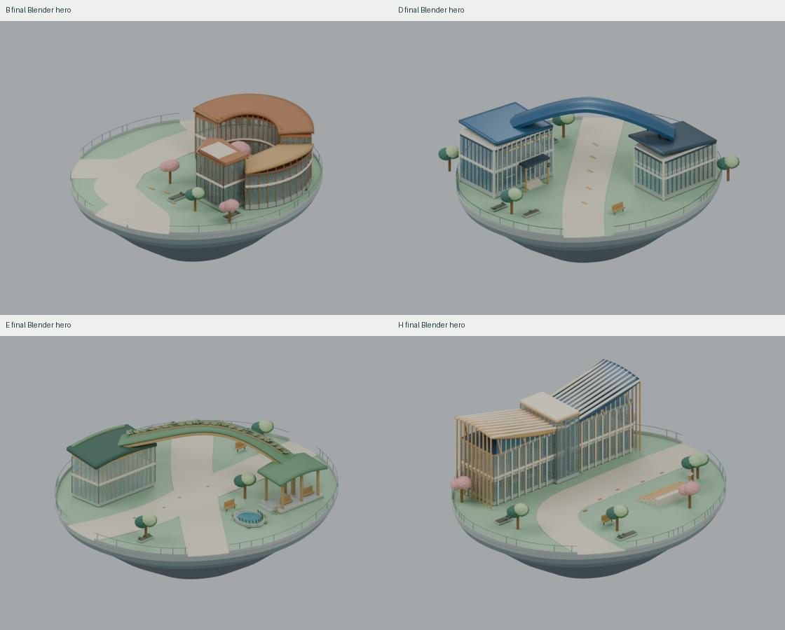
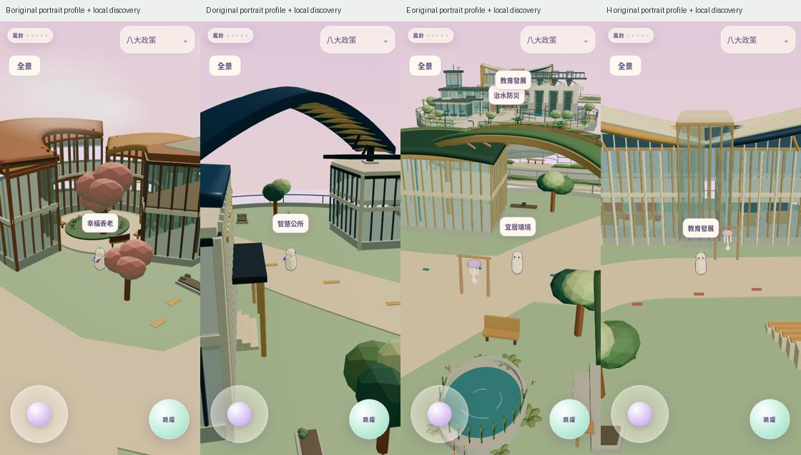
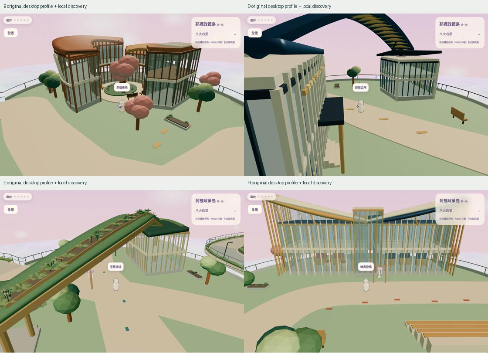
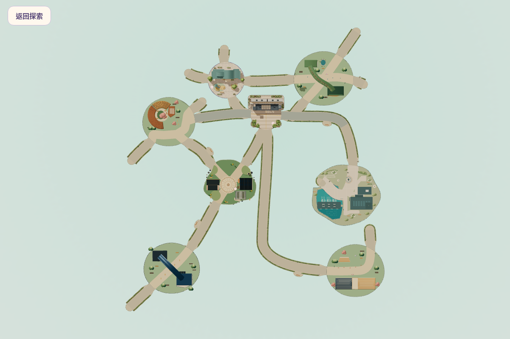

# PR19 四島 R21 最終精修驗收入口

四島主體與固定路網保留；E植生／雨水側庭、B伴坐院落、D/H普通玩家鏡頭與局部避障實際精修。**Draft，待人工美術與真機驗收；沒有合併或部署Production。**

[完整結果與限制](REPORT.md) · [自行挑刺／修正](SELF-REVIEW.md) · [可重建／本機操作](REBUILD.md) · [來源核對](source-consistency.json) · [修改清單](FILE-LIST.md) · [GitHub下載SHA驗證](GITHUB-VERIFIED.json)

| 島 | 同源8視圖 | 桌機前後 | 直式／一指前後 | 橫式前後 | 連續搖桿稽核 |
|---|---|---|---|---|---|
| B | [8圖](comparisons/B-blender-eight.jpg)／[原PNG](B/blender/) | [對照](comparisons/B-desktop-before-after.jpg) | [對照](comparisons/B-portrait-before-after.jpg) | [對照](comparisons/B-landscape-before-after.jpg) | [trace](operation/B-trace.json)／[採樣](operation/B/) |
| D | [8圖](comparisons/D-blender-eight.jpg)／[原PNG](D/blender/) | [對照](comparisons/D-desktop-before-after.jpg) | [對照](comparisons/D-portrait-before-after.jpg) | [對照](comparisons/D-landscape-before-after.jpg) | [trace](operation/D-trace.json)／[採樣](operation/D/) |
| E | [8圖](comparisons/E-blender-eight.jpg)／[原PNG](E/blender/) | [對照](comparisons/E-desktop-before-after.jpg) | [對照](comparisons/E-portrait-before-after.jpg) | [對照](comparisons/E-landscape-before-after.jpg) | [trace](operation/E-trace.json)／[採樣](operation/E/) |
| H | [8圖](comparisons/H-blender-eight.jpg)／[原PNG](H/blender/) | [對照](comparisons/H-desktop-before-after.jpg) | [對照](comparisons/H-portrait-before-after.jpg) | [對照](comparisons/H-landscape-before-after.jpg) | [trace](operation/H-trace.json)／[採樣](operation/H/) |

[5張同源近景](details/) · [E植栽再挑刺同鏡位對照](iteration-3/E-planting-before-after.jpg) · [E原生角色遮擋修正](iteration-5/E-native-body-before-after.jpg) · [相同H動線CPU前後](performance/camera-index-comparison.json)

四套`.blend`位於[docs/design/bdeh-r21](../../../design/bdeh-r21/)，正式GLB位於[public/models/bdeh-r21](../../../../public/models/bdeh-r21/)。全是實際模型／真正遊戲影像，無AI圖。

最終圖僅看四島blender及game-after；iteration-*、game-before、recovery與history為明確歷史證據。前後118張遊戲PNG／32張同源Cycles64／5張補充近景，實際來源和鏡頭metadata可核對。

完整回歸與單元結果見REPORT；工程通過不代表美術／iPhone Safari／實體GPU／長時間單手操作批准。完成本輪後停止，不開始後續NPC或橋景。
