# 八座政策島第一版造景

Base：`codex/yuan-size-b-playable`（89103a1）；Head：`codex/eight-policy-islands-scenery-v1`。

B 方案的三個路網／島嶼配置 JSON 完全不變：八島位置、半徑、665.179 總中心線長度、4.8 寬觀光步道、連接關係與苑字輪廓均保留。沒有新增 NPC、音樂整合、政策全文、真實苑裡地圖、環島護欄或最終版防跌落美術。

交通島保留既有車站、列車、鐵道與道路橋；另七島改用同一套奶油白、灰青、珊瑚、草綠配色與原生 Three.js 幾何。建築皆為政策主題示意，不代表實際工程已核定或完成。

## 本輪造景

| 島嶼 | 第一版主題設施 |
| --- | --- |
| 交通大升級 | 保留原有車站、月台、列車、鐵道、道路橋及綠化 |
| 安心生養 | 暖色斜屋頂親子館、鞦韆／滑梯遊具、空嬰兒車、花圃 |
| 幸福養老 | 社區照護家園、健康標記、涼亭、休憩椅與庭園 |
| 產業青年 | 青創工作室、屋頂現代元素、展售攤位、共創工作桌 |
| 宜居環境 | 公園樹群、寵物敏捷圈／活動意象、野餐休憩與綠化 |
| 智慧公所 | 現代便民中心、門廊、數位服務機台、簡潔廣場 |
| 治水防災 | 藍色水道、堤岸、閘門控制輪、排水格柵、警示信標 |
| 教育發展 | 校舍／圖書館意象、旗幟、展開書本、小型運動場 |

舊的巨樹、神殿、池塘、風車、晶石與涼亭大型主物件不再於七島運行場景中生成，避免與新主題混雜。原 `props.js` 源碼保留；風鈴近距離的白色方塊提示改成原生幾何圓環，不新增音樂功能；浮空岩體、草地外緣、雲海、風鈴與選用彈跳蘑菇保留。人物與既有音效程式未改動。

## 全景

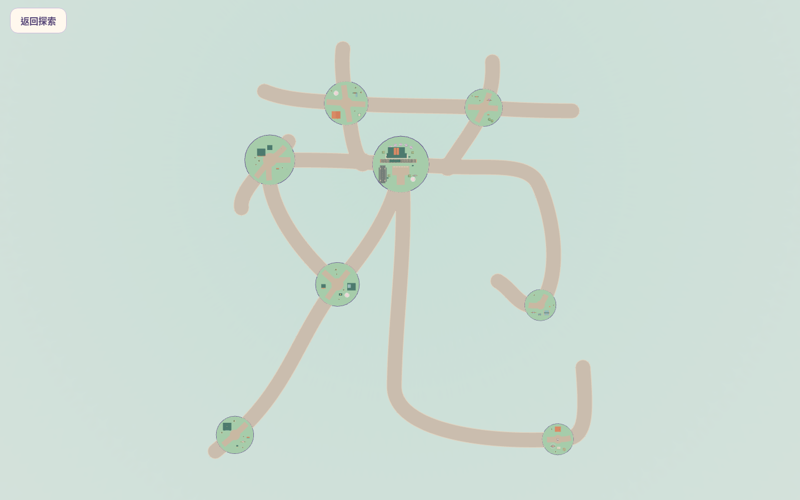

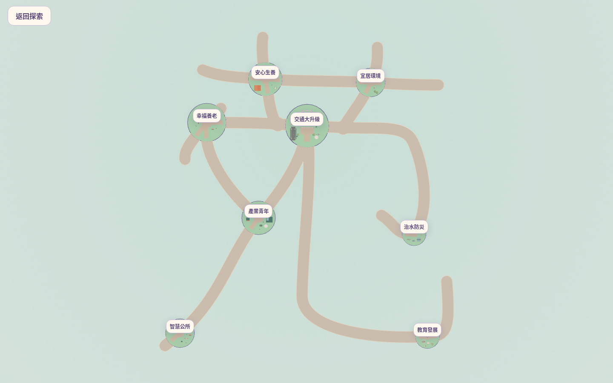

## 桌面與手機

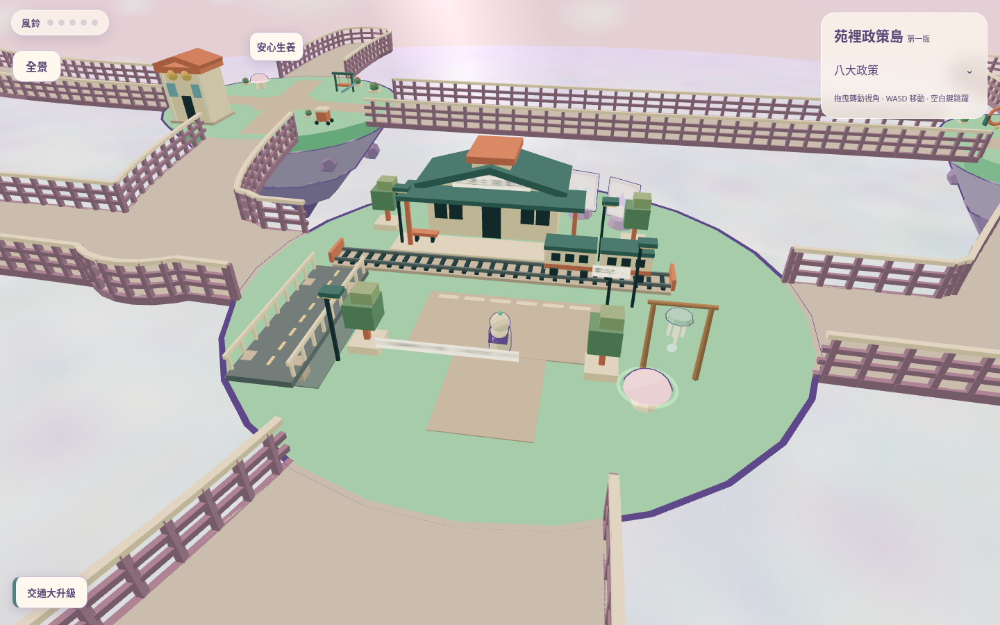

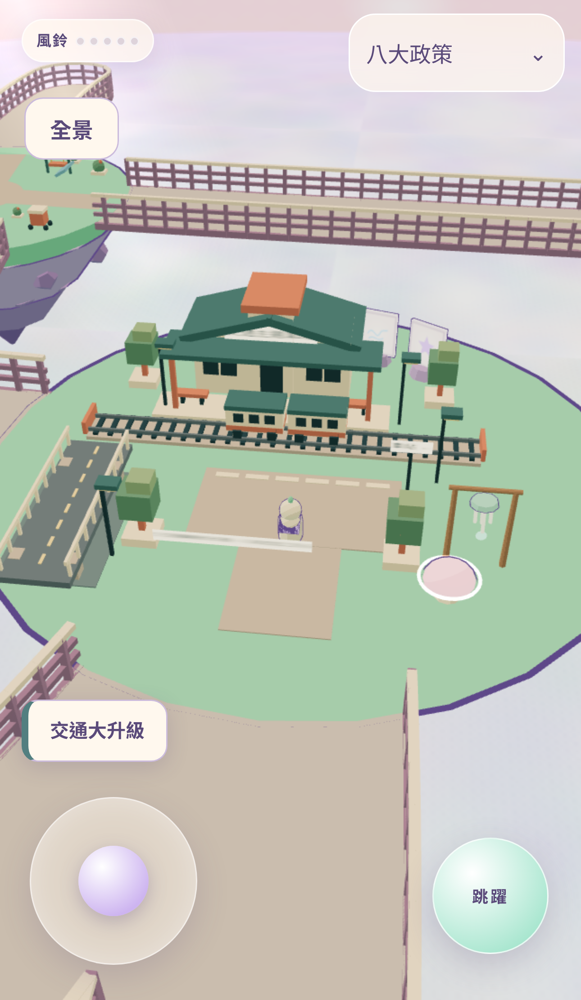

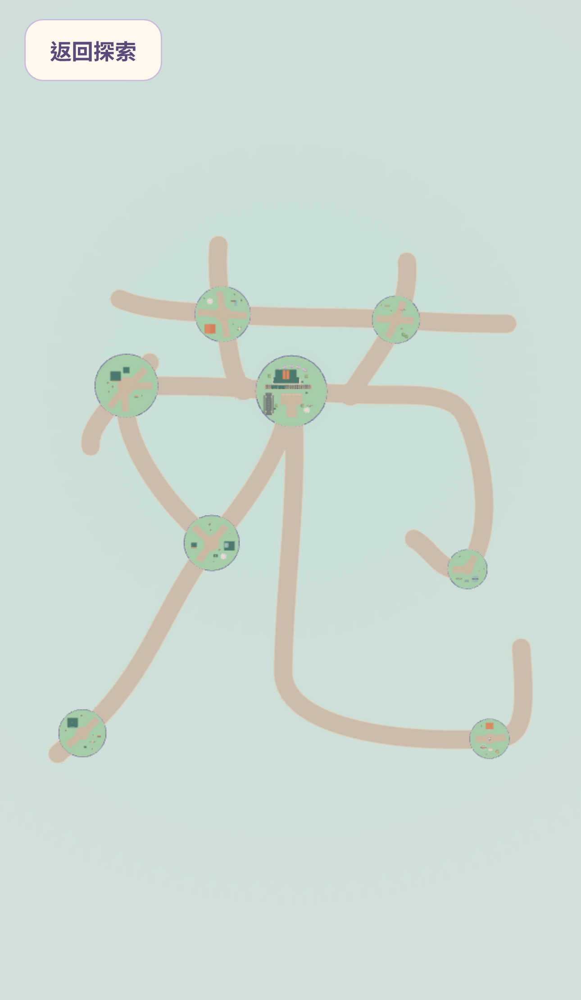

## 八島逐島預覽

### 交通大升級

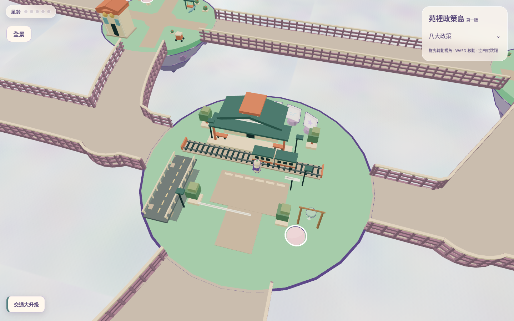

### 安心生養

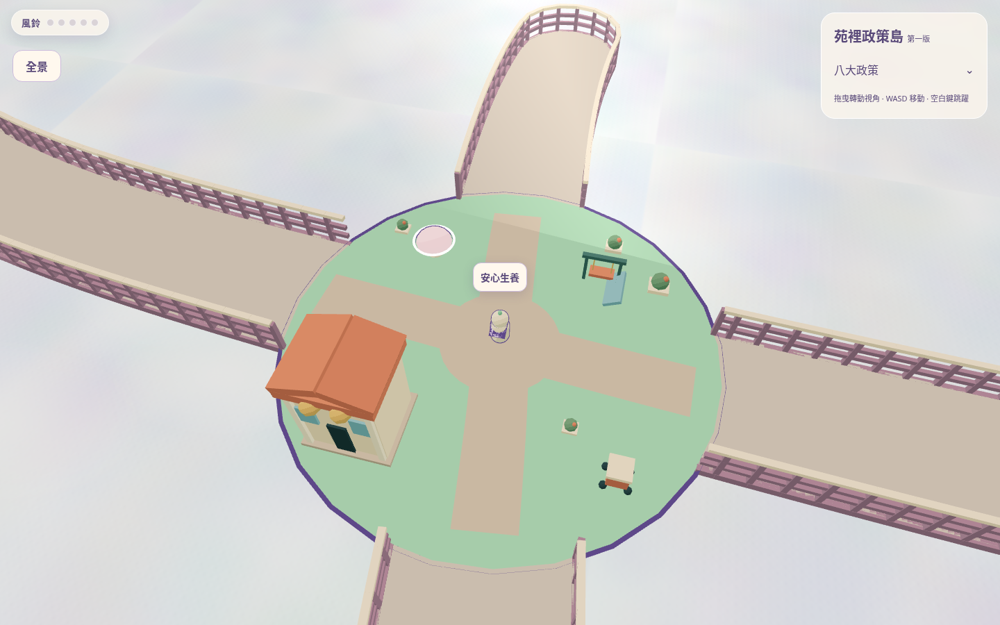

### 幸福養老

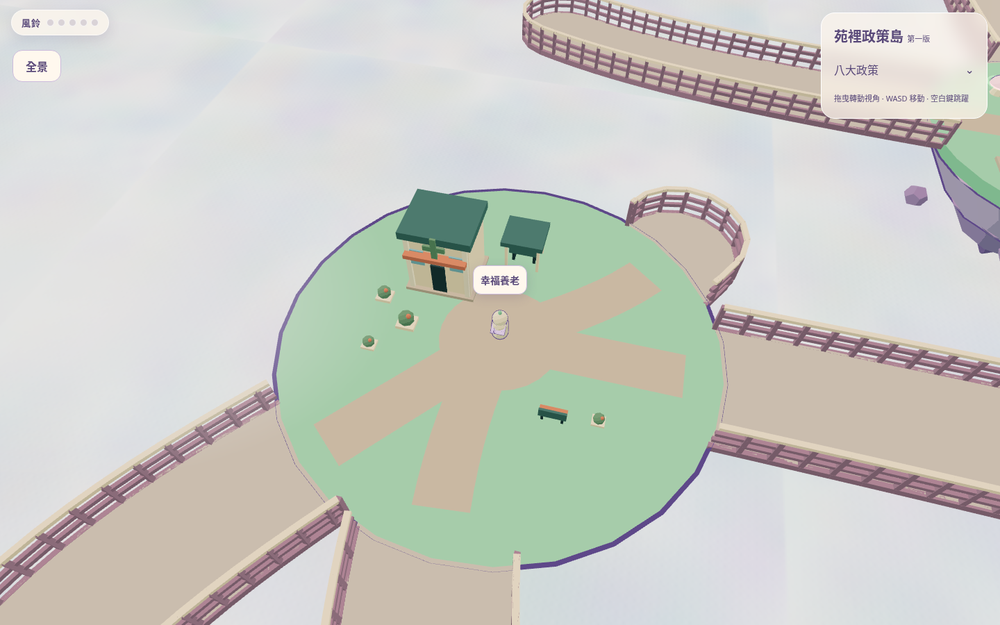

### 產業青年

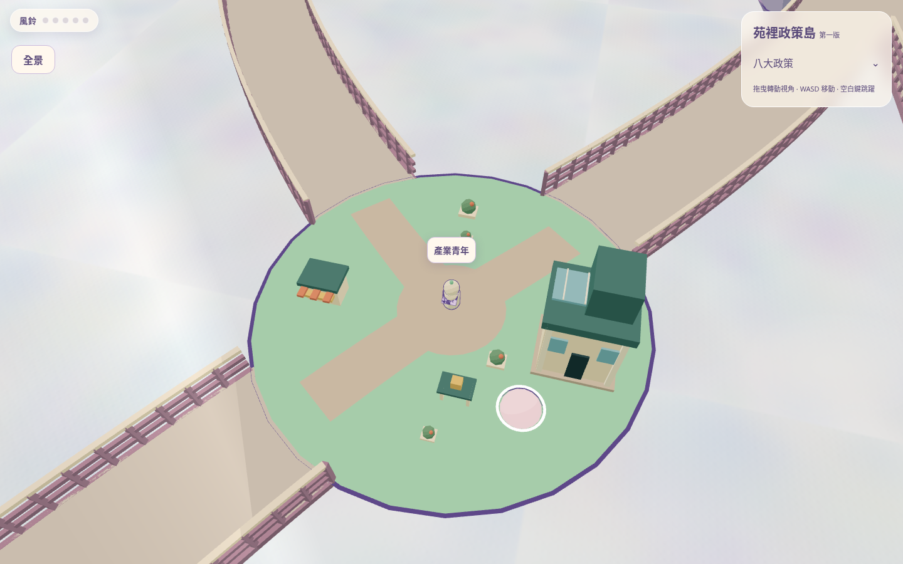

### 宜居環境

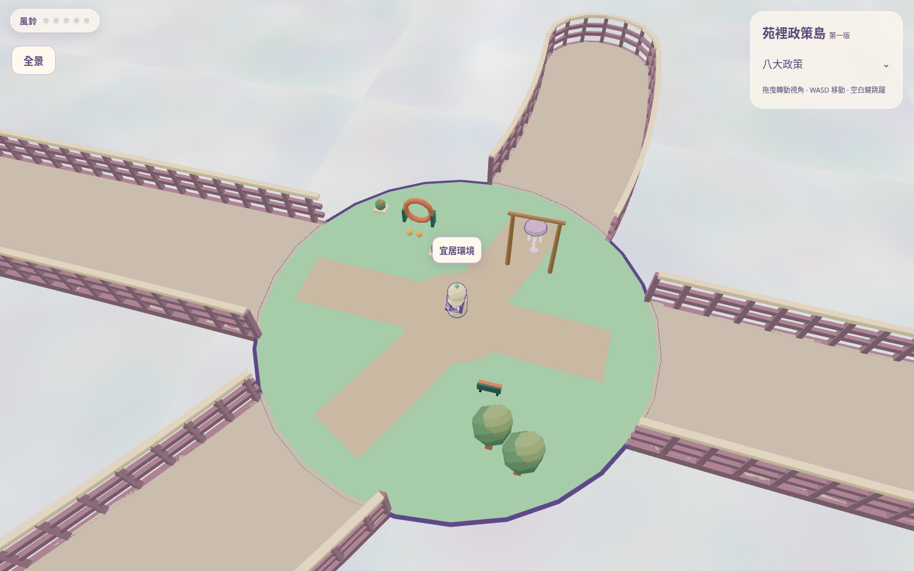

### 智慧公所

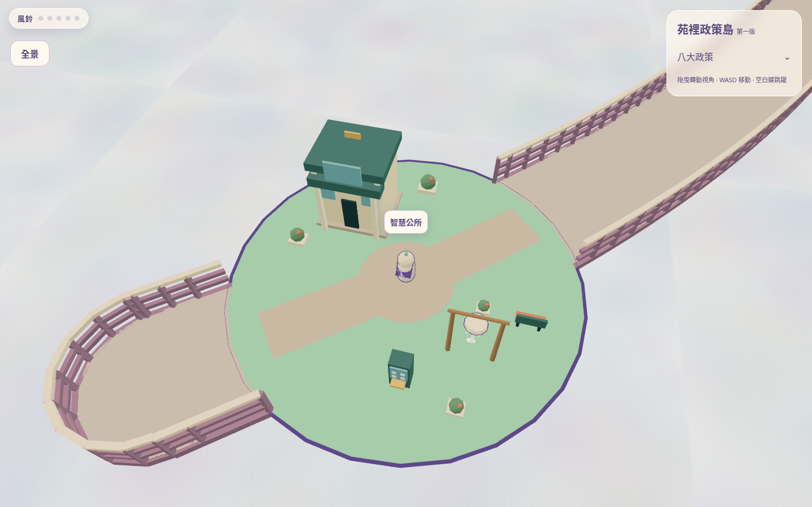

### 治水防災

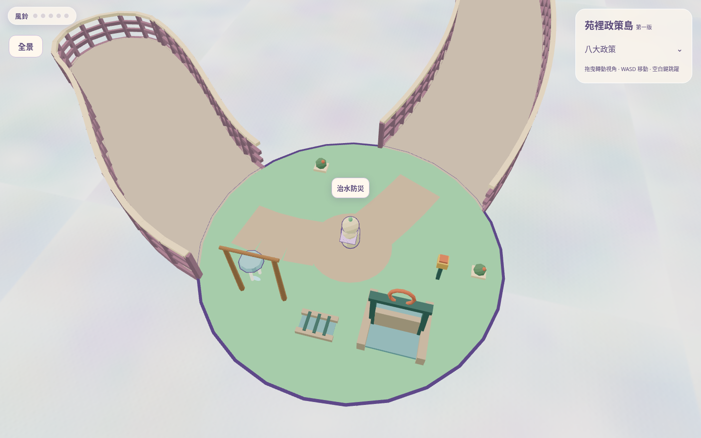

### 教育發展

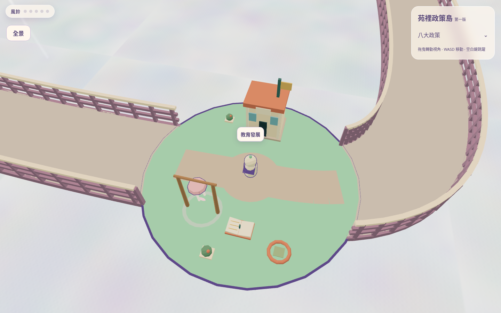

全部 PNG 是 Playwright 從本機運行的 Three.js 場景擷取，沒有以概念圖或貼圖代替實體模型。

## 配置、碰撞與效能

- `policy-scenery.js` 集中管理七島主題與共用建築／遊具／庭園幾何。交通島仍使用原 `transport.js`。
- 依現有 Bezier 採樣路線保留通行空間：橋梁與入口維持 4.8 寬，島內草地通廊保留至少 2.2 寬並逐步向入口展寬。新增石色鋪面只是島內視覺引導，沒有改動步道生成物。
- 設施選址保留人物半徑餘裕，避開既有風鈴及蘑菇；主建物不放在島中央或橋口。半徑與地形沒有拓展。
- 建物與小景觀加入保守水平阻擋；可見幾何加入接地射線，避免跳進建築後穿地。這是基本外部碰撞，不是室內通行、完整建築物理或屋頂攀爬系統。
- 水道為靜態低模意象，數位機台與校舍為場景設施，沒有新增服務流程或建築內部互動。
- 每島依顏色合併幾何，最多 10 個材質批次；不新增貼圖、外部素材、燈光、依賴套件或每幀造景動畫。現有列車、雲海與角色動畫保留。
- 先排除不可能影響島內選址的遠端路段；優化前後配置與淨距已比對完全一致。同一配置的安全選址結果在記憶體快取，不在每幀重新計算。初次載入仍需計算配置；真機載入時間與 FPS 待人工驗收。

## 測試報告

- [正式 build](logs/build.log)：通過。
- [lint](logs/lint.log)：通過。
- [36 個單元案例](logs/unit.log)：通過，含 B 方案三個資料檔完全一致檢查、新主題幾何、材質批次、入口餘裕與水平阻擋。
- 既有路網測試已加入新造景的實體接地與水平碰撞：全部 22 段雙向、兩種 dt、76 種路口轉向、停止距離及跌落復位均通過。
- [完整桌面／手機 Playwright](logs/browser.log)：首輪兩個工作程序共 40 項：35 通過、4 項裝置不適用略過，1 項手機多尺寸案例觸及 240 秒總時限，原始紀錄保留。單工重跑該案例已通過，見 focused-browser.log。
- 手機為 Chromium 模擬 iPhone 15 Pro Max，並非 iOS Safari 真機；單指全路線測試為同一 pointer 事件、真實 UI／Player 的固定 dt 加速整合，不是人手握手機走訪錄影。

- [單工場景／跨島／多尺寸回歸](logs/focused-browser.log)：7 通過、2 略過；其中新原生觸控點選建物案例找到政策視窗被同手勢相容 click 關閉的問題（原始失敗紀錄保留）。
- 修正為「手勢必須起始於背景才可關閉視窗」，不改版面或政策文字；[最後桌面／手機政策、造景與交通回歸](logs/policy-regression.log)：**8 通過、0 失敗**，包含真實 touchscreen 開啟新校舍政策、視窗保持開啟及下一次背景手勢關閉。
- 最終新增圓環視覺／建物點擊修正後，build、lint、全部 36 單元再次通過。跨島與多尺寸單工回歸已通過；未宣稱首輪 40 項一次全綠。
- 逐島圖在正常探索模式的目標相機位置穩定後擷取；未縮放模型或修改地形以配合截圖。

## 修改檔案

- `src/world/policy-scenery.js`：主題設施、共用幾何／配色、安全選址、材質合併、基本碰撞。
- `src/main.js`：組裝七島新造景並串接接地碰撞、護欄空間索引與 QA 狀態。
- `src/policies.js`：修復 canvas 觸控開啟視窗時，同手勢 click 被誤判為背景關閉。
- `src/world/chimes.js`：將近距離方塊亮光改為低模地面圓環，不改音效或風鈴進度。
- `src/world/islands.js`：保留原草地與岩體，移除與主題衝突的散置裝飾；隨機數消耗順序保留。
- `test/walkways.test.js`：將新造景碰撞納入既有真實控制器路網／路口測試。
- `test/policy-scenery.test.js`：主題、幾何、材質、選址及水平阻擋檢查。
- `test/scenery.e2e.js`：桌面／手機主題驗證、逐島擷取、探索與全景回復。
- 本目錄：13 張實際場景 PNG、圖片 manifest 與原始測試紀錄。

MIT、第三方授權、政策資料、人物外觀、人物速度、B 路網及交通島模型維持不變。

## 待人工驗收

1. 隱藏政策名稱後，八島是否具有足夠主題辨識度，尤其公所／青創／校舍的輪廓差異。
2. 新建築、遊具、植栽與島面比例，是否仍過於稀疏或局部擁擠；這是第一版造景，尚非最終精修。
3. 真機單手走訪各入口、轉角與設施側邊的舒適度，及手機 Safari／Android 的載入與幀率。
4. 全景是否仍能直覺讀作「苑」，新增設施是否分散字形辨識。
5. 場景的視覺碰撞餘裕、自由跳躍與屋頂附近的邊角行為。未宣稱完成最終防跌落／室內碰撞設計；島嶼懸崖仍可能跌落，會依既有安全點復位。

不合併 PR、不更新 main 或 Production；新分支推送可能依現有 Cloudflare 設定自動建立公開 Preview，沒有執行正式部署指令。完成後停止，等待人工操作驗收。
