# G 治水防災島：可玩 Blender 原型

獨立 Draft 供人工驗收；不宣稱美術/真機效能已獲通過。圖像均來自真實模型或遊戲。

[完整報告、測試與未驗證項目](REPORT.md) · [效能數據](performance.json) · [幾何與保護項目](geometry-audit.json) · [修改清單](CHANGES.md) · [SHA256](MANIFEST.json)

## 真正遊戲：G 島 QA 全島視角

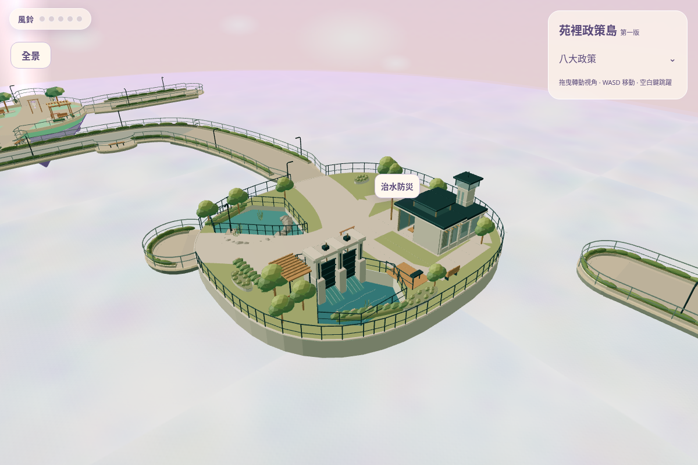
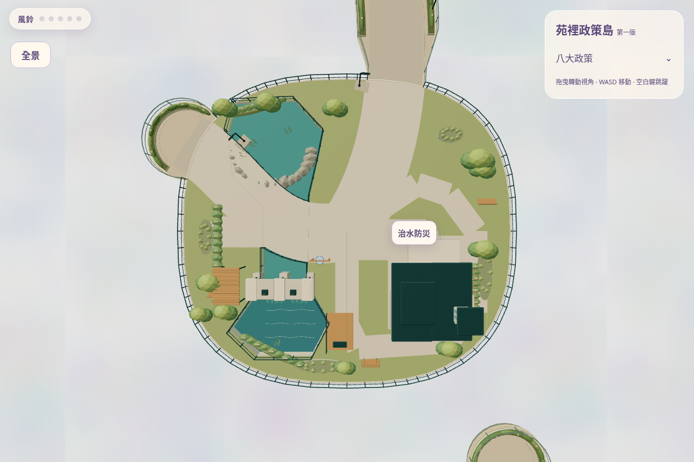

## 真正玩家鏡頭（只移動站位，保留原生 profile）

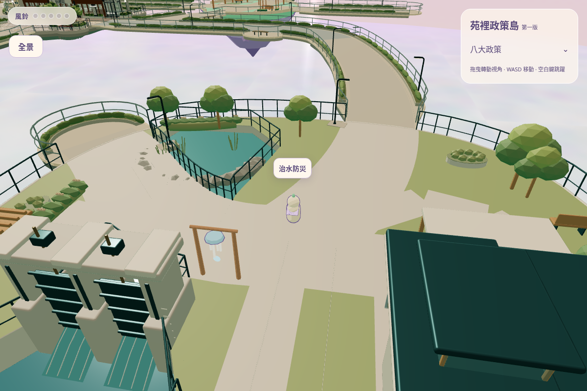
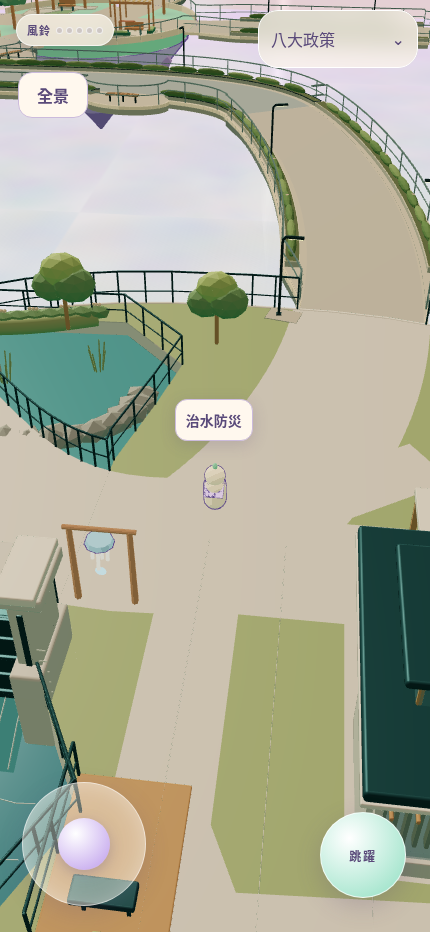

[S21 玩家視角](game/s21-player.png) · [S22 玩家視角](game/s22-player.png) · [指揮中心前廊玩家](game/command-porch-player.png) · [手機橫式](game/mobile-landscape.png) · [QA 入口](game/g-entrance.png) · [QA 水閘近景](game/sluice-detail.png)

## 真正遊戲：完整苑字全景

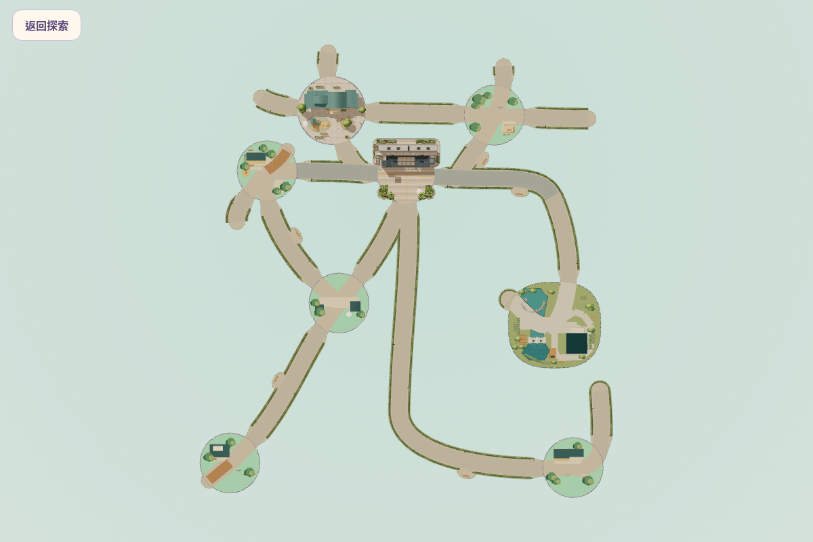
[手機全景](game/mobile-panorama.png)

## Blender 同一場景六張渲染（不是遊戲畫面）

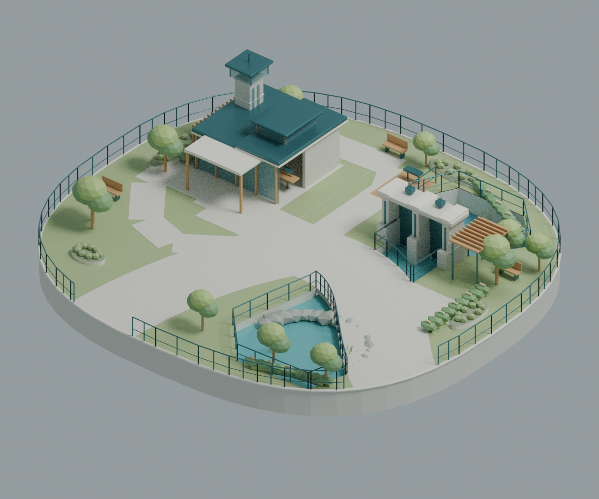

| 正面 | 背面 |
|---|---|
| 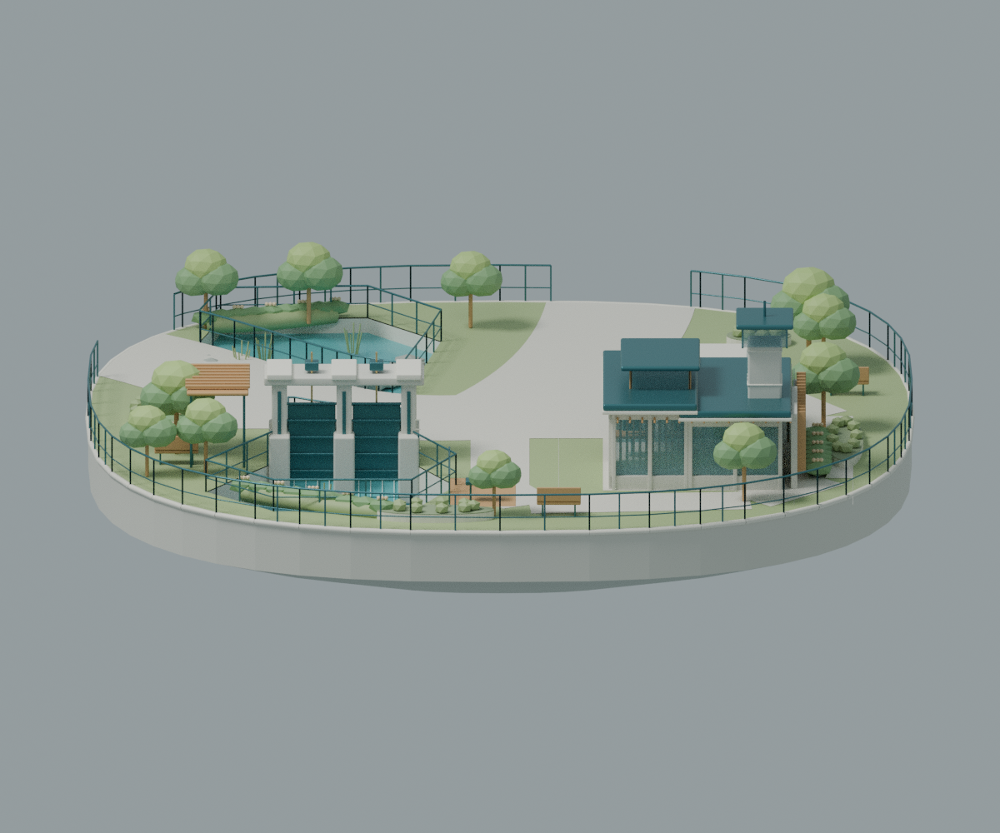 | 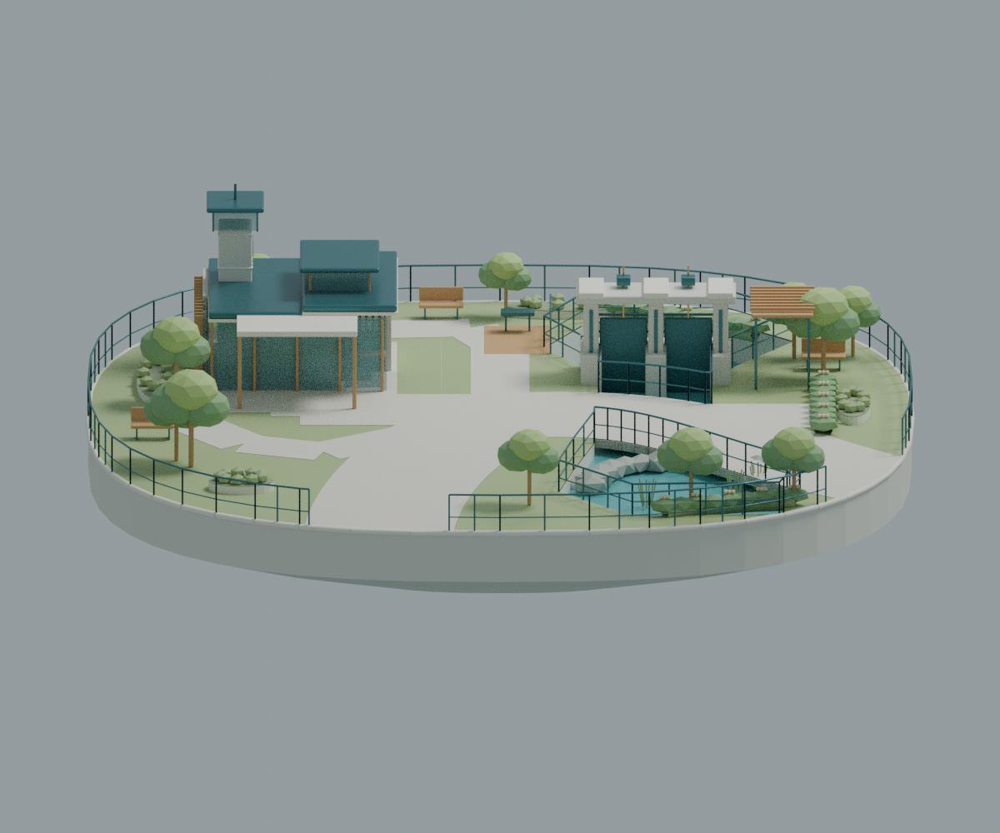 |

| 左側 | 右側 |
|---|---|
| 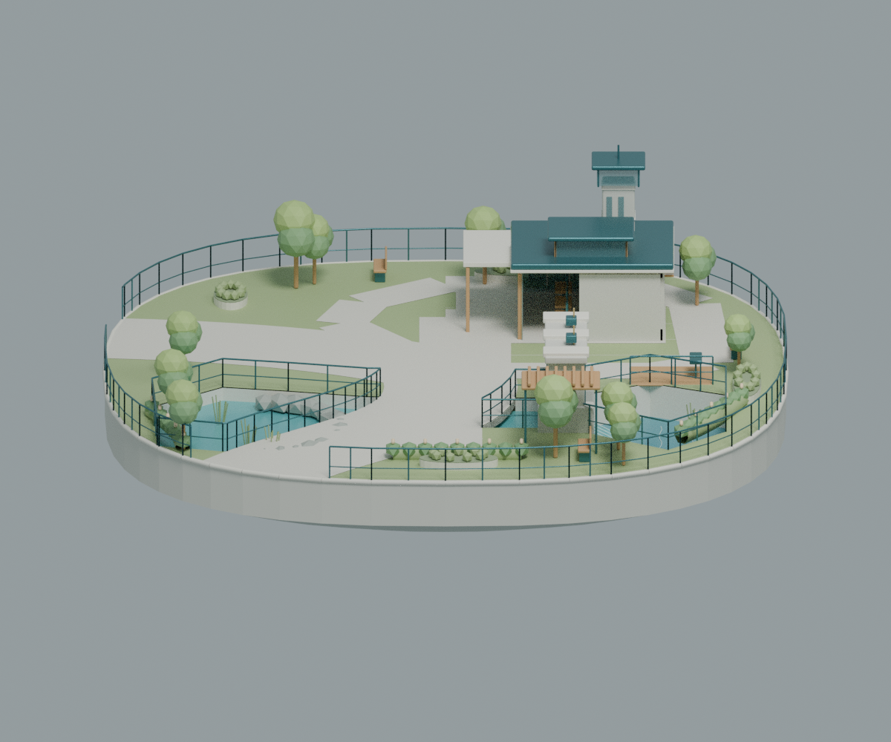 | 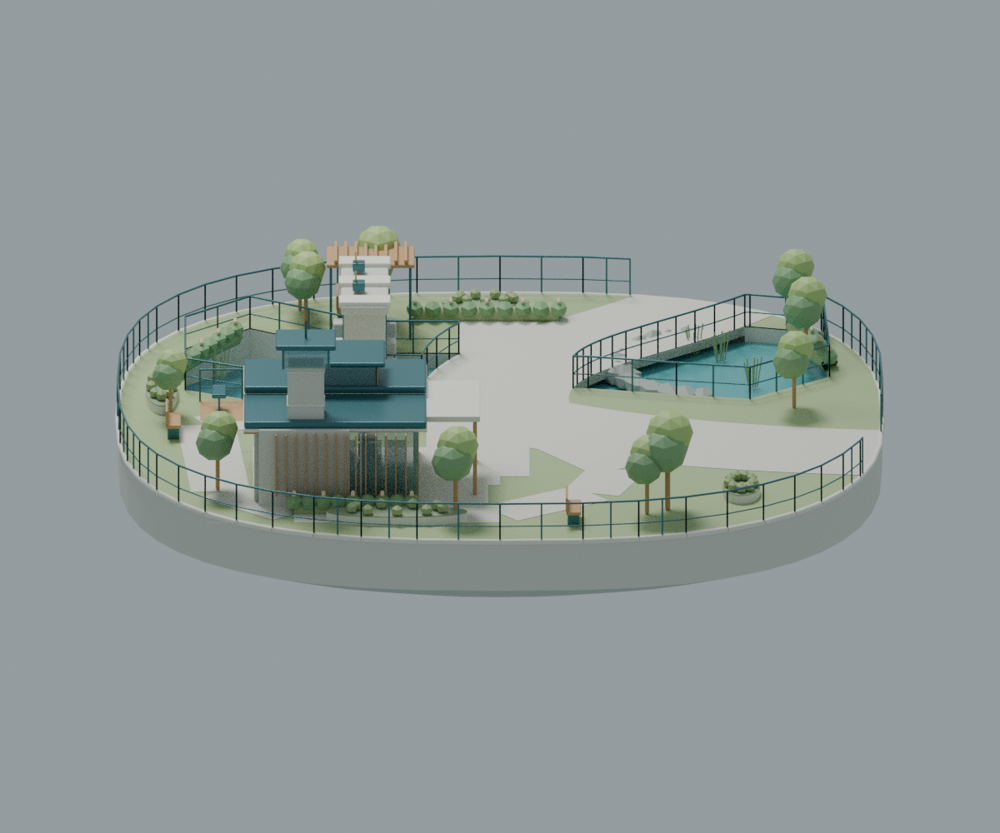 |

[Blender 俯視](blender/top.png) · [同源 SHA/相機紀錄](blender/render-record.json)

[可編輯 Blender 工程](../../design/flood-control-island-g-v1/flood-control-g.blend) · [Three.js GLB](../../../public/models/flood-control-g/flood-control-g.glb) · [模型報告](../../design/flood-control-island-g-v1/model-report.json)

## 相同遊戲 QA 機位，施工前後

| PR15 舊 G（半徑 9） | 本版 G |
|---|---|
| 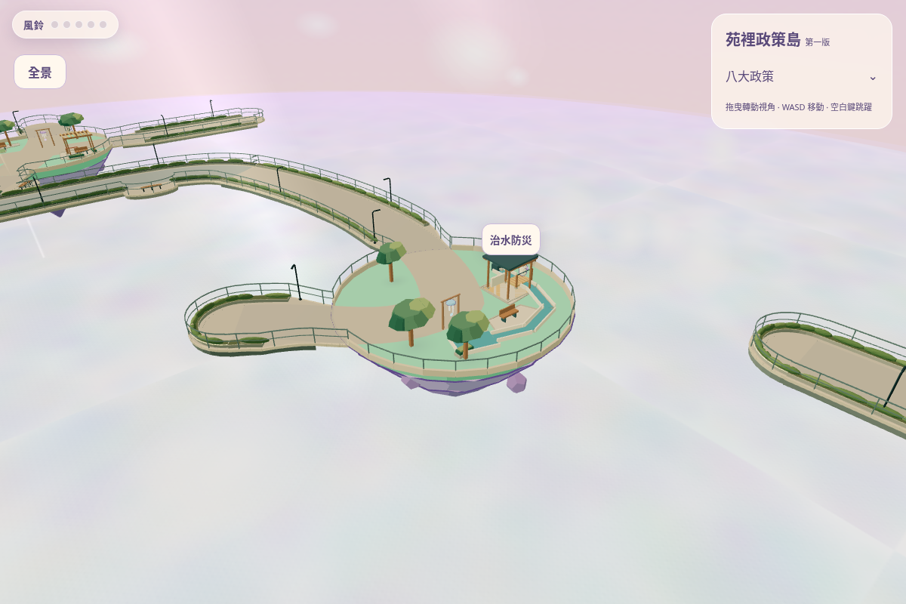 |  |

[之前全景](before/yuan-panorama.png) · [之後全景](game/yuan-panorama.png)

before/ 是指定基底的實際遊戲，checkpoint-a/ 是早期結構診斷圖；兩者都沒有混充最終成品。game/ 的 12 張圖才是最後新版 GLB 遊戲畫面，鏡頭種類/站位/數據見 capture-record.json。沒有 AI 生成圖。
