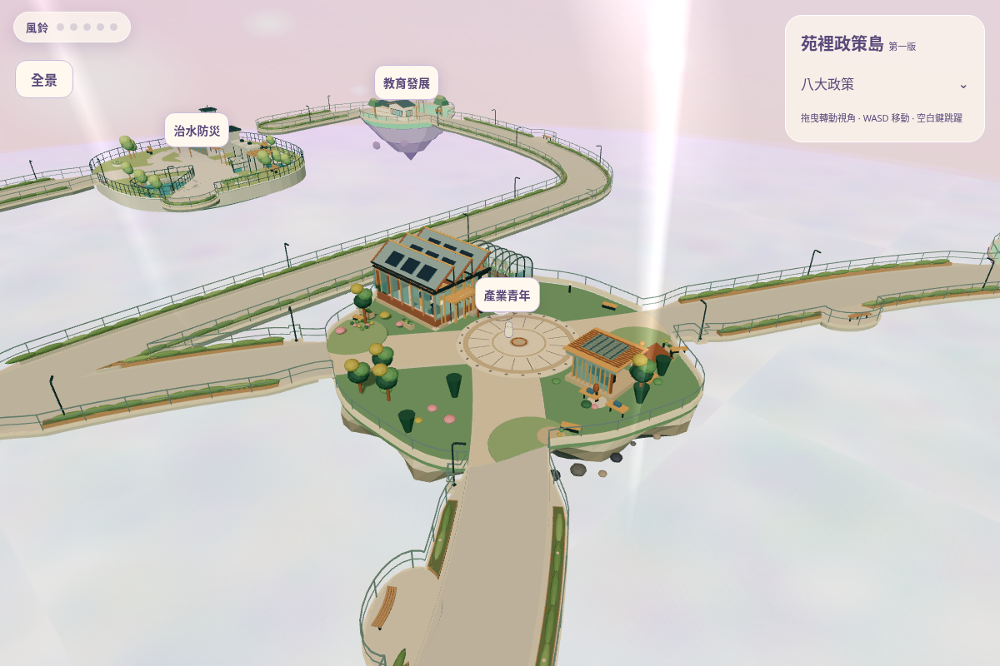
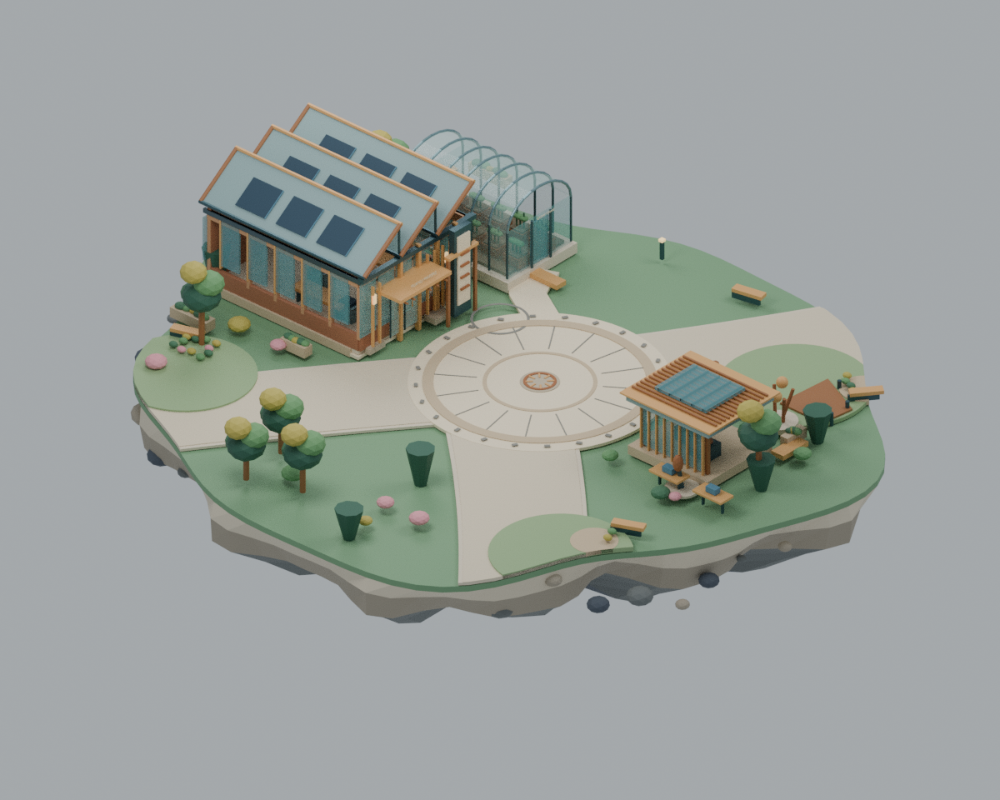

# C 產業青年島 V2.2｜審查入口

維持 Draft，等待人工美術／遊玩驗收。工程結果與限制見 [REPORT.md](REPORT.md)，不以案例數宣稱美術通過。

## 實際遊戲



| 全島 QA | 原生玩家鏡頭（站位以 QA 傳送到達） |
| --- | --- |
| [俯視](game/c-top.png)／[入口QA](game/c-entrance.png) | [桌機廣場](game/desktop-native.png)／[手機廣場](game/mobile-native.png) |
| [S14 玩家鏡頭](game/s14-player.png)／[S15](game/s15-player.png)／[S16](game/s16-player.png) | [手機門廊](game/mobile-porch-native.png)／[手機橫式](game/mobile-porch-landscape.png) |
| [完整苑字](game/yuan-panorama.png) | [手機全景](game/mobile-panorama.png) |

手機門廊圖使用原生鏡頭參數及正式 C 避障，沒有另拉遠相機。廣場直式圖如實保留建築裁切，整個園區請旋轉或使用全景。捕捉紀錄在 game/ 的兩份 JSON；QA framebuffer 設定只供穩定截圖。

## Blender 同源模型



[六視圖拼版](blender/six-views.png)：[正面](blender/front.png)／[背面](blender/back.png)／[左](blender/left.png)／[右](blender/right.png)／[俯視](blender/top.png)／[45度](blender/hero.png)。另有 [工坊細節](blender/workshop-detail.png)、[溫室細節](blender/greenhouse-detail.png) 與 [原設計對照](reference-comparison.png)。全部為同一份最終 Blender 工程的實際渲染。

- [可編輯 .blend](../../design/industry-youth-island-c-v2.2/industry-youth-c.blend)
- [遊戲 GLB](../../../public/models/industry-youth-c/industry-youth-c.glb)
- [模型數據](../../design/industry-youth-island-c-v2.2/model-report.json)
- [幾何／保護檢查](geometry-audit.json)、[瀏覽器結果與初測失敗歷史](browser-summary.json)、[效能](performance.json)
- [檔案清單](FILE-LIST.md)、[SHA256／圖片尺寸](MANIFEST.json)、上傳後的 GITHUB-VERIFIED.json

## 重現與本機預覽

使用含 numpy/trimesh/shapely/Pillow 的 Python 執行 prepare_c.py --refine，再 generate:yuan。Blender 4.3 執行 scripts/blender/build_industry_c.py -- --render 可重建可編輯工程、GLB 與八視圖。原始 V2.2 工程來源完整保留；不需要讀取先前七島模型。

```sh
npm ci
python scripts/industry/prepare_c.py --refine
npm run generate:yuan -- --report-dir docs/previews/industry-youth-island-c-v1
blender -b -t 4 --python scripts/blender/build_industry_c.py -- --render
npm run check
npm run dev -- --port 4224
```

此工作階段另有最終正式建置預覽在 4224 連接埠（工作區環境內，非公開 URL）。可在 Codex 的連接埠／Preview 面板開啟；環境停止後以以上 dev 指令重啟。沒有修改 Cloudflare 設定或 Production。
