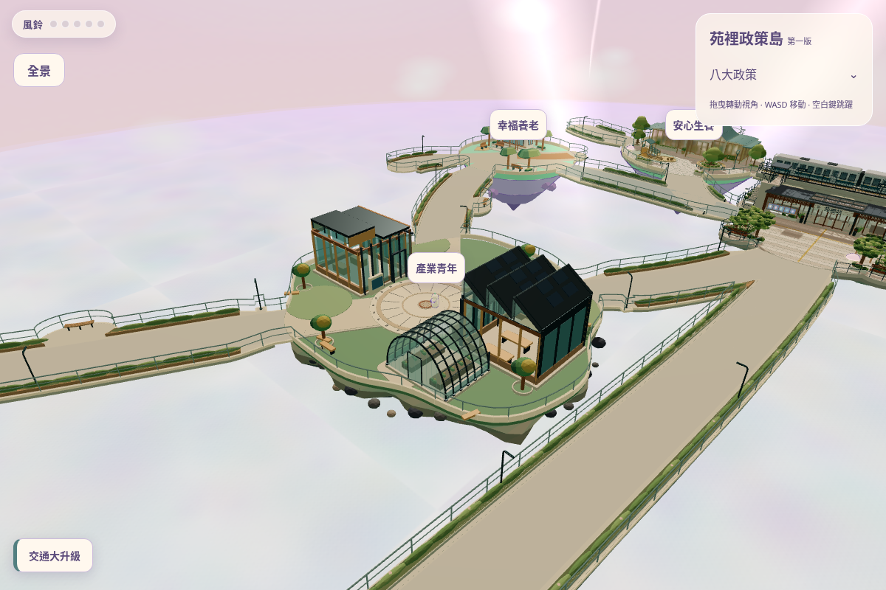
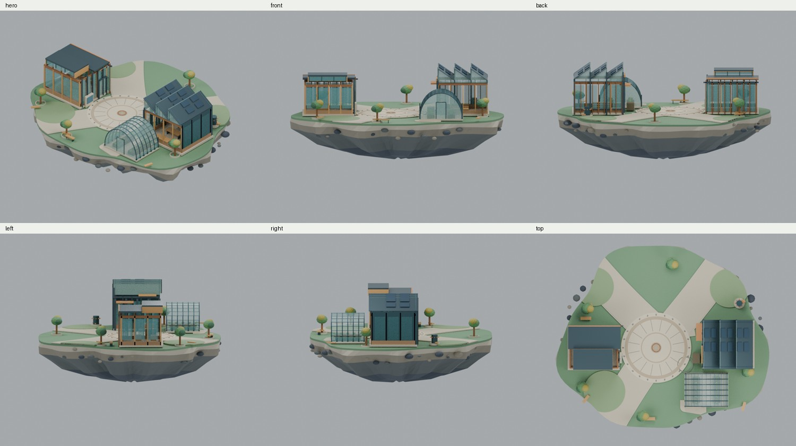

# C 產業青年雙引擎 V3｜審查入口

延續 Draft PR #17；兩棟主建築、弧形溫室已接回原遊戲 C 島。工程結果與人工驗收限制見 [REPORT.md](REPORT.md)，各項測試狀態以 [validation-summary.json](validation-summary.json) 及 [browser-summary.json](browser-summary.json) 為準。

## 真正遊戲畫面

| 類型 | 查看 |
|---|---|
| QA 全島／全景 | [C俯視](game/c-top.png) · [完整苑字](game/yuan-panorama.png) · [手機全景](game/mobile-panorama.png) |
| 原生玩家鏡頭 | [桌機廣場](game/desktop-native.png) · [手機直式](game/mobile-native.png) · [橫式](game/mobile-landscape.png) |
| 三橋口原生鏡頭 | [S14](game/s14-player.png) · [S15](game/s15-player.png) · [S16](game/s16-player.png) |
| 公共門前／預留區 | [青年中心](game/youth-player.png) · [溫室](game/greenhouse-player.png) · [NPC停留點](game/npc-player.png) |
| 手機工坊門廊 | [直式](game/mobile-porch-native.png) · [橫式](game/mobile-porch-landscape.png) |

原生參數不等於人工走到該處：截圖站位由 QA 傳送到達，保留正式相機／避障。跨島實走資料另見 routes-desktop.json、routes-mobile.json。

## 同源 Blender

[45°](blender/hero.png) · [正](blender/front.png) · [背](blender/back.png) · [左](blender/left.png) · [右](blender/right.png) · [俯視](blender/top.png)

細節：[工坊](blender/workshop-detail.png) · [溫室](blender/greenhouse-detail.png) · [青年中心](blender/youth-detail.png)

## 精修前後（同機位、同尺寸）

[Blender主視圖](comparisons/blender-hero.jpg) · [俯視](comparisons/blender-top.jpg) · [桌機原生](comparisons/game-desktop-native.jpg) · [手機直式](comparisons/game-mobile-native.jpg) · [手機橫式](comparisons/game-mobile-landscape.jpg)

前版使用 PR17 `0c7cab7` 的原始 .blend 唯讀渲染與實際舊遊戲建置，沒有拿概念圖當作施工前截圖。第一輪輸出與自我挑刺另存 [iteration-1/](iteration-1/)，不混入最終成果。

## 資產與證據

- [可編輯 .blend](../../design/industry-youth-island-c-v3/industry-youth-c-v3.blend) · [實際遊戲 GLB](../../../public/models/industry-youth-c/industry-youth-c.glb)
- [原參考施工包](../../design/industry-youth-island-c-v3/source-package/) · [模型數據](../../design/industry-youth-island-c-v3/model-report.json)
- [最終量體稽核](../../design/industry-youth-island-c-v3/placed-geometry-audit.json) · [17檔保護及原地形頂點證明](../../design/industry-youth-island-c-v3/locked-runtime-baseline.json)
- [測試結果](browser-summary.json) · [效能與前後比較](performance.json) · [修改清單](FILE-LIST.md) · [SHA256／尺寸](MANIFEST.json) · [GitHub下載核對](GITHUB-VERIFIED.json)

真機效能、連續相機手感、主觀美術與長時間遊玩仍待人工驗收；不宣稱已通過。未建立 NPC、未改其他政策島、未合併或正式部署。
