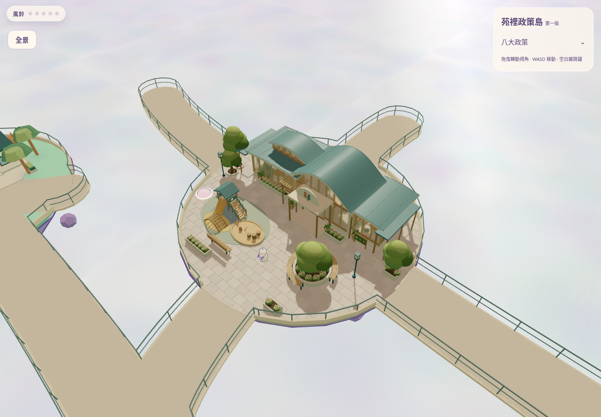
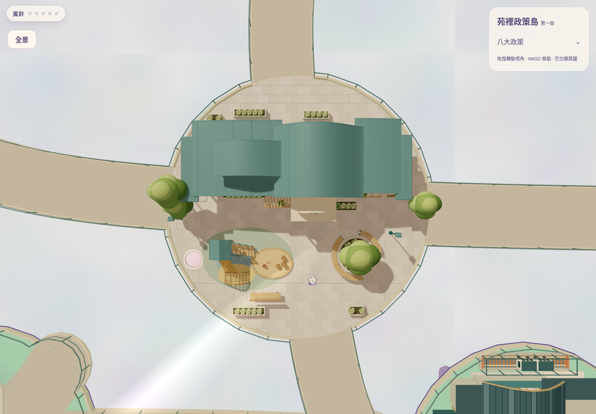
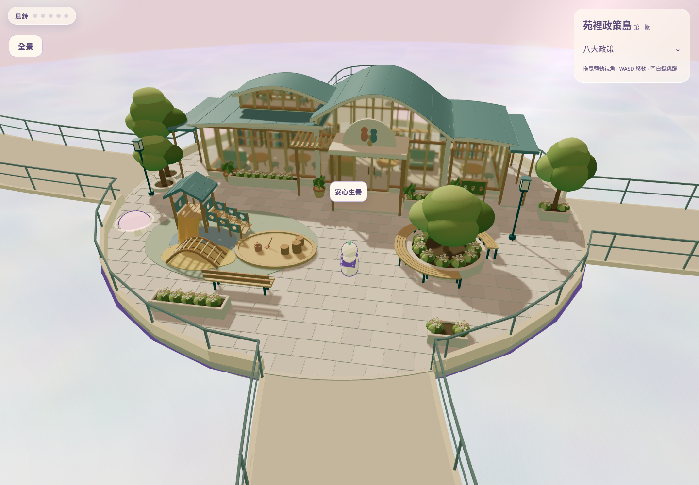
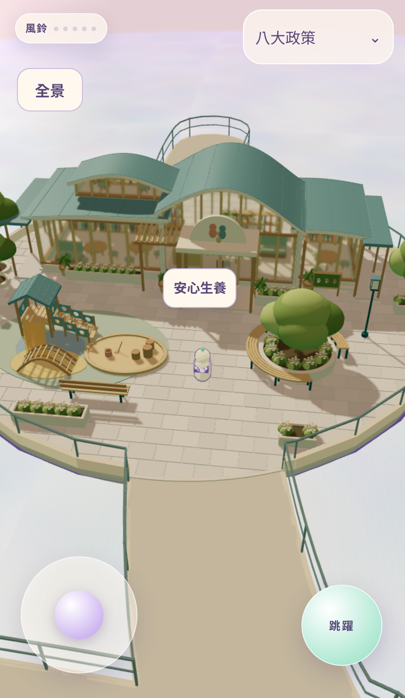
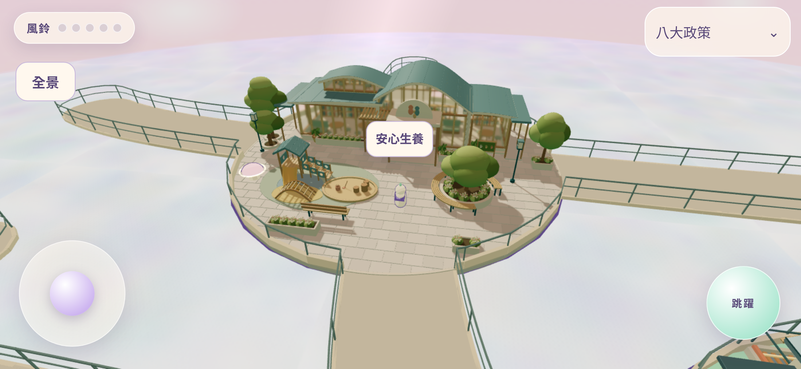
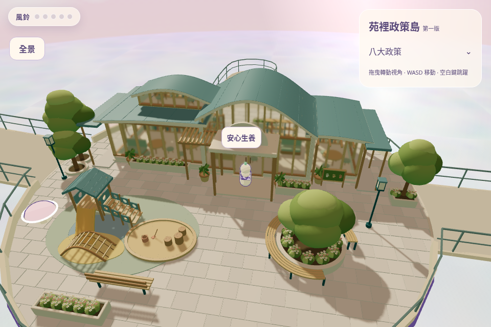
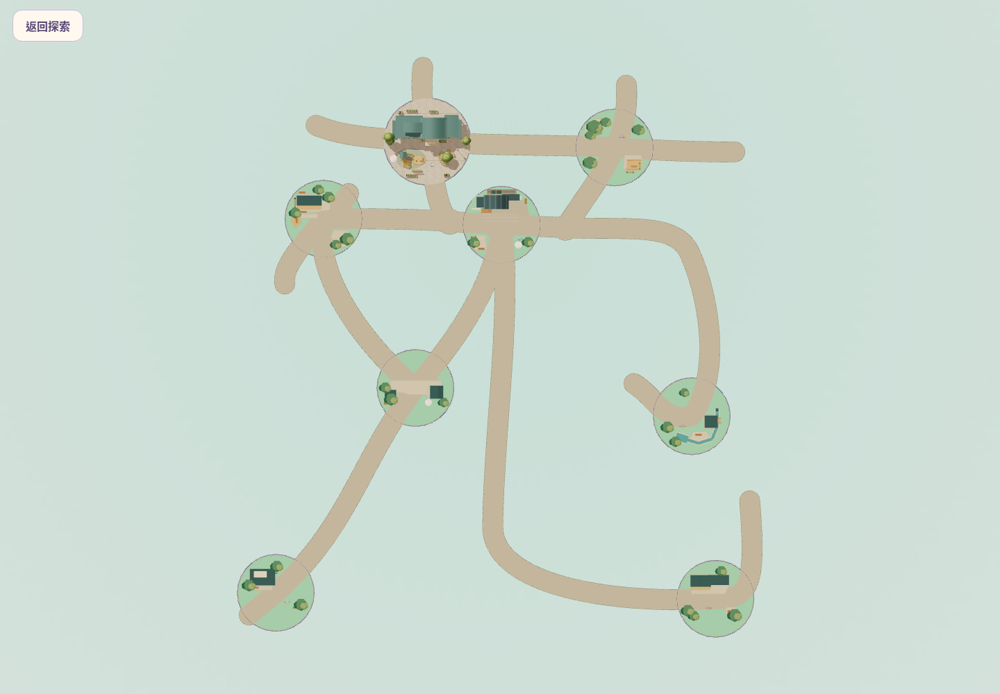

# 安心生養島｜核准 Blender GLB 遊戲整合

這是原 Sky Isles 的實際 Three.js 場景，使用 PR #11 已核准第二階段 GLB；沒有重新建模。只整合安心生養島，保留其他七島、原苑字橋網與 NPC 預留區。

[開啟可操作 Preview](https://34a8b999.sky-isles.pages.dev) · [整合 PR #12](https://github.com/qaz741612/sky-isles/pull/12)

[整合配置／碰撞規則](INTEGRATION.md) · [測試與未通過項目](TEST-REPORT.md) · [效能實測](PERFORMANCE.md) · [修改清單](MODIFIED-FILES.md) · [媒體雜湊](media-manifest.json) · [重現方法](REPRODUCE.md)

## 如何走到親子館

開啟 Preview 後按「開始探索」。可先按「全景」確認安心生養島位在交通島左上方，再「返回探索」；從交通島西側橋走到第一個交會平台，沿通往親子館的北向步道進入南入口。全程不需要跳躍。桌面用 WASD／拖曳旋轉，手機用左下搖桿；點島名可開政策視窗。這個 Preview 保留正常交通島出生點，沒有新增快速傳送 UI。

## 遊戲內 45° 與俯視

以下使用最終遊戲內模型及燈光，僅調整 QA 相機；不是 Blender 渲染或 AI 圖。政策 HTML 標籤暫時隱藏以檢視建築，模型完整保留。

## 原本玩家跟隨相機

下圖保留原本 orbit、zoom 與玩家跟隨；拍照前工程定位到前庭，未為截圖重設鏡頭角度。手機為 Chromium 觸控裝置模擬，並非真實手機硬體。

## 真實步行錄影

[開啟／下載原生按鍵操作 MP4](native-operation.mp4) · [操作與時間紀錄](operation-log.json) · [影片時序核對](video-validation.json)

錄影前定位在 S05 南入口，錄影中只使用原生 WASD／滑鼠，沒有傳送、改位置、加速或工程時間步進。影片每 15 個瀏覽器 compositor 合成影格擷取一張，依原始時間戳編碼，不補幀、不加速；無音軌。合成影格可能包含重複的 3D 畫面，影片容器 FPS 不代表遊戲 FPS。軟體 GPU 環境造成的低幀率及步行速度感會保留，不能以此代表真機手感。

## 完整苑字

核准的原始 `.blend`、GLB 仍在 [來源設計目錄](../../design/parent-child-blender-refinement-v2/README.md)。尺寸／比例、四入口對齊、較窄的半戶外廊道、閉合玻璃門、NPC N/A 與效能限制，請一併閱讀報告後進行人工驗收。
