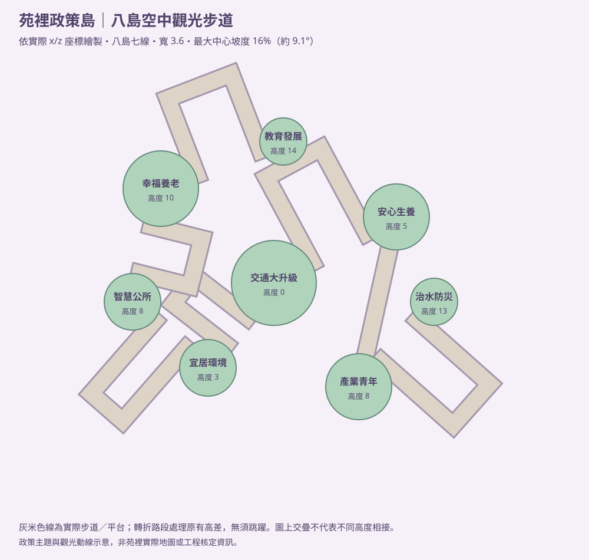
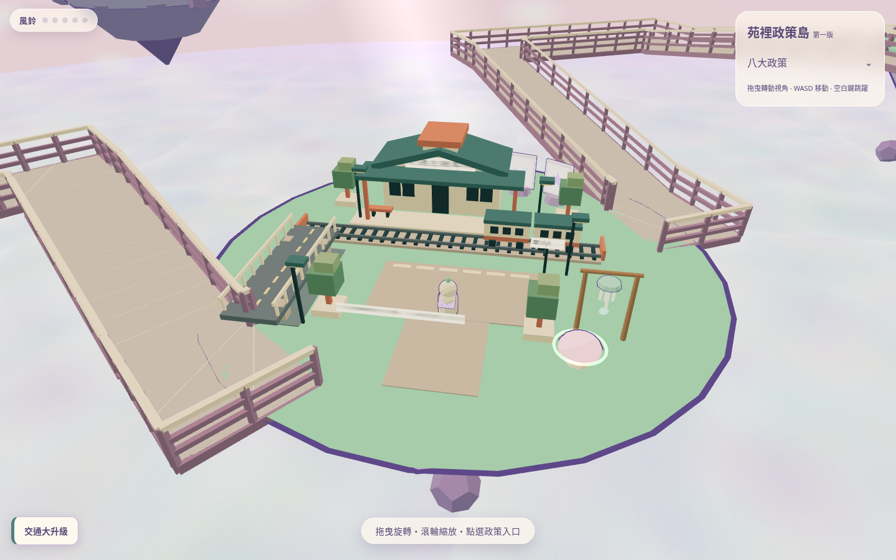
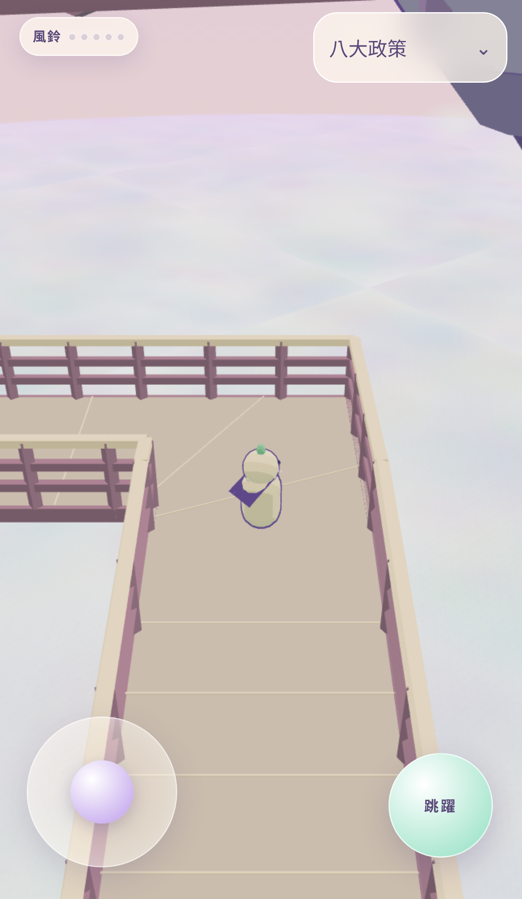
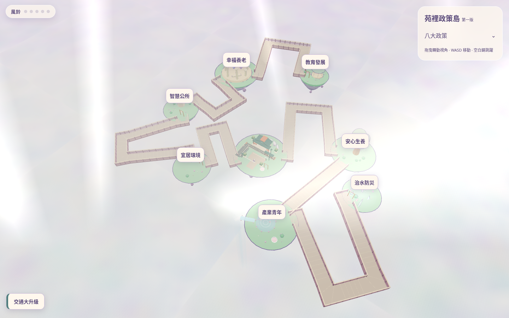

# 第四階段：空中觀光步道與單手操作

## 分支與部署

基於 GitHub／本機一致的完成版本 `8adc89ed23d1f74151ca70bab2b3bd730c6e54a5`，建立獨立分支 `codex/skywalk-one-hand-prototype`。本輪成果先保留在本機新分支，尚未推送任何遠端分支，以避免觸發自動預覽部署。本輪不更新 Cloudflare 公開部署分支 `codex/yuanli-policy-islands-v1`，不合併、不發布；未修改 PR #1 的來源分支。

## 八島連通

| 步道 | 起點高度 → 終點高度 | 路線 |
|---|---|---|
| 交通大升級 → 宜居環境 | 0 → 3 | 水平入口、轉折緩坡／平台 |
| 宜居環境 → 智慧公所 | 3 → 8 | 水平入口、轉折緩坡／平台 |
| 智慧公所 → 幸福養老 | 8 → 10 | 水平入口、轉折緩坡／平台 |
| 幸福養老 → 教育發展 | 10 → 14 | 水平入口、轉折緩坡／平台 |
| 交通大升級 → 安心生養 | 0 → 5 | 水平入口、轉折緩坡／平台 |
| 安心生養 → 產業青年 | 5 → 8 | 水平入口、直線緩坡 |
| 產業青年 → 治水防災 | 8 → 13 | 水平入口、轉折緩坡／平台 |

保留八島原位置、高度與外觀，七條步道形成同一棵可步行網絡。示意圖直接由實際路線座標產生，不是苑裡實際地圖。

[完整路線座標、長度、寬度及高度 JSON](skywalk-routes.json)

## 碰撞與控制

- 步道寬 3.6 世界單位，兩側護欄高 1.3；人物水平碰撞半徑 0.33，護欄厚度 0.16。碰撞邊界與可見護欄由同一份資料建立。
- 路面使用共享頂點、連續三角網格，不以有縫的獨立木板作碰撞。石色路面／木質柔紫護欄保留 Low-poly 配色；靜態幾何合併，沒有晃動路面。
- 所有轉彎與出入口都保留水平路段，升降只發生在直線段；每一片實際碰撞路面三角形都驗證坡度不超過 16%（約 9.1°），不只驗證中心線。端點深入島嶼 1.8，避免銜接處落空。
- 水平移動分段掃掠，單步最長 0.1，以人物圓形半徑推開護欄並保留沿牆滑動；轉角兩側護欄連續相接，不留可穿越的接頭。
- 保留相機平滑位置追蹤與原有旋轉、縮放；移動本身不改相機 yaw。左下搖桿單指控制所有方向；放開、取消與失去指標捕捉時清零輸入，移動阻尼使速度自然降至零。
- 檢查點只在真正站上安全地面時更新：島內距邊緣有餘裕，或步道離護欄超過 0.7。空中／任意傳送不覆寫檢查點，跌落後回到最近一次驗證安全的地面位置。
- 蘑菇不再因走上去而自動彈跳，必須主動按住跳躍；產業青年島的一顆蘑菇移離新入口。正常八島行程完全不依賴跳躍、蘑菇或解謎。

## 程式變更

- `src/sim/walkways.js`：七線規劃、緩坡與水平平台、共享邊界、護欄水平掃掠碰撞與安全點條件。
- `src/world/bridges.js`：以連續觀光步道取代原繩橋，接回真實地面碰撞；保留原來下游雲與道具亂數序列。
- `src/sim/player.js`：套用護欄阻擋、安全檢查點與主動彈跳；人物外觀與相機追蹤架構不變。
- `src/sim/movement.js`、`src/ui.js`：放開後的停止阻尼與搖桿取消／指標捕捉清理。
- `src/main.js`、`src/world/islands.js`、`index.html`：連接碰撞資料、移開入口蘑菇、調整簡短操作說明。交通場景模型、政策 JSON 及其他七島建築未改。
- `test/walkways.test.js`、`test/walkways.e2e.js`、`test/helpers/walk-tour.js`：連通、所有坡面、轉角與護欄、停止、無跳躍跨島、蘑菇及安全點測試。
- `test/app.e2e.js`：等待真正落地再驗證安全點回復，避免以空中傳送位置充當安全點。
- `scripts/skywalk-diagram.mjs`、`scripts/capture-skywalk.mjs`：自動生成路線圖／JSON與實際建置預覽。

## 預覽

[桌面初始畫面](skywalk-desktop.png) · [手機初始畫面](skywalk-mobile.png) · [手機步道轉角](skywalk-mobile-path.png) · [八島 3D 總覽](skywalk-overview.png)

八島總覽使用**僅截圖用的遠距鏡頭**，不是玩家預設鏡頭；手機步道圖定位在實際平台以展示寬度與護欄。跨島可達性由下列測試證明，不以截圖定位當成步行證據。

重新產生：`node scripts/skywalk-diagram.mjs`、`npm run build`、`node scripts/capture-skywalk.mjs`。只啟動本機預覽，不部署。

## 實際測試範圍

- Node：用真正的 `Player` 與地面網格，在 1/60 秒與 0.05 秒步進下，從主島走遍八島並沿所有七條線反向返回；不跳躍，檢查未卡住、未掉落或踩上錯誤高度。
- Node：逐一檢查每片路面三角形坡度、端點覆蓋、雙側護欄與高速度掃掠；在每條步道的轉角及兩側持續推擠，驗證仍站在地面。
- 瀏覽器：載入完整真實場景，經由原 UI 與人物控制器走訪八島；桌面用鍵盤事件，手機用同一個搖桿指標。第一筆輸入由原生鍵盤／CDP 觸控建立，後續在同一個瀏覽器工作內派送 DOM UI 事件並做固定時間步進，避免遠端通訊與背景動畫重複移動。
- 長程瀏覽器測試走過西側路線並折返主島，再前往安心生養、產業青年與治水防災；過程不使用跨島傳送、不跳躍、無意外自動重生。手機行程相機 yaw 不變，不需要第二根手指旋轉鏡頭。
- 行程結束後**才**故意以測試介面放到虛空，確認回到遠端島嶼的安全點，而非主島。另在真實場景推擠護欄、踏上蘑菇不按跳躍，檢查不穿欄及不自動發射。
- 原生手機觸控另檢查單指放開／取消後輸入回零、速度停止、停止距離小於 0.5，相機不轉向。
- 既有桌面／手機政策視窗、角色移動、跳躍、鏡頭、選單與響應式回歸另完整執行。

## 仍需人工／實機評估

- 加速固定步進整合測試驗證 UI → 控制器 → 真實碰撞，不等同有人在實體手機連續步行數分鐘；拇指舒適度、轉角引導與相機視野仍需人工操作。
- 實體手機的 GPU、持續幀率、電量、瀏覽器安全區與不同螢幕尺寸需實機測量。總覽視角顯示全部島嶼的負荷高於一般近距離跟隨視角。
- 護欄阻擋正常行走與角色身體相交的移動；刻意跳到護欄上方仍可離開安全路線，之後由安全點回復。未新增島嶼外圍全包圍防護或車站側牆碰撞。
- 沒有新增另外七座島的建築、真實苑裡地圖或政策說明。原有 MIT 與第三方聲明保留。

## 驗證結果

- 正式建置：成功。既有與新增單元測試：6 組檔案通過；步道檔案內 7 個場景全部通過。
- 瀏覽器：36 個桌面／手機案例中，最終 32 個通過、4 個因桌面不適用觸控而略過。
- 完整回歸首次為 30 通過、4 略過；兩個護欄案例的側向距離斷言原取樣在允許走回島嶼的開放入口，修正至兩側封閉的長坡中點後，桌面／手機 2 項重測通過。此修正只改測試取樣，產品程式未改。
- [完整案例清單、兩次結果與原始來源 SHA-256](skywalk-validation.json)。摘要採每項案例最新結果，保留首次未通過的原始統計，沒有把中止或未執行的測試算成通過。
- 最終建置預覽：無 console error；favicon、JSON 與 LICENSE 均 HTTP 200。
- 桌面路線 11,496 次、手機路線 12,825 次固定步進；兩者八島全到、零意外重生。手機相機 yaw 維持不變，並另以原生觸控確認放開／取消後停止。

重跑完整測試：`npm test`、`npm run test:e2e -- --retries=0`。若要產生上述摘要，先以 JSON reporter 將完整結果寫到 `work/skywalk-browser-results.json`；既有摘要另保留當次護欄修正的聚焦重測結果。`scripts/summarize-skywalk-tests.mjs` 可接受一份或多份 JSON 結果，並要求最新結果沒有失敗。
