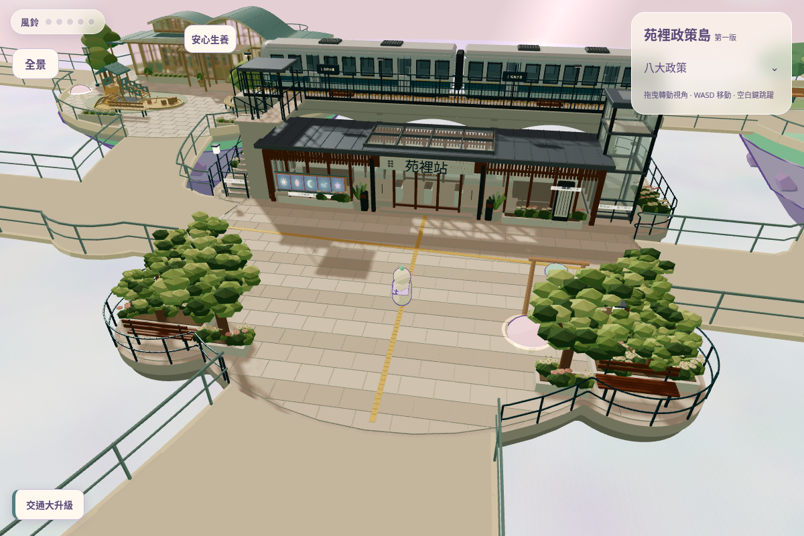
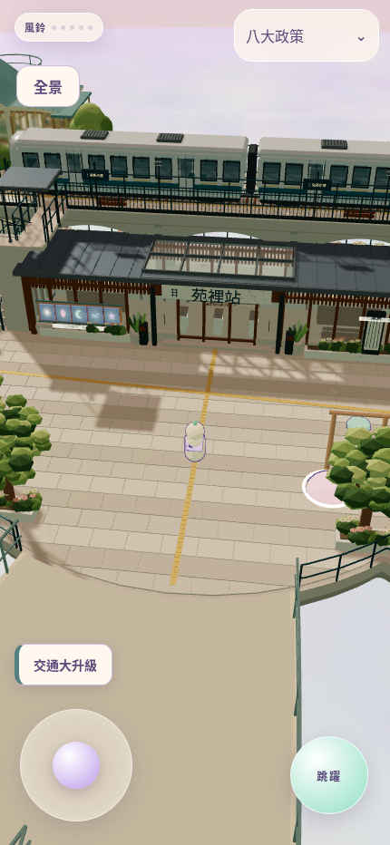
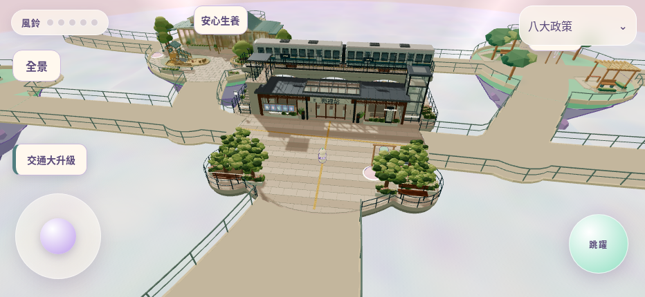
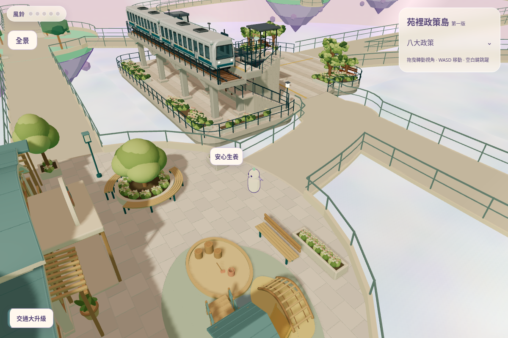
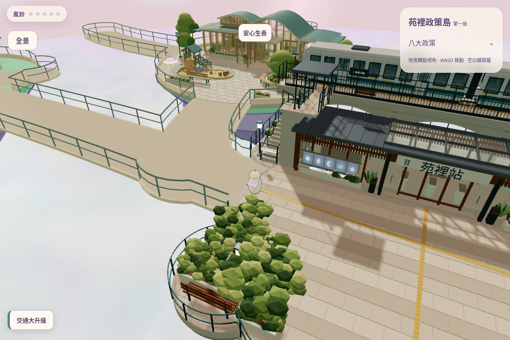
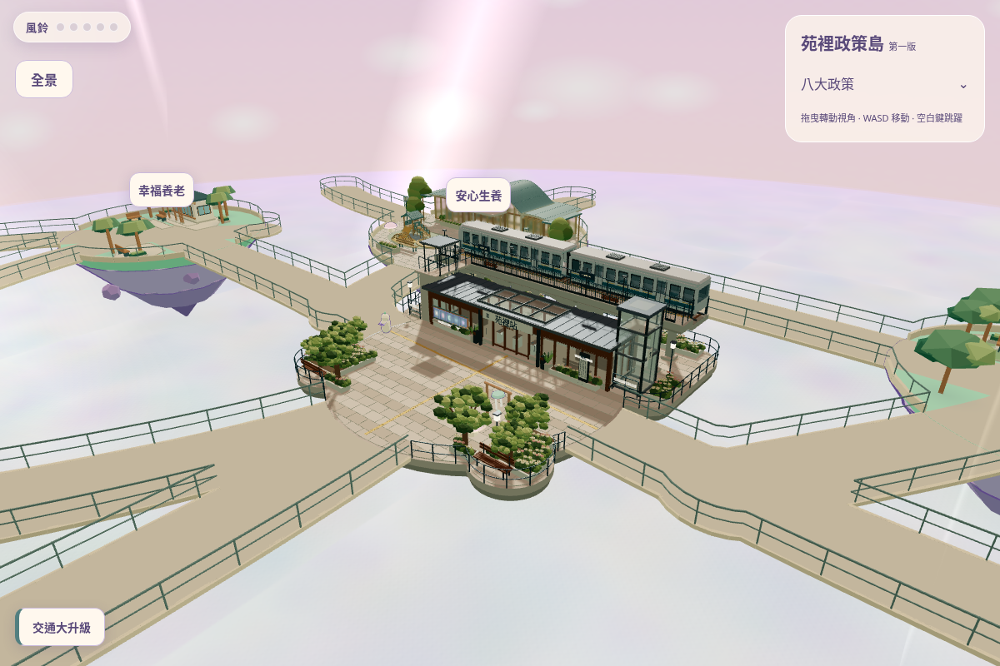
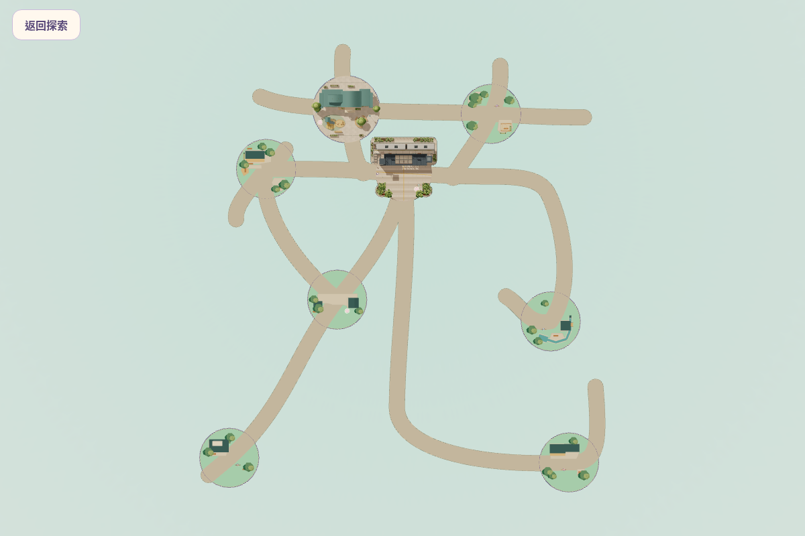

# 交通大升級高架車站：遊戲整合第一階段

模型、地基及基本安全接入已完成並有回歸證據；真機效能、美術及完整可玩性尚待人工驗收。沒有正式部署。

[完整報告、通過項目與限制](STAGE1-REPORT.md) · [原始測試紀錄](logs/) · [修改清單](CHANGES.md) · [GitHub 回讀驗證](GITHUB-VERIFIED.json) · [影像／資產 SHA256](STAGE1-MANIFEST.json)

## 原出生點：桌機預設相機

## 手機直式：原預設相機

人物與入口可見，列車兩端出框是目前限制；未用 QA 拉遠鏡頭冒充預設視角。

## 手機橫式

## 安心生養入口看交通島

QA 傳送至入口站位，使用正常玩家相機；不是實走影片。

## 交通島橋口看安心生養

## 全島斜視（自訂 QA 鏡頭）

這張是同一真正遊戲場景的自訂 QA 相機，不是預設玩家視角、不是 Blender 渲染。

## 苑字全景

真正全景模式；沒有政策文字標籤。

拍攝機位、尺寸及 GPU 記錄見 [capture-record.json](capture-record.json)。截圖由同一最終執行程式產生，沒有 AI 圖或 Blender 圖混入。
