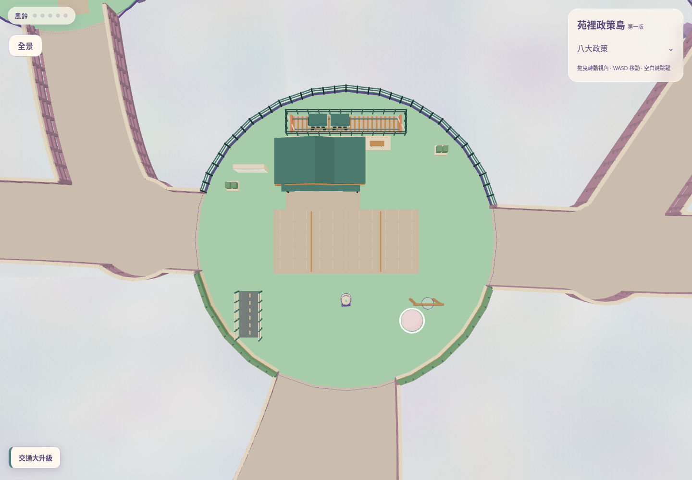
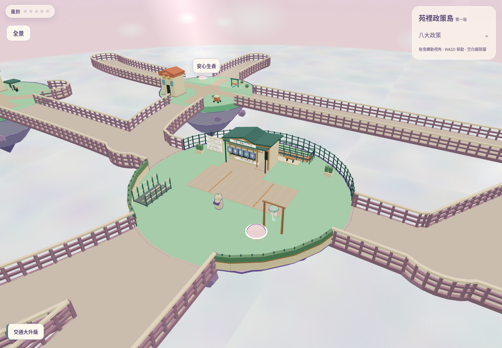
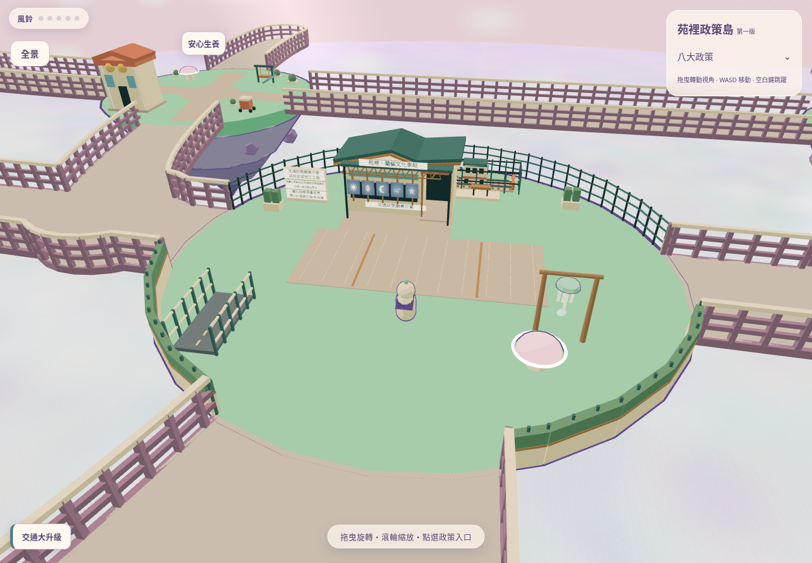
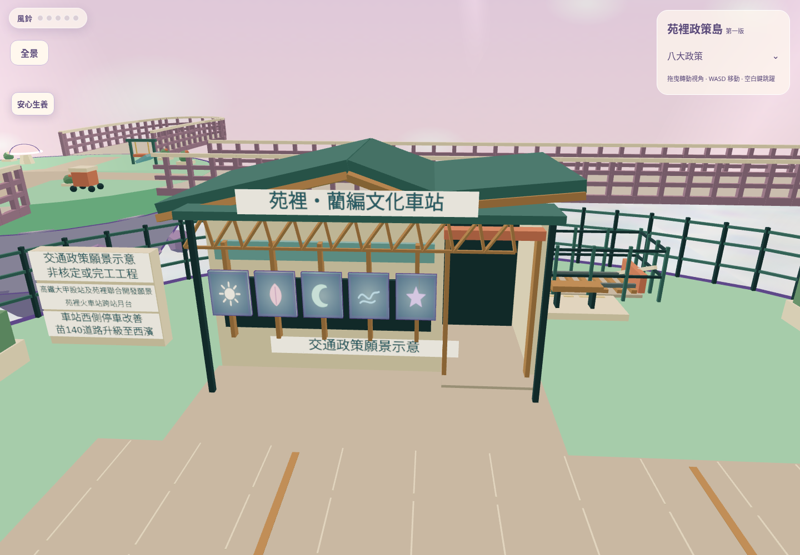
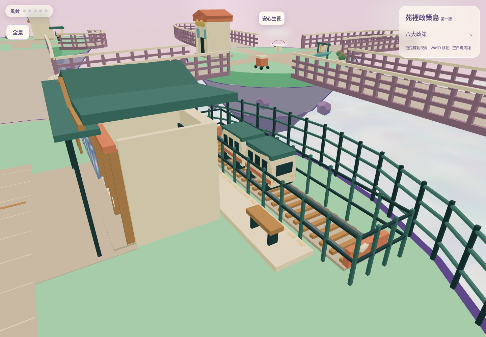
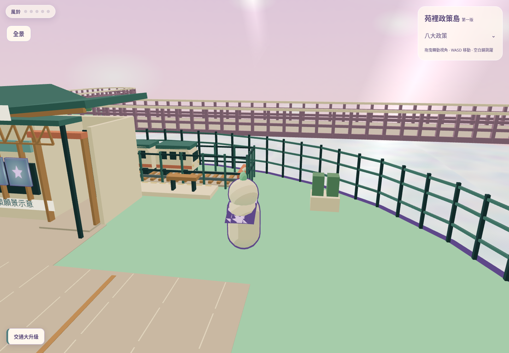
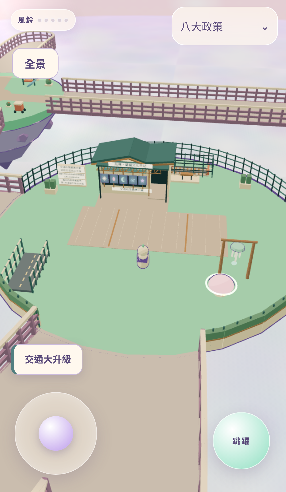
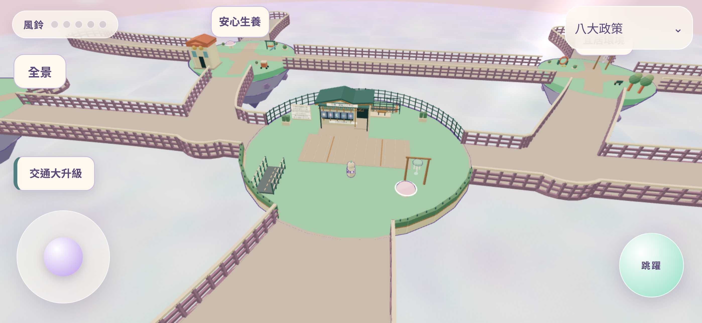
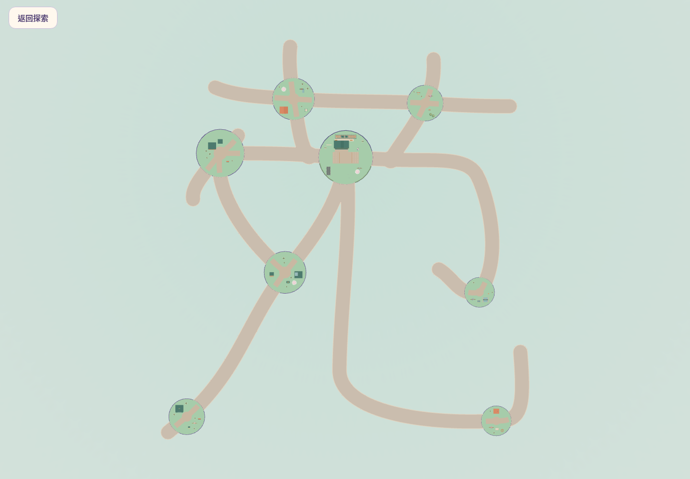

# 交通大升級島 V3：現代建築 × 苑裡藺編文化

由 `codex/eight-policy-islands-scenery-v1` 的 `27d85e9` 建立獨立分支 `codex/transport-island-redesign-v3`。本次只改交通島，未合併、未更新 Production。這是供人工美術及遊玩驗收的原型，並非真實車站設計或核定工程資訊。

## 真實 Three.js 畫面

圖片均由 Chromium 渲染可運行場景產生；沒有 AI 概念圖。局部拍攝只調整 QA 鏡頭，出生與手機畫面使用原本探索相機。完整全景使用遊戲內正交全景模式。

| 畫面 | 預覽 |
| --- | --- |
| 交通島正上方 |  |
| 交通島斜俯瞰 |  |
| 出生位置原始探索相機 |  |
| 車站正面探索角度 |  |
| 北側月台及列車 |  |
| NPC 預留空間與玩家停留位置，沒有 NPC 模型 |  |
| 手機直式原始探索相機 |  |
| 手機橫式 |  |
| 完整苑字全景 |  |

## 最終配置

完整座標、碰撞邊界及數值稽核見 [layout-audit.json](layout-audit.json)，可維護的設施／NPC 設定在 [transport-v3.json](../../../src/data/transport-v3.json)。未改 B 方案任一座標、半徑、Bezier 或寬度，沒有再次壓縮。

| 設施 | 本地 X/Z 與尺度 | 通行安排 |
| --- | --- | --- |
| 浮島 | 中心 `(0,0,0)`、半徑 `9` | 原有地形與碰撞保留 |
| 車站 | 中心 `(-1.4,-4.45)`、主體 `4.4×1.8` | 非對稱三折板屋頂、三角藺編抽象格柵；西翼有實體水平碰撞 |
| 凹入口 | 中心 `(0.1,-3.15)` | 開口淨寬 1.2，玩家直徑約 .66；可進入淺凹空間及原路返回，並非完整室內 |
| 屋簷 | 雨棚高 2.4、前緣約 Z=-2.695 | 高於角色；支柱有碰撞，位於通行帶外 |
| 月台 | 中心 `(-.5,-5.87)`、`6.4×.86`、高 .12 | 東側 `(2.4,-4.8)` 可接近；步行上下不需跳躍；月台邊緣色帶 |
| 展示鐵道 | 中心 `(0,-7)`、長 6.6 | 四側透明感金屬欄有真實碰撞，列車掃掠區不進入中央廣場 |
| 列車 | 往返中心 ±1.65；車體最遠約 X=±2.9 | 緩慢正弦往返、兩端可視車窗及燈，沒有載客／搭乘系統 |
| 願景展板 | `(-5.6,-4.1)` | 僅使用使用者提供的四項題目，標示非核定或完工工程；正式政策 JSON 未修改 |
| 道路橋微縮展示 | `(-5.8,4.5)`、`1.3×2.8` | 從舊長道路橋縮為短展示橋，不占 S15/S18 共享入口 |
| 出生 | `(0,.5,3.5)` | 完全不變，中央廣場開放 |

願景展板包含「高鐵大甲設站及苑裡聯合開發願景」、「苑裡火車站跨站月台」、「車站西側停車改善」、「苗140道路升級至西濱」。未填入預算、期程、核定狀態或正式政策全文。

### 唯一 NPC 預留資料

沒有建立 NPC、碰撞人物或對話系統；`implemented:false`。

- 位置 `(4.1,0,-4.2)`，面向南方 `yaw=0`，未來身體半徑建議 `.4`。
- 建議互動半徑 `1.8`，玩家停留點 `(4.1,0,-2.9)`，距預留點 `1.3`。
- 建議對話鏡頭 `(5.2,3.3,2.8)`，看向 `(4.1,1.1,-4.2)`；對交通設施實際射線無遮擋。
- 預留點距最近交通碰撞邊界約 `1.54`，停留點及其接近路徑以真實 Player 驗證。建議半徑代表觸發距離，不代表整個半徑內皆空無設施。
- 尚須未來加入 NPC 後，以實際人物高度及手機對話 UI 重驗，不能由空間預留宣稱對話體驗已完成。

### 保留玩法

- 五塊原始壁畫移至車站正面文化牆，圖紋與解謎順序仍為 `[2,4,0,3,1]`（日、葉、月、浪、星）。縮為原來 `.4`，排列 X=`[-3.25,-2.65,-2.05,-1.45,-.85]`，Y=1.24、Z=-3.28。原石座嵌入牆體，沒有刪除資訊；文化牆以灰青底提升原色圖案對比。
- 五座風鈴本身及命中範圍、音符、順序邏輯不變；交通島風鈴仍在 `(4.6,0,3.6)`，其他四座及七島造景均未動。
- 三座彈跳蘑菇不變；交通島約 `(3.926,0,4.798)`。正常步行不觸發彈跳，按住跳躍仍可啟動。
- 出生點、音效／音樂模組、政策 UI、政策資料、全景鏡頭及單手操作控制不變。

### 安全與效能

沿用 `yuan-surface.domain` 原有聯集的交通島暴露外側邊界，篩出 **23** 段島緣線；不重新推算近似圓形門洞，沒有改動外部道路。北側通透金屬欄、南側窄景觀牆／植栽與支柱使用同一條水平碰撞線。四條入口保持開放，S15/S18 之間沒有新增內欄。

含建築、軌道隔離、橋模型、花台與柱，共 **61** 段水平碰撞資料；與既有 `guardIndex` 合併。主入口沿線 ±1.95 玩家中心帶取樣檢查，含 .41 碰撞淨距，原有路面寬仍為 **4.8**。建築實體距主要路面邊緣最小約 **.94**。

原生幾何、按色合併、無新增依賴、額外光源、外部模型或大貼圖。新標示使用少量 512px Canvas 紋理；透明材質未新增。列車每幀僅更新 X 座標，不重新生成靜態幾何。現有 MIT／第三方聲明保留。實際三角數與 Draw Calls 見 `desktop-render-stats.json`、`mobile-render-stats.json`，這些是當次鏡頭數據，並非手機 FPS 保證。

## 修改檔案

- `src/data/transport-v3.json`：設施、壁畫、NPC 預留資料。
- `src/world/transport.js`：交通主題 V3、靜態材質批次、短列車、明確碰撞與安全邊界。
- `src/world/islands.js`：僅調整交通島壁畫及石座位置／尺度、加入順序 QA 資料。
- `src/world/textures.js`：壁畫底色可選，只有交通島文化牆使用深底，圖案與音符色不變。
- `src/main.js`：將交通碰撞加入原導航索引，交通模型加入既有政策點選。
- `test/transport.test.js`、`test/walkways.test.js`：交通及所有路線實體碰撞回歸。
- `test/transport.e2e.js`：接受新增的明確碰撞幾何，不再寫死舊版兩個模型。
- `test/transport-v3.e2e.js`：車站／月台／NPC 停留、島緣、蘑菇解謎、手機雙方向、全景狀態。
- `scripts/audit-transport-v3.mjs`、`scripts/capture-transport-v3.mjs`：可重跑稽核與實景截圖工具。
- 本資料夾：真實 PNG、配置稽核、測試紀錄及報告。

## 測試結果

| 檢查 | 結果／實際範圍 |
| --- | --- |
| `npm run build` | 通過；最終預設 dist 再建置，另有獨立最終視覺建置紀錄 |
| `npm run lint` | 通過 |
| `npm test` | **39 通過，0 失敗** |
| 全套桌面／手機 Playwright | **40 通過、4 裝置不適用 skip、0 失敗**，44 案例，29.2 分鐘；單 worker、零 retries |
| 最終視覺建置追加回歸 | **8 通過、0 失敗**，桌面及手機皆含原生風鈴鍵盤／觸控、車站、月台、島緣、蘑菇、全景／返回、政策點選；手機含橫直兩向 |
| 八島與 22 路段 | 真實 Player 在兩種 dt 全路段雙向行走；桌面鍵盤／手機單指 UI 加速整趟，21 路網節點全訪、無跳躍、無意外復位 |
| 四入口及共享南口 | 單元取樣 ±1.95 玩家中心帶與 .41 淨距；所有路段雙向及路口轉向回歸通過 |
| 車站／月台／列車 | 出生走到入口、進退凹口、東側登月台與 NPC 停留點通過；月台接地 Y=.12、建築阻擋 Z≈-3.14、軌道阻擋 Z≈-5.94；完整列車動畫掃掠在隔離區內 |
| 島緣與玩法 | 23 段島緣實際步行接地與雙向水平阻擋；原五風鈴、壁畫順序及完整解謎；步行不彈、按住跳躍蘑菇向上速度 16.5；強制跌落回最近檢查點 |
| 影像 | 九張最終 Three.js PNG，SHA256 與尺寸見 [images-manifest.json](images-manifest.json) |
| 保持不變檢查 | 三份 B 方案 JSON、七島造景、風鈴座標、角色／移動、政策 JSON、LICENSE 與基礎分支逐檔無差異 |

原始輸出存於 [logs](logs/)。全套固定建置完成後，標示比例／壁畫對比與嵌入石座的純視覺修整以最終建置另跑 8 個相關回歸；沒有藉此改動路網、移動或碰撞。最終未解決的自動測試失敗：**0**。

固定建置回歸使用本機 `vite preview`，Chromium 軟體 WebGL，1 worker、0 retries。跨島測試由真實 Player、碰撞資料與原 UI 驅動固定 dt 加速行走，不等同人類連續手持操作錄影。

開發過程發現並修正：西側小花台侵入通行帶（已移出）；標示文字比例過扁及窗框遮住文化圖紋（已重整）；島緣測試將安全進入外部步道誤判為離島（改檢查接地與復位）；熱更新期間測試頁重載（最終使用固定 dist，保留開發紀錄）。不以開發失敗測試充當通過結果。

## 已知限制與待人工驗收

- 車站、藺編抽象意象、材質與手機構圖品質，必須由使用者判定；自動測試不能證明精品美術品質或文化詮釋正確。
- 真機 iOS／Android 的 FPS、溫度、記憶體與持續單手操作舒適度待驗，Chromium 裝置模擬不等同實機 Safari。
- 自由旋轉／極近縮放沒有新增相機避障系統；指定 NPC 視角射線通過不代表所有角度皆不遮擋。需人工繞站檢查屋簷遮擋。
- 建築只有外部與淺凹入口，沒有售票系統、室內導覽、可搭列車、NPC 或對話。
- 安全邊界針對一般地面步行；主動跳躍、滑翔或蘑菇仍可越出安全範圍，保留既有檢查點復位。
- 其他七島未做安全邊界精修；不宣稱全世界防跌落美術已完成。
- 政策展板為使用者題目之願景呈現，不是工程事實或正式政策全文。

完成後停止，等待人工美術及遊玩驗收，不合併 PR、不更新 Production。

## 本機重現

```sh
npm ci
npm run build
npm run lint
npm test
npx vite preview --host 127.0.0.1 --port 4185 --strictPort
```

另開終端執行：

```sh
npx playwright test --workers=1 --retries=0 --timeout=240000
node scripts/audit-transport-v3.mjs
node scripts/capture-transport-v3.mjs http://127.0.0.1:4185
```

瀏覽器使用本機 Chromium／軟體 WebGL，測試未支援的裝置案例會明確 skip。截圖腳本只調整 QA 鏡頭，並不修改存檔、世界尺寸或正式 UI；拍攝前須先啟動本機 preview。`images-manifest.json` 包含九張 PNG 的尺寸及 SHA256，供 GitHub 上傳後核對。
