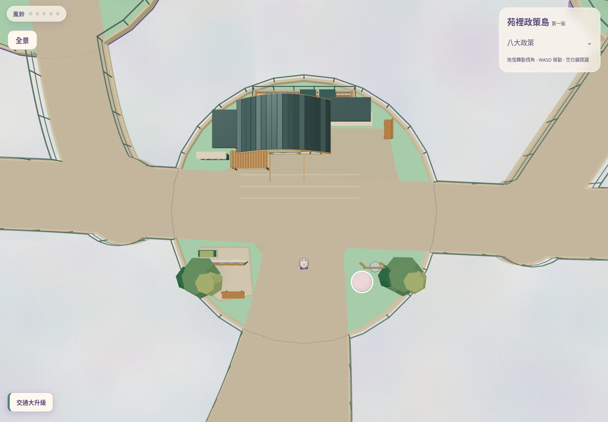
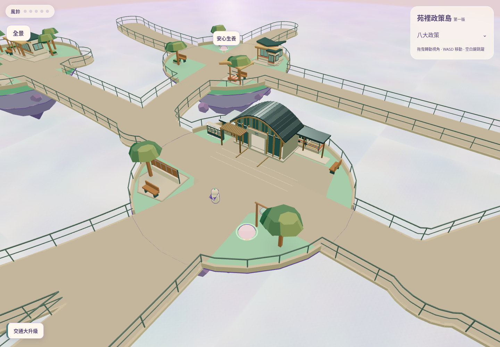
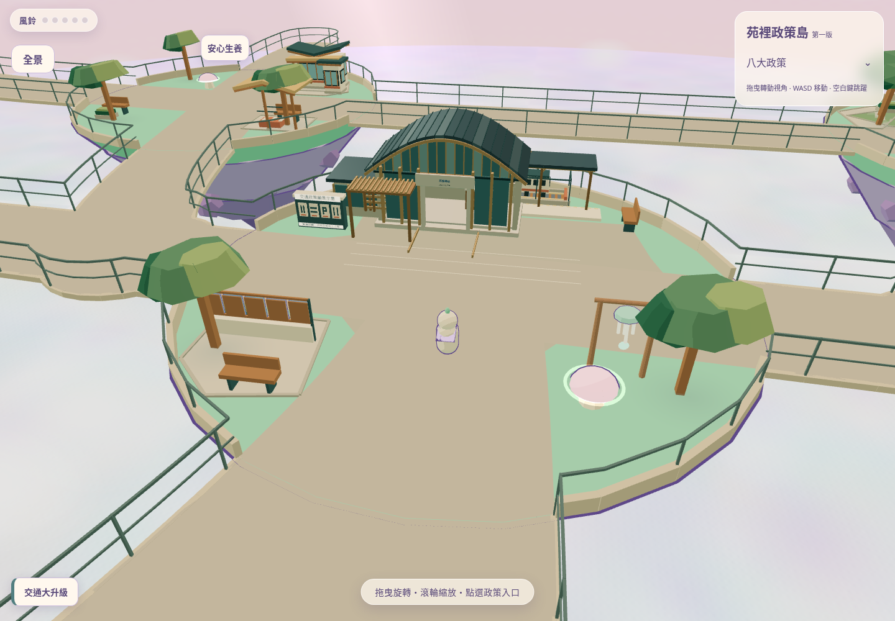
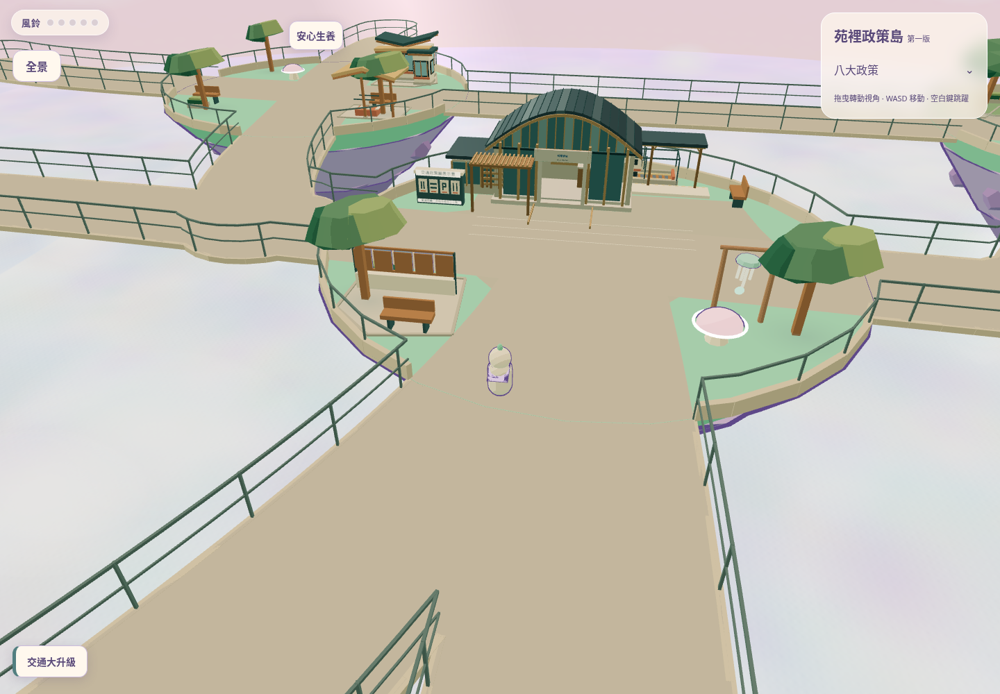
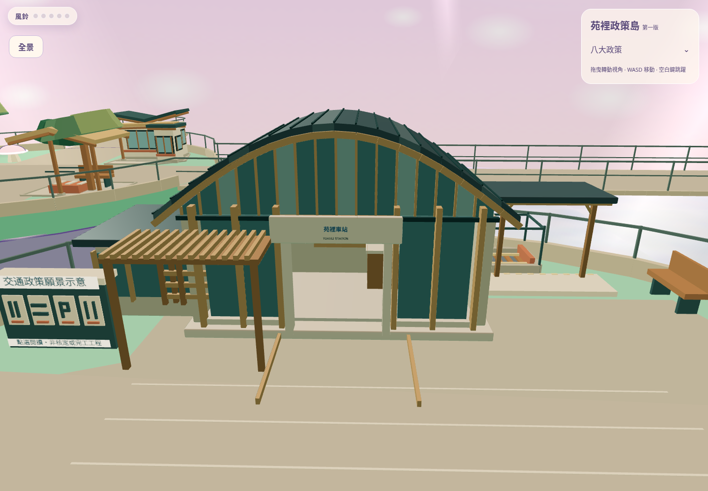
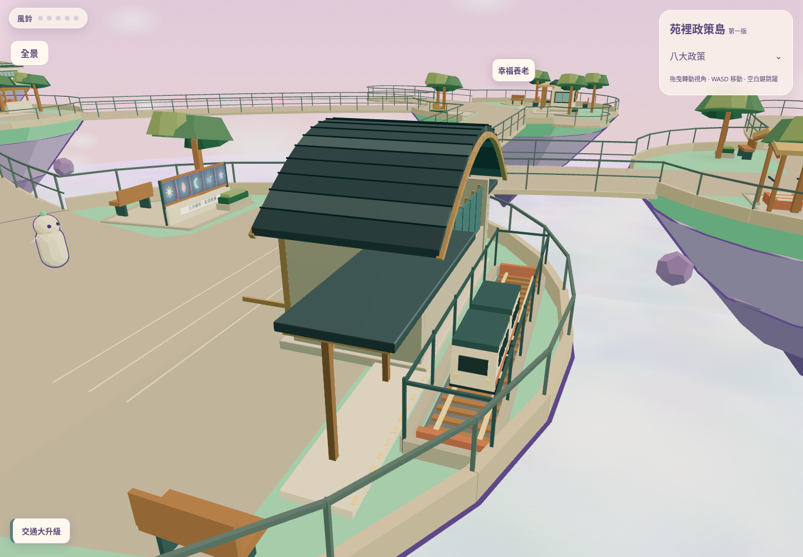
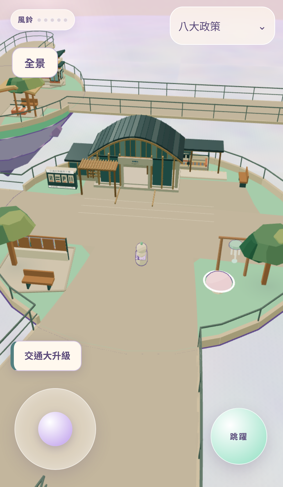
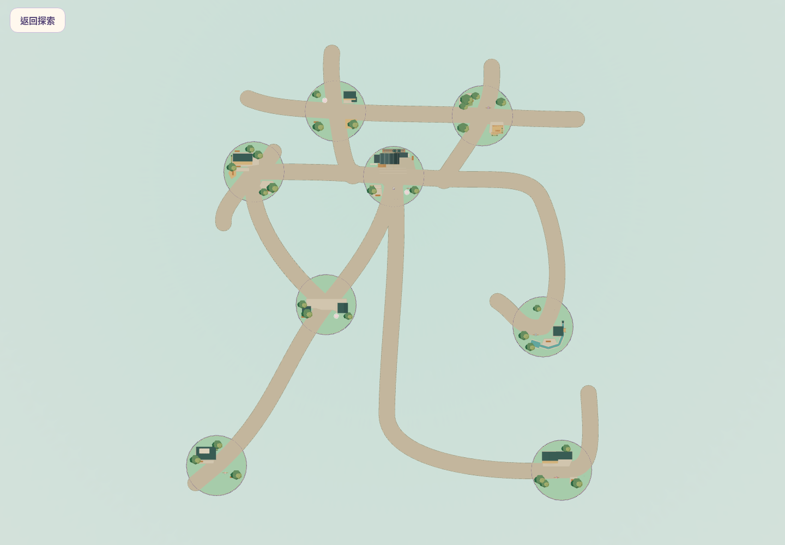

# Blender 車站 GLB 整合 V1

將已完成的 Blender 車站放進原有交通島，取代程式生成的站房、重複雨棚與舊入口木條；入口沿用 GLB 原有導引構件。沒有重新設計車站；沒有另建網站或載入第二座原型島。沿用八島重製可玩世界及其 B 方案路網。

來源：`codex/transport-station-blender-prototype-v1`，`6acf7bee301173fda1a5075186295cdfe5fdcdf2`。
開發：`codex/transport-station-glb-integration-v1`。本分支供人工檢視，不合併、不更新 Production。

**[開啟可操作的自動公開 Preview](https://c5e551b2.sky-isles.pages.dev)** · [PR #10](https://github.com/qaz741612/sky-isles/pull/10)

**已確認上傳：**[GitHub 下載核對 11／11 檔案](github-media-verification.json)，含 8 張 PNG、完整 MP4、原 GLB 與 Blend；大小及 SHA256 全部相符。Preview 由既有 Cloudflare Git 整合自動建立，沒有手動部署或更新 Production。

[原始 GLB](../../../public/prototypes/transport-station/transport-station.glb) · [Blender 原始檔](../../design/transport-station-blender-prototype/transport-station.blend) · [尺寸與配置稽核](geometry-audit.json) · [測試與限制](TESTS.md) · [逐鏡頭渲染數據](render-stats.json) · [玩家實際走動影片](native-operation.mp4) · [操作紀錄](operation-log.json) · [媒體清單](media-manifest.json)

## 既有模型與比例

GLB 本身是完整原型展示場景，含示意島、展示列車及比例人偶。完整 GLB 及被選取建築各自的精確包圍盒，均列於 `geometry-audit.json`。本輪只實例化**原站房全部 Architecture 幾何、地板、入口導引、附屬雨棚與支柱、站名字樣**；其餘展示場景不載入遊戲世界，保留遊戲原本的列車、鐵道、文化解謎與景觀。這不是裁切站房或刪除建築細節。

`.blend` 與 `.glb` 均未修改。原 GLB SHA256：
`56a8d8f511242ae3c825e60af5b752b831f8287d372845b9ed06858602a6c6e4`。

| 量測 | 結果（世界單位，非工程尺寸） |
| --- | --- |
| 原車站含屋簷、左廊架、右雨棚尺寸 X/Y/Z | 13.760 / 5.253 / 7.005 |
| 等比例縮放 | **0.74 / 0.74 / 0.74**，不改原始頂點形狀 |
| 場景位置 X/Y/Z | **−0.5 / −0.0259 / −3.2** |
| 旋轉 | Y=0，正面朝南 |
| 整合尺寸 X/Y/Z | **10.182 / 3.887 / 5.184** |
| 最遠建築頂點距島中心 | **8.831**，包含屋簷及雨棚；交通島半徑仍為 9 |
| 基座最低點 | 約 0，浮點誤差小於 0.000001 |
| 室內地板頂面 | 0.2479，可從原模型門口不跳躍進出 |
| 門口測試點淨高／玩家頭頂包絡 | **約 1.913 / 1.60**（門外腳底 0）；相對室內最高地坪保守值 1.665 |
| 原車站幾何 | **5,368 三角形、16 個材質網格，無貼圖檔** |

早期 0.62 倍配置在地板升高後無法正常退出門口，已淘汰，**未交付為可玩版本**。最終提高至 0.74，調整島內站體、鐵道及月台配置後完成實走。半徑 9 可以保留四入口與 NPC 區域，故沒有改島半徑，也沒有套用任何局部擴展或 10／11／12 半徑候選。若人工驗收仍認為比例需要加大，應另行提出同鏡頭方案比較，不能直接擴島。

## 島內配置與碰撞

- 四入口 **S09／S10／S15／S18**、全部 22 條路線、Bezier、4.8 路寬、八島中心與半徑完全未改；其他七島造景資料與程式亦未改。雜湊核對見 `geometry-audit.json`。
- 鐵道移至 `(0, 0, −7.7)`，長 6.6，列車原模型、速度 0.16 及往返幅度 1.35 保留。完整掃掠在鐵道隔離區內。
- 保留月台，配合原模型**側向雨棚**改為東側可達月台：中心 `(3, 0.06, −6.35)`、尺寸 `3.4 × 0.12 × 1.0`。從東側 `(4.9, 0, −6.35)` 上月台，必須繞過實際支柱，不能直穿柱。
- 北側後牆和隔離鐵道之間不是遊客通道；不要求玩家擠過窄縫。從東側走到觀車區即可。車站不再保證從南側正面看見列車所有運動階段。
- NPC 預留站位 `(5.6, 0, −3.9)`、面向 0、互動半徑 1.8、玩家停留點 `(5.6, 0, −2.65)` 全部保留；不建立人偶或對話。
- 四項交通願景內容、五圖順序、風鈴、彈跳蘑菇、出生及政策 UI 保留。願景展示牌只向西移 0.3，讓開站房邊緣。
- 接地使用原模型三角面；水平防穿牆依原模型垂直面建立 **319 段**牆／柱 guard，不用整體包圍盒封住入口。相機避障使用本站實體網格，沿用現有局部查詢。
- 玩家外觀、速度、全域移動參數、相機配置及 UI 均未修改；Player 只增加本站專用、可選的屋底上行阻擋掛鉤。本站 guard 以 1.60 頭頂包絡轉接既有 solver 的 1.70 含容差判斷，門楣／屋簷保持真實高度，上跳由實際屋底阻擋。

## 實際 Three.js 遊戲畫面

所有圖片來自本次可運行的遊戲，沒有 AI 概念圖。俯視、45 度、正面及側面為 **QA 特製鏡頭**；出生及手機圖片為**原有預設玩家鏡頭**。進島圖片在現有南側步道定位後使用原有跟隨鏡頭，不是新增第一人稱模式。截圖會暫停列車於固定相位以便檢視；影片列車正常更新。

### 交通島完整俯視

### 45 度斜俯視

### 玩家出生與進島視角

### Blender 車站正面

### 車站側面及列車

### 手機直式原有探索鏡頭

### 保留的真實苑字全景

## 原生操作影片

[播放／下載實際走動 MP4](native-operation.mp4)。從出生點走到車站、走進並退出原模型門口、前往東側觀車與月台、旋轉鏡頭、走回廣場並開關政策視窗。

影片是 Playwright 驅動**原生鍵盤與滑鼠**的正常速度操作，不使用傳送、逐幀模擬加速、位置寫入或 QA 相機；操作紀錄另附。錄影沒有音軌，不將它作為音樂／音效的聽感驗收。長度 **133.6 秒、960×640、約 6.85 MB**。進入站房時原有相機會收近，影片保留這個真實限制，未用剪接或 QA 相機掩蓋。軟體 GPU 的畫面速度不代表真實手機效能。

## 修改範圍

- `src/world/station-model.js`：載入原 GLB、選取完整站房構件、沿用原材質、模型碰撞與量測。
- `src/data/station-model.json`：集中設定來源、等比例變換、門口與觀車路線。
- `src/world/transport.js`：以 GLB 取代重複站房／雨棚，保留原列車、文化與互動；依配置調整月台。
- `src/data/transport.json`：本站月台、鐵道及展示牌位置；移除已淘汰的程式站房資料。
- `src/main.js`：先完成 GLB 載入，再建立碰撞與玩家，避免可操作後模型才出現。
- `src/sim/player.js`：增加可選的屋底碰撞掛鉤；在本站範圍上升時，以實際模型底面阻擋頭頂，不改外觀或移動參數。
- `test/helpers/station-fixture.js`、`test/station-model.test.js` 及相關回歸：使用實際原 GLB，而非假模型；更新站房入口／月台路徑與東側觀車驗證。
- `scripts/*station-integration.mjs`、本目錄：實際畫面、操作影片、量測、測試與交付。

沿用原 MIT 與既有第三方授權，無新外部素材、無新依賴。
