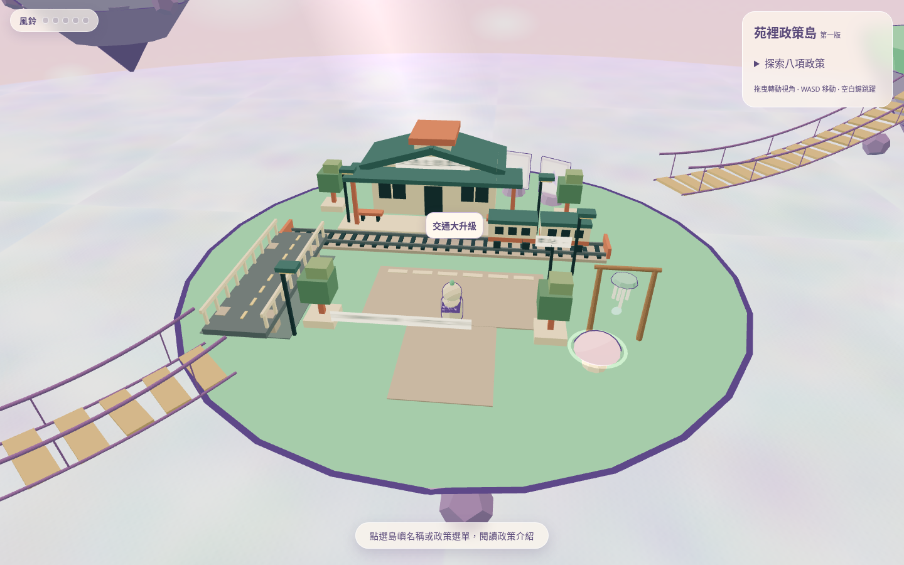
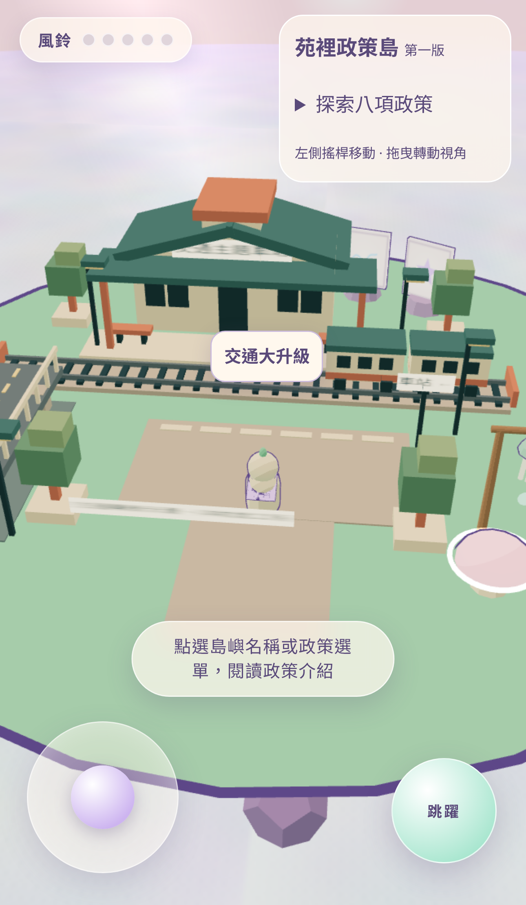

# 第二階段：交通島美術原型

本階段僅改造 `home`／「交通大升級」。沿用 PR #1 分支的八島、繁中政策與 JSON 資料。場景為政策主題示意，不表示任何實際工程已核定或完成。

## 場景與工程

- `src/world/transport.js`：低模車站、月台、短鐵道、兩節緩行列車、道路橋、淺溝景觀、廣場、路燈、路牌及綠化。原生 Three.js 幾何與既有 toon 材質；無外部素材或新增套件。
- 同色靜態幾何合併，整個交通模組包含文字面板共 19 個繪製批次、1,734 個三角形；未新增光源或即時陰影。列車每幀僅更新一個位置值，不更新幾何。
- `src/main.js`：建立交通模組、接上動畫和兩個可站立表面，調整初始鏡頭朝向車站；原始拖曳／縮放、人物與手機搖桿控制維持原架構。
- `src/world/islands.js`：只移除交通島的隨機花草，讓主題場景接管佈置；仍消耗相同亂數序列，另外七島的隨機美術不受影響。
- `src/policies.js`：只在交通政策視窗附加場景示意聲明；未新增政策內文或改動 JSON 政策資料。
- `test/transport.test.js`、`test/transport.e2e.js`：檢查模組作用範圍、幾何預算、列車移動範圍、站立表面、跳躍、鏡頭拖曳及直接點擊車站開啟政策。
- `scripts/capture-transport.mjs`：從正式建置擷取桌面／手機 PNG，記錄視角中的場景繪製數，檢查 console error 與 favicon／JSON／授權檔回應。

## 預覽

重建截圖：先執行 `npm run build`，再執行 `node scripts/capture-transport.mjs`。會寫入本資料夾，保留第一版的原有三張圖片。

## 原型限制

- 月台與道路橋有向下射線可站立表面；車站牆面、列車、樹與欄杆是展示幾何，沒有新增側向阻擋物理。主要廣場、吊橋入口與跳躍蘑菇路線保持開放。
- 鐵道採短距離正弦往返，非真實時刻表、交通模擬或真實工程配置。淺溝為幾何景觀示意，沒有改造島嶼地形或挖空既有地面碰撞。
- 手機直式畫面優先顯示車站、列車與政策入口，道路橋全貌需旋轉鏡頭查看。
- 瀏覽器驗證使用 Chromium 的桌面及手機觸控模擬，不能視為實體手機 GPU／電量／長時間幀率驗證。
- 原始 MIT 與第三方授權保持不變；無合併 main，無正式公開部署。

## 驗證結果

- `npm run build`：成功。
- `npm test`：4 組通過。
- `npm run test:e2e -- --retries=0`：21 項通過，1 項略過（桌面沒有觸控搖桿）。包含桌面／手機的場景渲染、八項政策、移動、重生、搖桿，以及交通場景的跳躍、相機拖曳、列車動畫與直接點擊政策。
- 最終正式建置的截圖另確認無 console error，favicon／JSON／授權檔均 HTTP 200。
- `test/app.e2e.js` 僅將內文檢查改成包含判斷，以容納新增的交通場景示意聲明。
