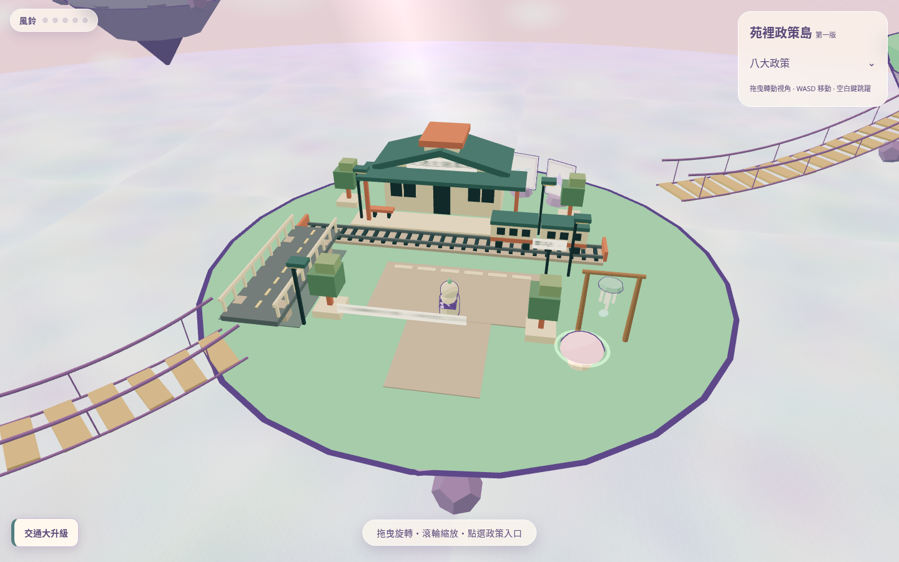
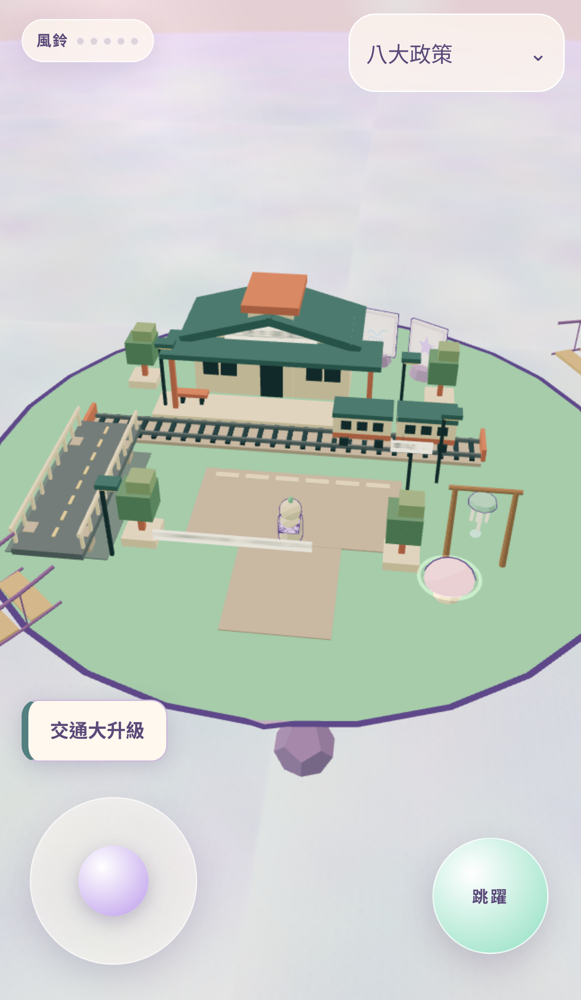
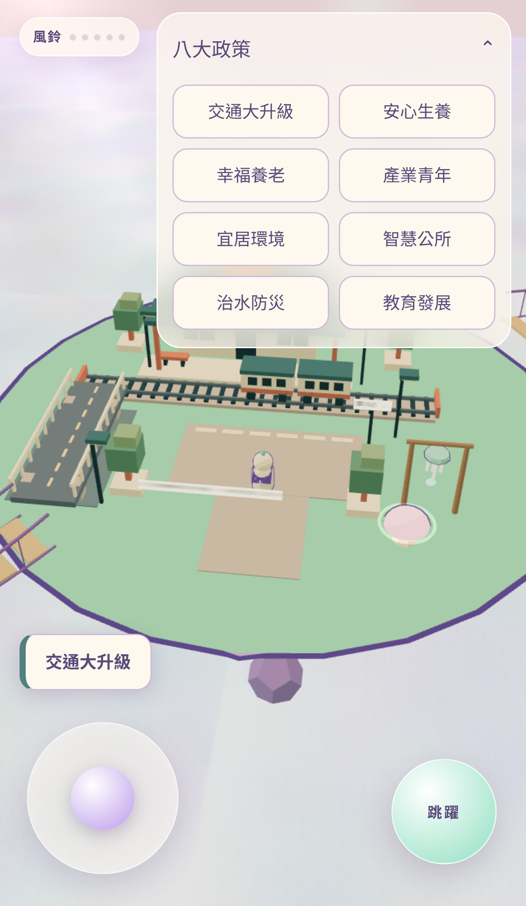
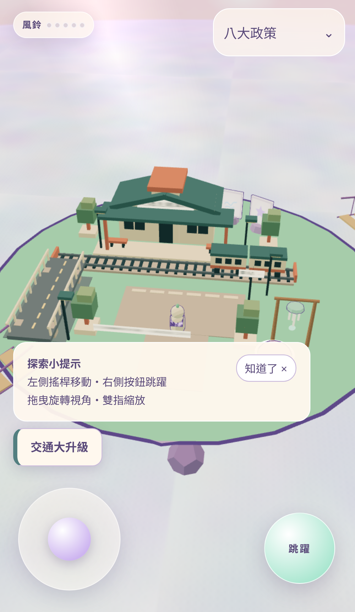

# 第三階段：鏡頭與 UI/UX

本輪基於 PR #1 的交通島原型，只修改相機、DOM 介面與操作處理；未修改交通島建築、人物、政策內容與其他七座島的模型。

## 變更

- `src/sim/camera-profile.js`：桌面初始距離 16／FOV 55；手機直式距離 22／FOV 58，另設俯角；小高度橫向配置距離 18。世界縮放維持 1。調整初始視距不再被舊的距離 16 上限每幀拉回。
- `src/main.js`：套用獨立初始構圖，視窗大小變更時更新 FOV，但不重設使用者的旋轉與縮放；人物追蹤沿用原始控制器。
- `src/ui.js`：縮放範圍 3.5–28；保留拖曳與滾輪，新增雙指縮放；多指手勢／取消手勢不誤開政策。手機操作提示可關閉，使用 sessionStorage 記住同一分頁工作階段內的選擇。互動按鈕／選單的空白鍵不再同時觸發人物跳躍，失去視窗焦點時清除按鍵。
- `index.html`：右上選單收合時顯示「八大政策」入口，手機隱藏多餘標題與常駐操作文字；展開可查看八個名稱，短畫面允許選單內捲動。保留搖桿／跳躍操作區，標籤與說明跟隨底部安全區偏移。首次簡短提示可關閉；展開選單時暫時隱藏，避免橫向短畫面互相遮擋。
- `src/policies.js`：交通政策入口改為視窗下方側邊標籤，避開車站與列車；仍可點擊。其他七島標籤保持原本投影方式。政策視窗關閉時，若來源是收合選單的項目，焦點回到可見的「八大政策」入口。
- `test/camera-profile.test.js`、`test/ux.e2e.js`：相機配置／縮放限制、世界比例、鏡頭追蹤、選單開合與八個名稱、操作區遮擋、標籤點擊、焦點回復、提示關閉記憶、雙指縮放。
- `test/transport.e2e.js`：先關閉首次提示，再驗證既有的跳躍與相機拖曳。
- `scripts/capture-ux.mjs`：從正式建置擷取以下狀態，保留前兩階段圖片。

## 預覽

[桌面](ux-desktop.png) · [手機：選單收合](ux-mobile.png) · [手機：八大政策展開](ux-mobile-menu.png) · [手機：首次操作提示](ux-mobile-help.png)

重新擷取：`npm run build` 後執行 `node scripts/capture-ux.mjs`。

## 仍需人工評估

- 實體手機拇指操作的舒適度、字級與標籤位置是否符合使用者偏好。
- 真實裝置上雙指手勢的手感、瀏覽器安全區與切換直橫向後的視覺感受。
- 使用者是否能直覺找到政策入口，以及轉動鏡頭後的構圖是否滿意。
- 實體手機 GPU、電量、長時間幀率與不同系統瀏覽器表現；Chromium 觸控模擬不能取代實機測量。

政策標籤採 HUD 定位，並不模擬真實場景遮擋。縮放最大距離放寬後，仍可自行拉近；沒有新增攝影機與建築碰撞系統。

未合併 main、未正式公開部署；完成本輪後停止，未延伸其他七島建模。

## 驗證結果

- 正式建置成功，5 組單元測試通過。
- 完整桌面／手機瀏覽器回歸：26 項通過、2 項略過（桌面搖桿、手機首次提示）。
- 另以手機專案執行 `test/responsive.e2e.js`：1 項通過，涵蓋 320×568 與 844×390；逐一捲動查看八個名稱，檢查選單界線、操作區與提示的遮擋。
- 最終正式建置的桌面／手機截圖無 console error，favicon／JSON／LICENSE 均為 HTTP 200。
