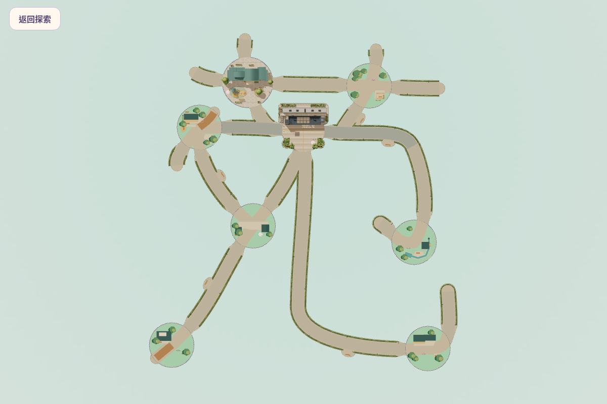
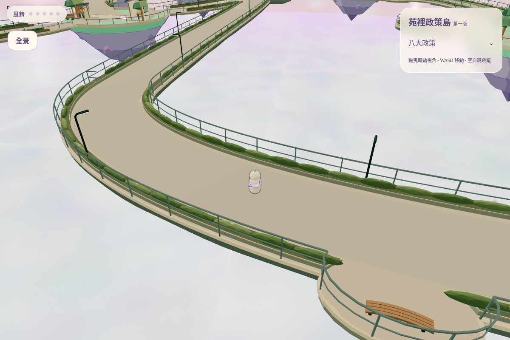
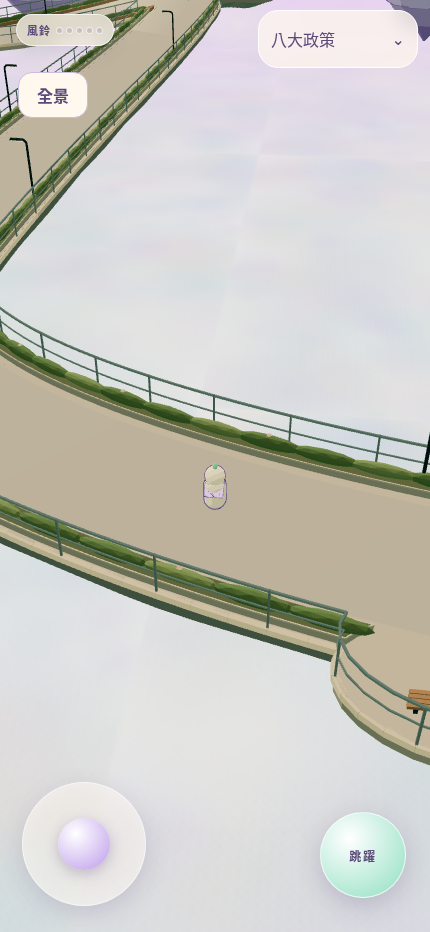
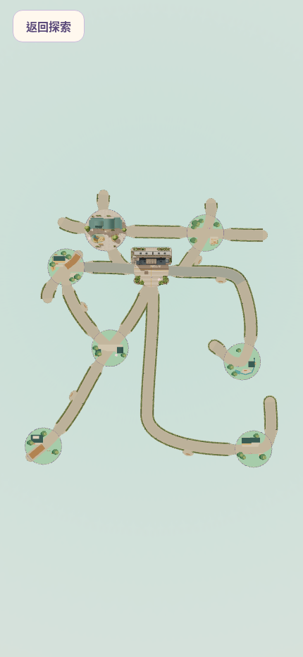
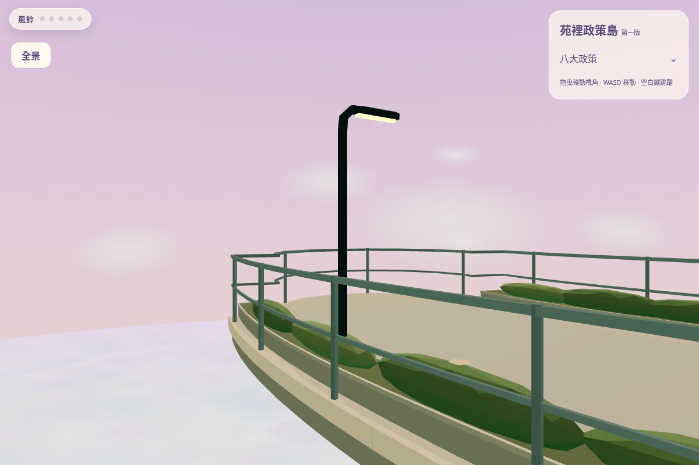
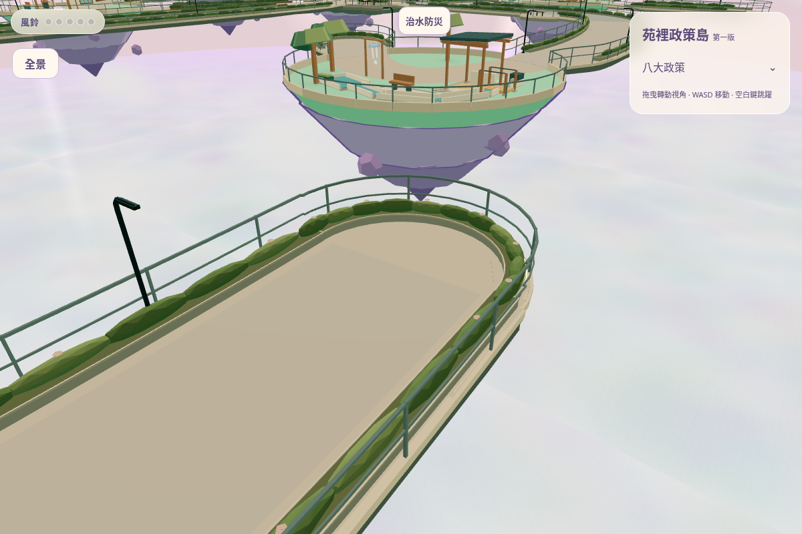

# 苑字地圖、22 段道路景觀與 7 字路燈

施工版保持 Draft，等待一次整體人工驗收。沒有合併或正式部署；未宣稱真機效能或美術已獲通過。

[完整報告與未驗收項目](REPORT.md) · [22 段配置](route-coverage.json) · [燈位 JSON](lighting-layout.json) / [CSV](lighting-layout.csv) · [測試紀錄](logs/) · [SHA256 清單](MANIFEST.json)

## 完整苑字全景（真正遊戲、無政策標籤）

## 桌機／手機：橋上的正常玩家鏡頭

站位由 QA 移至 S19，使用原玩家鏡頭、真實角色及碰撞；不是另外拉遠的 QA 相機，也不是走訪影片。

## 手機全景

## 7 字燈近景及收筆端

這兩張為同一遊戲的自訂 QA 鏡頭。

## 五區代表（實際遊戲 QA 鏡頭）

| 範圍 | 圖片 |
|---|---|
| S01–S03 綠帶 | [查看第一區](final/zone-1.png) |
| S04–S07 石景 | [查看第二區](final/zone-2.png) |
| S08–S11 交通導引 | [查看第三區](final/zone-3.png) |
| S12–S17 庭園木景 | [查看第四區](final/zone-4.png) |
| S18–S22 曲線收筆 | [查看第五區](final/zone-5.png) |

[交通與安心生養關係](final/family-separation.png) · [桌機原出生點](final/desktop-player.png) · [手機原出生點](final/mobile-player.png) · [手機橫式](final/mobile-landscape.png)

來源：final/ 的 15 張 PNG 均為最終運行版本。機位記於 capture-record.json 和 bridge-player-record.json；map-checkpoint/ 是施工前的地圖檢查點，用作對照，沒有混充最終圖。沒有 AI 概念圖或 Blender 渲染。
