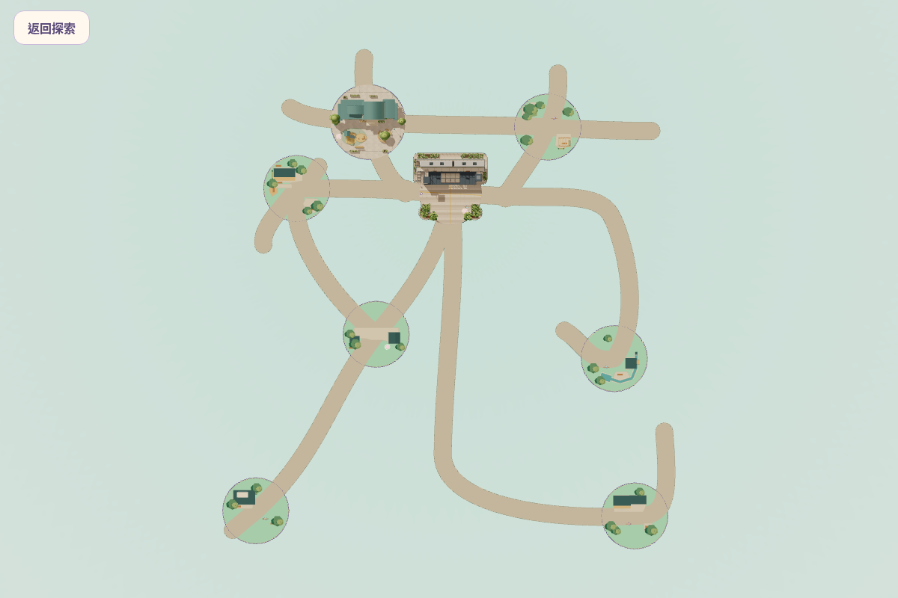
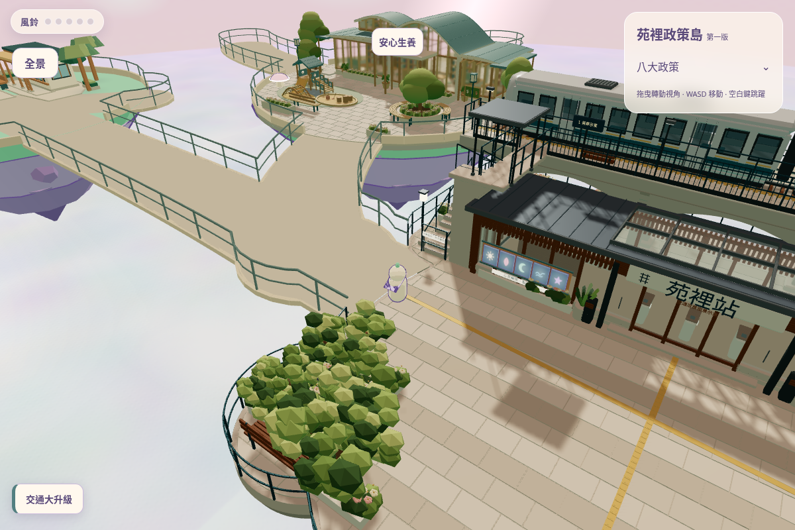
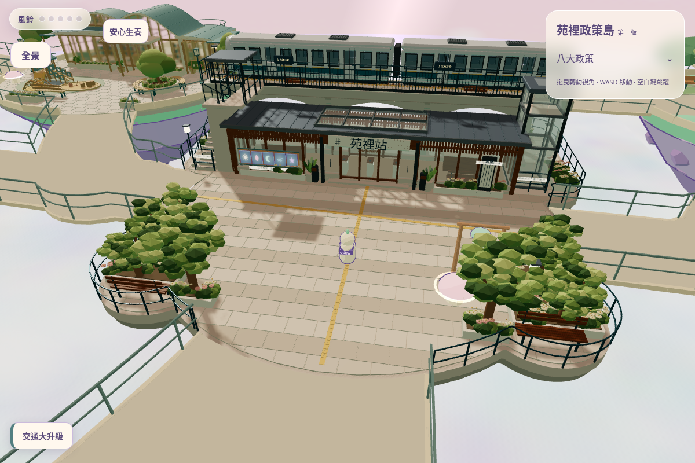
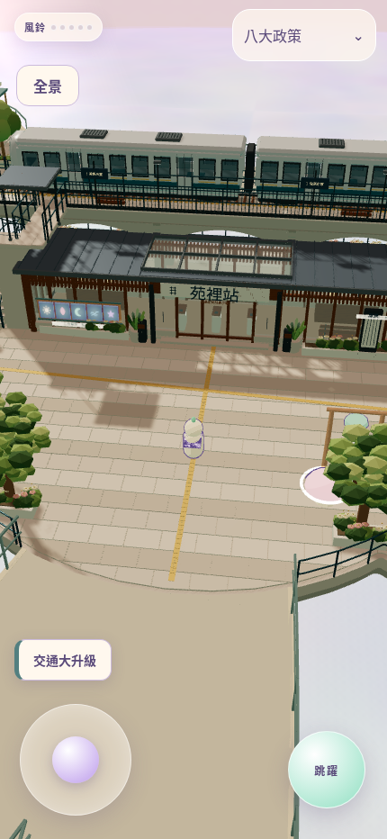

# 第一施工檢查點：安心生養向西 5 單位

A = (-22.55, -19.656)，T3 同向西移 5。僅改 S01/S02/S04/S05 的指定控制點；交通 F 及其餘七島中心不變。未修改核准 GLB。

- 生成、地基及安心生養四入口單元測試通過。
- 真正遊戲桌機鍵盤／手機單指搖桿完成 22 段雙向、八島連通，無跳躍、無意外復位（network-browser.txt）。
- 同一遊戲場景的預設桌機／手機、全景及交通橋口看安心生養畫面已輸出；沒有 AI 或 Blender 圖。
- 這是地圖檢查點，尚未施工景觀。真機效能／長時間手感未驗收。

