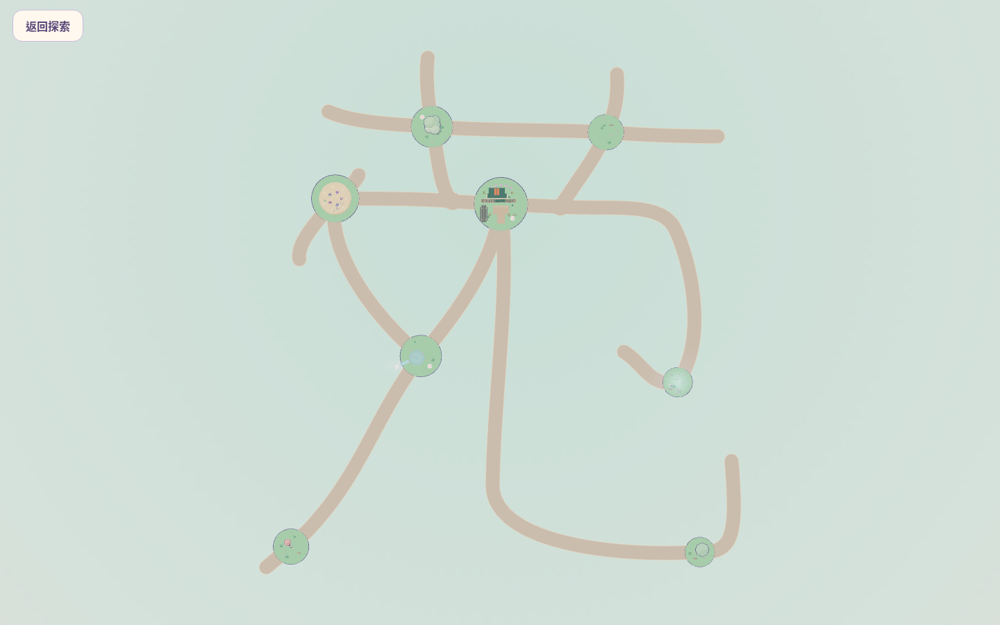
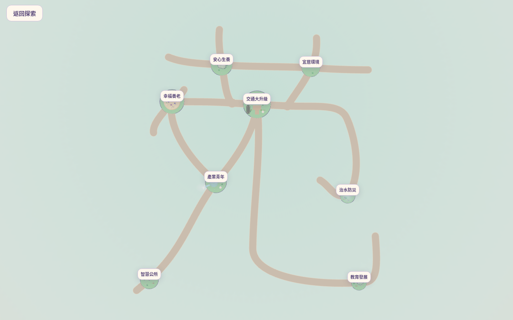
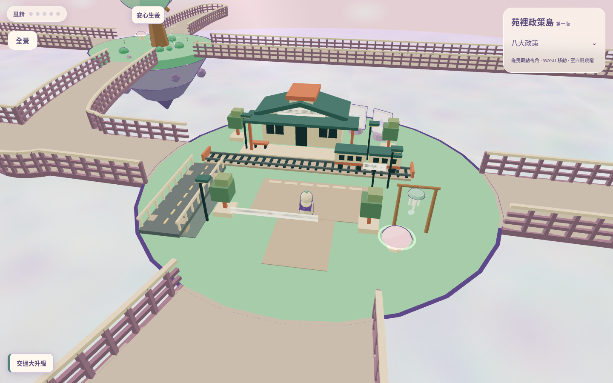
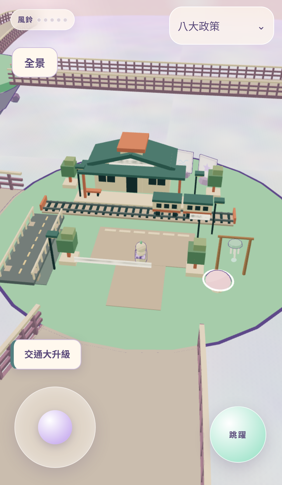
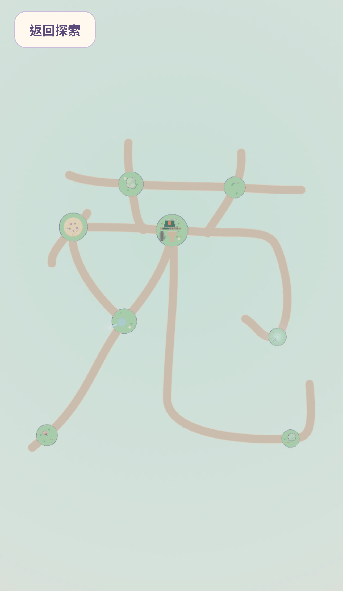

# 苑字全景 3D 世界原型

以 PR #3 的 `codex/yuan-masterplan-design`（`446e889`）為起點，開發分支為 `codex/yuan-panorama-3d-prototype`。此目錄的五張 PNG 全部由 Playwright 拍攝實際執行的 Three.js 網站，並非設計圖、文字輪廓或貼圖。

## 實際 3D 畫面

### 正交全景：隱藏全部政策名稱



### 正交全景：八座政策島標示



標示版透過既有 DOM 政策入口投影產生，僅供 QA 記錄；一般使用者進入全景時，政策標籤與操作提示皆會隱藏。字形由相同場景中的實體島嶼、路面與護欄構成，沒有另加「苑」字圖層。

### 桌面探索



### 手機探索



### 手機直式全景



## 本機操作預覽

```bash
npm ci
npm run dev -- --port 4185 --strictPort
```

在 Codex 的執行環境／Ports 或預覽面板開啟 **4185** 連接埠；若使用本機 Codex，瀏覽 `http://localhost:4185`。按「開始探索」，左下搖桿或 WASD 移動，拖曳旋轉，滾輪／雙指縮放。按「全景」切換，按「返回探索」返回人物原處。空中跳躍期間須先落地才能進入全景。

這是本機開發伺服器，並未執行 Cloudflare 發布指令。推送新分支／建立 PR 仍可能依倉庫既有 Cloudflare 設定自動觸發公開 Preview；本次不修改該設定，也不更新 Production 分支。

## 路網、工程與驗收

- [修改前後路網比較與全部八島中心線最短距離](NETWORK.md)
- [完整比較數據 JSON](network-comparison.json)
- [測試結果、修改檔案與待人工驗收項目](VALIDATION.md)

所有島面與新步道在本輪採共同 `y=0` 基準，保留浮空岩體、島嶼半徑、建築與原有操作。這是避免接縫與路口高度衝突的原型取捨；目前沒有重建高低差坡道。字形辨識、實機流暢度與單手手感仍須人工驗收。
