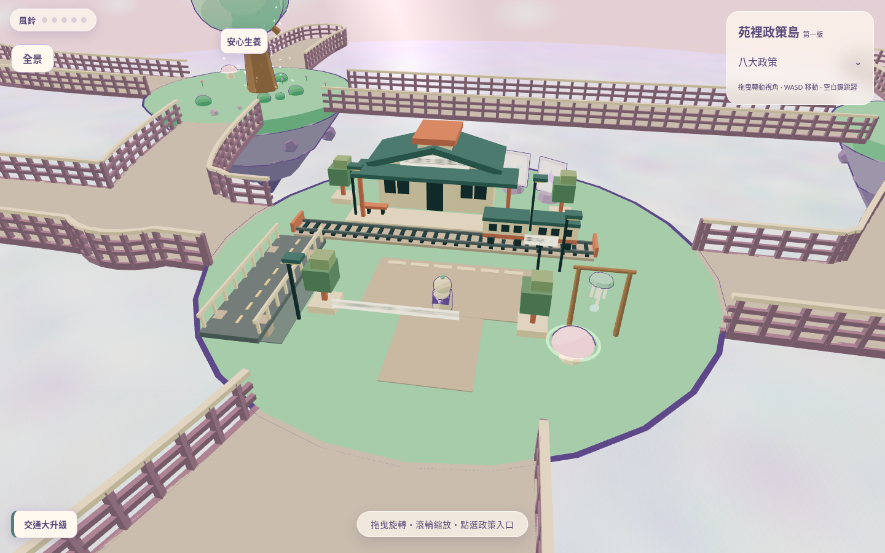
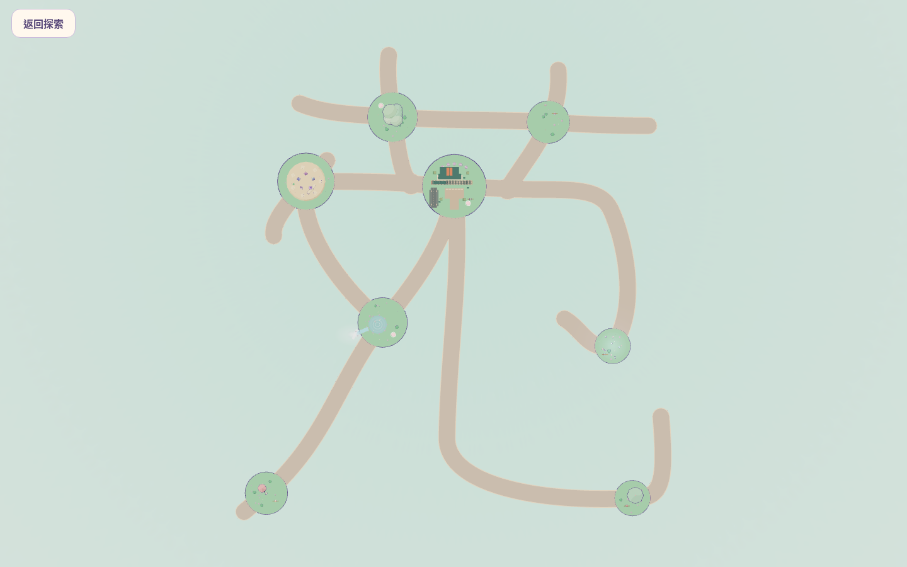
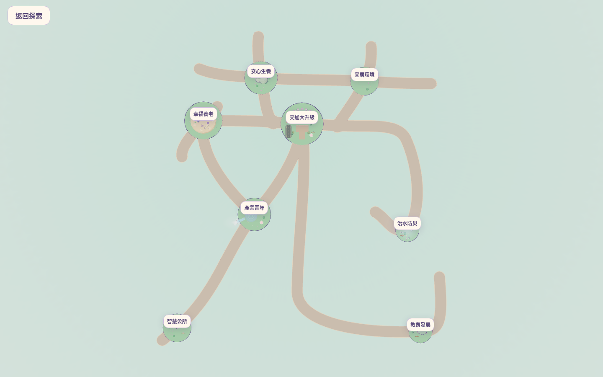
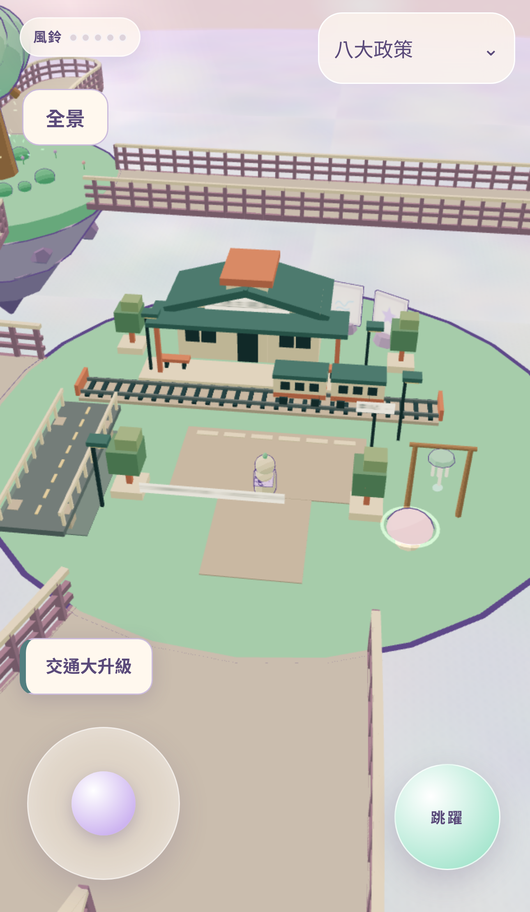
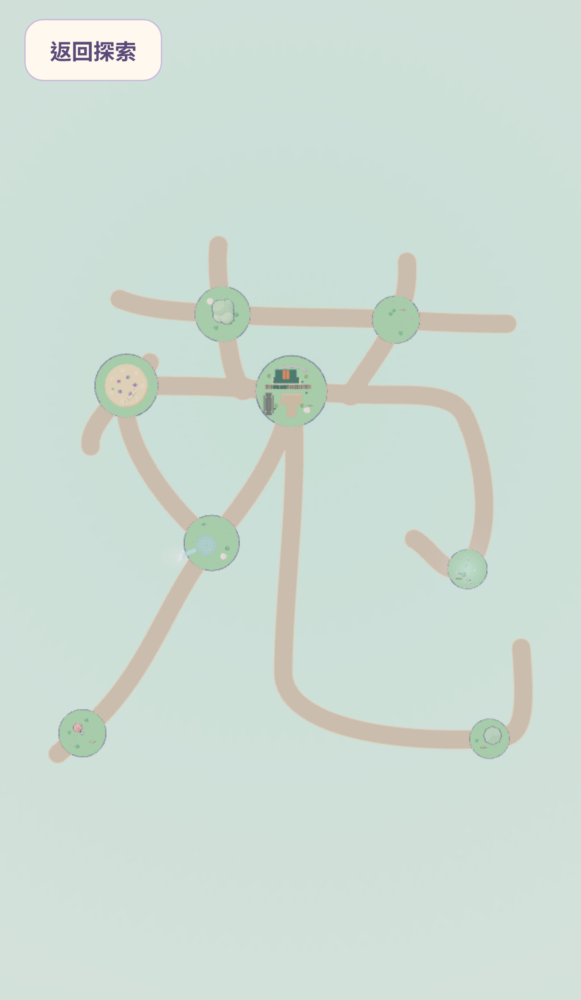

# B 方案可玩版本

Base：`codex/yuan-size-comparison`（d68ecd2）；Head：`codex/yuan-size-b-playable`。

直接將 `docs/design/yuan-size-comparison-v1/b/yuan-plan.json` 複製為運行配置，再執行 `npm run generate:yuan`。沒有再乘算座標或壓縮比例。生成的 layout/surface 與審查版 B 逐位元一致。

- 22 段中心線總長約 **665.179**，相對 PR #4 約減少 25%。
- 八島半徑、人物速度、模型尺寸、4.8 單位步道寬度及共同水平基準不變。
- 只更動三個運行資料 JSON；人物、NPC、政策、UI、八島造景、步道材質及島嶼邊緣程式未更動。
- 最近兩政策島的島緣間隔約 10.351；非相接步道最小估計淨距約 7.487；步道至非端點島面最小估計淨距約 0.905。
- 交通島 F 與 J1 平台輪廓相隔約 0.305，但之間為共享實體路面，並非地面缺口。保留原有交通模型，不移動道路或車站。

## 真實場景截圖

## 測試與操作驗收

- [正式建置](logs/build.log)、[lint](logs/lint.log)、[33 個原有單元案例](logs/unit.log)通過。
- [防止再次縮放的 B 資料完全一致測試](logs/selected-plan.log)通過。
- 單元測試使用真實 Player、島面、道路／步道碰撞面，包含 22 段雙向通行（dt=1/60 與 0.05）、全部 76 種路口轉向及護欄阻擋；中央交通島與鄰近各島均包含其中。
- [完整桌面／手機 Playwright 紀錄](logs/browser.log)：首輪 33 通過、4 略過、1 項多尺寸案例於 120 秒總時限逾時；同案例以 240 秒重跑 **1 通過**（2.2 分鐘），見 [重跑紀錄](logs/responsive-rerun.log)。因此全部適用案例均已驗證通過。保留原始失敗紀錄，並僅將這個包含兩次場景載入的案例時限改為 240 秒，未放寬斷言或修改 UI。
- 桌面 1440×900、手機為 Chromium 模擬 iPhone 15 Pro Max。手機單指跨島測試使用原生觸控建立 pointer capture，後續同一 pointer 以 DOM 事件與真實控制器加速步行，非真人持續操作錄影。
- 真機幀率、單手舒適度、中央緊密區域的視覺與人工行走體驗仍待使用者實際操作；不以自動化宣稱人工驗收通過。
- 原有島嶼懸崖可跌落行為與最近安全點復位機制保留；未擴充成建築全實體碰撞系統。

Cloudflare Preview 以本 PR 的新提交 Check Run 回報為準；不合併 PR、不更新 Production，也不主動執行正式發布。
